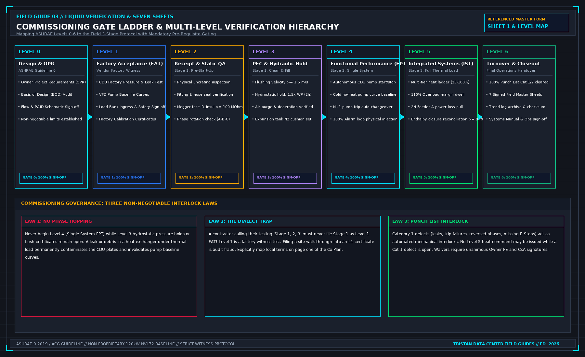

# 3. Two numberings

This chapter prevents an accurate site test report from being filed into an audit binder as fraudulent documentation.

In global mission-critical data center commissioning, documentation is structured around seven standard completion certificate tiers. Simultaneously, local mechanical contractors frequently communicate using a colloquial "three-stage" vocabulary. When these two vocabularies are carelessly conflated, audit compliance collapses.

## The Global Standard: Levels 0 Through 6

Modern commissioning frameworks (governed by ASHRAE Guideline 0-2019, ASHRAE Guideline 1.1, and the AABC Commissioning Group) define seven formal completion certificates:

- **Level 0: Design and Planning.** Audit of OPR, BOD, and engineering specifications. Certification that design intent and commissioning requirements are fully integrated.
- **Level 1: Factory Acceptance Testing (FAT).** Witnessed testing at the manufacturing plant (CDU vendor, chiller factory, load-bank fabricator). Validates pressure vessels, pump curves, and controls under factory conditions.
- **Level 2: Component Delivery, Receipt, and Static QA.** Uncrating, physical visual inspection, seismic anchoring verification, torque testing, and static de-energized electrical insulation checks.
- **Level 3: Pre-Functional Checks (PFC) and System Start-Up.** Chemical pipe flushing, hydrostatic pressure holds, vacuum deaeration, fluid charging, initial equipment energization, and manufacturer startup.
- **Level 4: Functional Performance Testing (FPT).** Dynamic testing of individual, isolated machines. Proves autonomous CDU pump sequencing, modulating valve response, local VFD control loops, and instrument point-to-point telemetry.
- **Level 5: Integrated System Testing (IST).** Multi-system dynamic verification under full simulated thermal heat. Verifies row-level manifold balance, multi-tier thermal steps, 2N power loss failover, primary cooling interruption ride-through, and emergency shutdown cascades.
- **Level 6: Close-Out, Turnover, and Operations Handover.** Resolution of all punch list items, final systems manual submission, operations team training, and handover to live site facilities engineering.

## The Local Dialect: Three Stages

On a retrofit project or a completed hall where a liquid verification team is mobilized specifically for a load-bank campaign, contractors routinely use an informal three-stage shorthand:
- **Stage 1: Static Acceptance (No Energy).** Physical installation, cable checks, hose connections, and pressure holds.
- **Stage 2: Single-System Function.** Individual CDU startup, pump rotation, and local alarms.
- **Stage 3: Integrated Thermal Performance.** Energizing the load banks, stepping through heat, and simulating facility power drops.

The stage sequence itself is logically sound: you do not energize equipment that has not passed static inspection, and you do not apply thermal load to a loop whose pumps have not been functionally proven. The hazard lies in the numbering.

## The Compliance Trap

Contractors frequently label their Stage 1 static walk-through as "Level 1 Testing" in project folders. When an auditor or client compliance officer reviews the project binders, they open the tab marked "Level 1: Factory Acceptance Testing" and discover a clipboard checklist verifying that secondary hoses were unboxed and clamped to a manifold.

Filing a site walk-through into a factory acceptance binder is documentation fraud. Even if every checkbox on that site checklist represents diligent physical work, the certificate is invalid because Level 1 requires factory test bench data, factory calibration sheets, and manufacturing witness signatures.

To prevent this compliance breach, the first page of the Commissioning Plan must feature a prominent cross-reference matrix:

**COMMISSIONING TIER TRANSLATION MATRIX**

| GLOBAL CERTIFICATE TIER | LOCAL FIELD CONTRACTOR TERM | MANDATORY VERIFICATION BOUNDARY |
| :--- | :--- | :--- |
| Level 0: Design Audit | Excluded / Attached | OPR & BOD sign-off; design review waiver. |
| Level 1: Factory Testing | FAT Vendor Documentation | Factory test records attached as evidence. |
| Level 2: Site Receipt QA | Stage 1 (Static Part A) | Sheet 1: Unpack, megger, phase rotation. |
| Level 3: PFC & Start-Up | Stage 1 (Static Part B) | Sheet 1: Flush, hydro-hold, fill and vent. |
| Level 4: Functional (FPT) | Stage 2 (Single System) | Sheet 2, Sheet 6, Sheet 7: CDU & alarms. |
| Level 5: Integrated (IST) | Stage 3 (Heat Window) | Sheet 3, Sheet 4: Thermal ladder & 2N pull. |
| Level 6: Turnover | Closeout Handover | Sheet 5, Punch list clearance, Cx pack. |

## Mandatory Gating and Interlock Rules

A core tenet of commissioning governance is that no project may advance across a level boundary while unresolved defects exist in the preceding tier:

1. **Static Prerequisite Gate**: Level 4 Functional Performance Testing cannot commence if Level 3 Pre-Functional Checklists remain unsigned. Operating a CDU pump through an unverified, un-flushed secondary loop risks circulating metal shavings and construction debris directly into plate heat exchangers and quick disconnect valves.
2. **Thermal Prerequisite Gate**: Level 5 Integrated System Testing cannot commence if Level 4 single-system safety trips or pump changeover routines have failed. Introducing megawatts of thermal energy into a system with an unverified N+1 pump changeover guarantees an uncontrolled thermal runaway when a pump inevitably trips.
3. **The "Fix It During Heat" Trap**: When a contractor pleads, "Let us proceed with the heat test today and we will resolve the pump changeover issue tomorrow," the Commissioning Lead must issue an immediate stop. Thermal energy does not rectify mechanical and electrical defects; it magnifies them under high risk.

If an owner chooses to waive an open defect to maintain an aggressive project schedule, that waiver must be documented as a formal written deviation signed in ink by the Owner’s Project Engineer. The waiver must explicitly define the compensatory safety controls deployed on site. An informal verbal agreement is completely invalid.

## Decisions to record before test start

- The mapping between local stage terms and formal Level 0–6 certificate binders.
- The specific certificate levels this verification scope is authorized to issue.
- The certificate levels excluded from scope, accompanied by formal scope letters.
- The non-negotiable prerequisite gates governing transitions between Levels 2/3, Level 4, and Level 5.
- The single authority empowered to execute formal deviation waivers.
