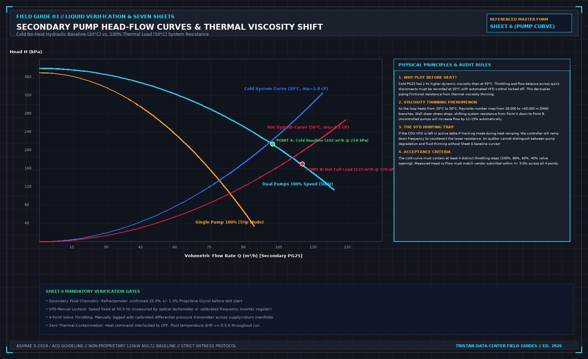
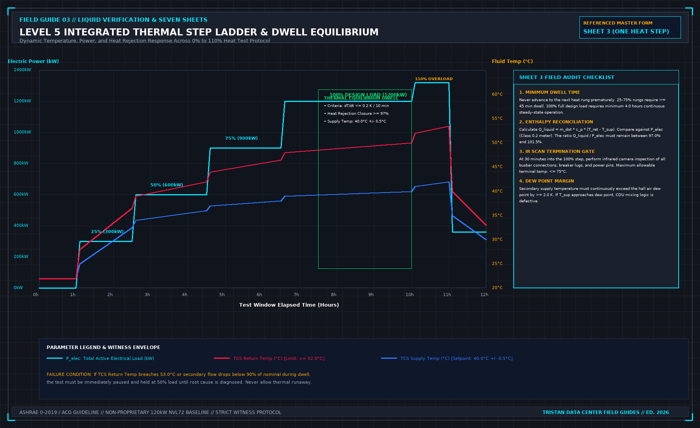

# 9. The heat window

The thermal heat window is the phase most heavily photographed by stakeholders. It is not the entire project; it is the culmination earned through the disciplined execution of the preceding chapters.

In the global commissioning framework, this is **Level 5 Integrated System Testing (IST)**. Your responsibility during this window is to execute the approved dynamic test scripts in strict sequence, maintain disciplined dwell durations, log high-precision telemetry, and enforce stop criteria immediately when a threshold is breached. It is not an opportunity to improvise new test procedures on the fly.



## Script 07: The Cold No-Heat Baseline Pump Curve

Before introducing thermal energy, you must execute Script 07 to establish the baseline hydraulic resistance of the secondary loop.

### Why Baseline Before Heat?
The secondary heat transfer fluid—typically 25% Propylene Glycol (PG25) or treated demineralized water—exhibits a significant viscosity shift across its operating temperature range:
- At 20.0°C, the kinematic viscosity of PG25 is $\nu ≈ 2.45 mm²/s$ (μ ≈ 2.50 cP).
- At 50.0°C, its kinematic viscosity drops by more than 50% to $\nu ≈ 1.15 mm²/s$ (μ ≈ 1.10 cP).

This viscosity drop reduces pipe wall shear stress and turbulent frictional resistance. For an identical volumetric flow rate, the pressure drop across secondary manifolds and quick-disconnect fittings decreases significantly at 50°C compared to 20°C.

If you fail to baseline the hydraulic resistance cold, you cannot decouple piping frictional resistance from thermal fluid thinning. If a flow anomaly occurs later under full heat, an auditor cannot determine whether it stems from pump impeller wear, piping blockage, or fluid thinning.

### Execution Protocol for Sheet 6
1. **Lock Out VFD Modulation**: Lock the CDU secondary pump in manual frequency override at 50.0 Hz (or 60.0 Hz nominal design). Automatic differential pressure tracking must be verified as disabled.
2. **Four-Point Throttling Profile**: Gradually throttle the main secondary balancing valve to establish four distinct hydraulic operating points:
 - Point 1: 100% Wide Open (Maximum Flow)
 - Point 2: 80% Equivalent Flow Setpoint
 - Point 3: 60% Equivalent Flow Setpoint
 - Point 4: 40% Equivalent Flow Setpoint
3. **Log Head vs. Flow**: At each point, record volumetric flow Q using the ultrasonic meter, and differential pressure ΔP across the pump and the secondary manifold.
4. **Acceptance Standard**: The measured cold curve must match the manufacturer's certified pump curve within ± 5.0%. Fluid temperature must remain stable within ± 0.5 K throughout the run.



## Script 08: The Multi-Tier Thermal Heat Ladder

Once the cold hydraulic baseline is signed off, thermal loading commences under Script 08. The thermal ladder is a progressive sequence designed to verify that the facility power distribution, CDU heat exchangers, primary water loop, and whitespace air management stabilize at each load increment.

```
+----------------------------------------------------------------------------------------------------+
| THERMAL LADDER STAGE PARAMETERS |
+-------+------------+------------+--------------------+----------------------+----------------------+
| STAGE | THERMAL LOAD| DESIGN kW | MINIMUM DWELL TIME | STABILIZATION GOAL | SHEET REFERENCED |
+-------+------------+------------+--------------------+----------------------+----------------------+
| 1 | 25% Step | 300 kW | 45 minutes | Initial TCV tracking | Sheet 3 (Copy 1) |
| 2 | 50% Step | 600 kW | 45 minutes | Partial-load balance | Sheet 3 (Copy 2) |
| 3 | 75% Step | 900 kW | 45 minutes | Hydraulic shift audit| Sheet 3 (Copy 3) |
| 4 | 100% Step | 1200 kW | 4.0 hours soak | Full-load equilibrium| Sheet 3 (Copy 4) |
| 5 | 110% Step | 1320 kW | 60 minutes | Overload stress test | Sheet 3 (Copy 5) |
+-------+------------+------------+--------------------+----------------------+----------------------+
```

### The Thermal Equilibrium Dwell Criteria
Never advance to the next load step based solely on elapsed time. A load stage is deemed complete only when the system achieves verified **thermal equilibrium**:

$$\left| \frac{dT_{\text{supply}}}{dt} \right| \le 0.20\,\text{K} \text{ over a continuous 10-minute window}$$

If secondary supply temperature is still rising or oscillating due to control valve hunting, the dwell must be extended. Advancing to a higher thermal rung with an unstable control loop compounds thermal instability and risks tripping high-temperature safety limits.

### Enthalpy Heat Balance Reconciliation
At each thermal step, reconcile the active electrical energy consumed against the thermal heat absorbed by the secondary fluid:

$$Q_{\text{liquid}} = \dot{m} \cdot c_p(T_{\text{bulk}}) \cdot (T_{\text{return}} - T_{\text{supply}})$$

Where:
- ṁ = ρ · Q is the mass flow rate (kg/s).
- c_p is the specific heat capacity of PG25 evaluated at bulk fluid temperature (kJ/kg·K).
- P_elec is active 3-phase power measured by the Class 0.2 reference meter (kW).

**Acceptance Standard**: The heat balance closure ratio $\eta = \frac{Q_{\text{liquid}}}{P_{\text{elec}}}$ must maintain:

$$97.0\% \le \eta \le 101.5\%$$

A closure ratio below 97.0% indicates either significant measurement error (such as inaccurate fluid density, incorrect glycol concentration, or untuned flowmeters) or excessive convective heat loss into the whitespace air. A closure ratio exceeding 101.5% is thermodynamically impossible and signals a calibration error.

### Infrared (IR) Thermography Inspection
At 30 minutes into the 100% full-load dwell, conduct an infrared thermographic survey of all electrical distribution equipment:
- Scan all upstream PDU breaker lugs, busway tap box connections, contactor terminals, and load-bank power receptacles.
- **Acceptance Standard**: No electrical terminal may exceed **75.0°C** absolute temperature, and phase-to-phase temperature unbalance across identical terminations must not exceed **5.0 K**. Any loose terminal generating a thermal hot spot is logged on Sheet 3 as an electrical defect.

### Script 08 Overload and Transient Steps
- **110% Overload Margin Test**: Operates the system at 1320 kW for 60 minutes to demonstrate that facility breakers, busbars, and primary cooling capacity maintain safe operational margins above rated capacity.
- **Step-Change Thermal Shock Test**: Initiates an abrupt load shed from $100% \to 30%$ in a single step, holds for 30 minutes, and then steps abruptly back from $30% \to 100%$. This validates that the CDU primary modulating valve (TCV-101) can follow rapid compute workload swings without hunting or causing secondary supply temperature overshoot (ΔT_overshoot ≤ 1.5 K).

## Multi-Rack Secondary Flow Uniformity

During the 100% full-load dwell, measure the flow rate through each individual load bank along the manifold row. As demonstrated in Figure 04, direct-return piping systems tend to starve the furthest rack, whereas reverse-return (Tichelmann) loops maintain uniform pressure drops.

**Acceptance Standard**:
1. Individual load-bank flow deviation from average must not exceed **± 7.5%**.
2. The row-wide Coefficient of Variation ($CV = \frac{\sigma}{\mu} \cdot 100\%$) across all ten load banks must satisfy:

$$CV \le 5.0\%$$

## Dew Point Margin Enforcement

Throughout all thermal testing, monitor ambient data hall relative humidity and dry-bulb temperature. Calculate the real-time air dew point T_dew.

**Acceptance Standard**: The secondary supply temperature T_supply must continuously exceed the room dew point by at least **2.0 K**:

$$T_{\text{supply}} - T_{\text{dew}} \ge 2.0\,\text{K}$$

If secondary supply temperature drops toward the dew point, the CDU mixing valve logic is defective, creating an immediate condensation hazard across uninsulated manifold piping.

## Decisions to record before test start

- The witnessed cold no-heat baseline pump curve filed on Sheet 6.
- The completed multi-tier thermal ladder logs (Sheets 3-1 through 3-5).
- The calculated enthalpy heat balance closure ratio at each step (≥ 97.0%).
- The infrared thermography survey log, recording peak termination temperatures.
- The multi-rack flow uniformity calculation (CV ≤ 5.0%).
- Continuous verification that secondary coolant temperature stayed ≥ 2.0 K above hall dew point.
