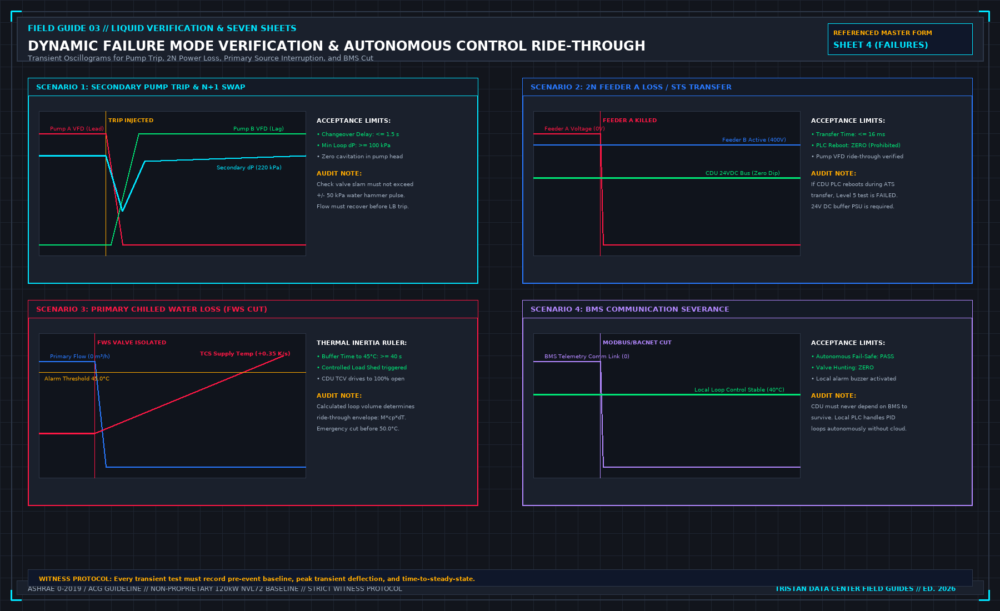

# 10. Stops, and the order out

An emergency stop in a data hall is not a suggestion in an emergency response manual. It is a physical safety circuit wired to de-energize equipment rapidly and safely.

The first book established that the load bank’s internal safety stop operates autonomously and survives the loss of supervisory networks. This book governs who is authorized to activate that stop, and who is permitted to override it.

The operational rule is absolute: **Nobody may override an emergency stop once called.** If a technician, apprentice, or observer calls a stop due to a suspected leak, an electrical anomaly, or personal safety concern, testing terminates instantly. A Test Lead who responds, "Hold on, let me observe the thermal curve for thirty seconds," has committed a grave safety violation. From that second forward, the session ceases to be an engineering test; it becomes a formal incident investigation.

## Script 09: Dynamic Transient Failure Verification

Integrated testing under Script 09 validates that the data hall cooling system can survive catastrophic facility disruptions without compromising compute hardware. These tests simulate real-world failure modes and log the resulting transient recovery curves on Sheet 4:

### 1. Secondary Pump Trip and Auto-Changeover
With the system operating at 100% full thermal load (1.2 MW), physically trip the operating secondary pump (Pump P-1A):
- **Acceptance Criteria**: The standby pump (Pump P-1B) must detect the loss of differential pressure, start automatically, and restore design loop flow within ≤ 1.5 seconds.
- Peak water hammer pressure surge on check valve closure must not exceed ± 50 kPa.
- Secondary loop differential pressure must not drop below the minimum cavitation floor (100 kPa).

### 2. 2N Electrical Feeder A Loss / ATS Transfer
With the CDU operating under dual-feed 2N power distribution, trip the primary Feeder A circuit breaker:
- **Acceptance Criteria**: The Static Transfer Switch (STS) or Automatic Transfer Switch (ATS) must transfer to Feeder B within ≤ 16 milliseconds (less than one AC cycle).
- The CDU’s 24V DC control bus must maintain constant voltage without dipping below the PLC's dropout threshold.
- The CDU controller must **not reboot**. A controller reboot during an electrical bus transfer is an immediate failure of the Level 5 test.
- The secondary pump VFDs must either ride through the bus transfer seamlessly or recover full operating frequency within < 3.0 seconds.

### 3. Primary Chilled Water Supply Interruption (FWS Loss)
With the secondary loop operating at 100% thermal load, simulate a total loss of facility primary cooling water by rapidly closing the primary supply isolation valve:
- This test measures the **hydraulic thermal inertia** of the secondary circuit.
- As primary heat extraction drops to zero, the thermal energy injected by the load banks is absorbed entirely by the sensible heat capacity of the secondary fluid mass:

$$\frac{dT_{\text{supply}}}{dt} = \frac{P_{\text{load}}}{M_{\text{fluid}} \cdot c_p}$$

- **Acceptance Criteria**:
 - The time required for secondary supply temperature to climb from nominal 40.0°C to the High Temperature Alarm threshold of 45.0°C must be at least **40 seconds** (t_buffer ≥ 40 s).
 - Upon reaching 45.0°C, the CDU must automatically issue a High-Temp Warning and initiate a staged load shed.
 - If temperature reaches the Emergency Critical Limit of **50.0°C**, the emergency interlock circuit must trip all load-bank power contactors instantly, halting heat input before boiling or mechanical seal failure occurs.

### 4. BMS Communication Severance
With the loop running under full thermal load, physically disconnect the Modbus-TCP and BACnet network cables linking the CDU PLC to the central facility BMS:
- **Acceptance Criteria**: The CDU local controller must continue operating autonomously without disruption. Secondary pump speeds and modulating valve positions must remain stable under local PID setpoint tracking. The CDU must never hunt, oscillate, or fail open due to a lost external supervisory connection.

## The Controlled Order Out (Sheet 5)

Demobilizing from a multi-megawatt thermal test requires the same operational discipline as initiating it. The de-energization and shutdown sequence must be executed in a strict, non-reversible order.

**MANDATORY SHUTDOWN EXECUTION SEQUENCE**

| STEP | ACTION COMMAND | ENGINEERING SAFETY RATIONALE |
| :--- | :--- | :--- |
| 01 | SHED THERMAL LOAD TO 0 kW | Cut all heater contactors/SCRs. Never interrupt fluid flow while 1.2 MW of electrical heat is active! |
| 02 | OPEN LOAD-BANK BREAKERS | Lock out and tag out (LOTO) all primary electrical feeds. Prove circuits dead with calibrated voltage detector. |
| 03 | 10-MINUTE FLUID COOLDOWN | Maintain secondary pump circulation for 10 minutes to remove residual core heat from elements and prevent localized boiling. |
| 04 | STOP CDU SECONDARY PUMPS | Power down pumps only after secondary fluid temperature drops safely below 30.0°C. Confirm differential pressure is 0 kPa. |
| 05 | ISOLATE & DISCONNECT HOSES | Close manifold isolation valves, relieve residual static head, and disconnect quick-disconnect couplings into catch buckets. |

> **CRITICAL REVERSE-SEQUENCE WARNING**: Never reverse Steps 1 and 4! Stopping fluid circulation while megawatts of electrical heat are engaged will cause the stagnant fluid inside the heating channels to flash into steam within seconds. The resulting rapid vapor expansion creates an explosive pressure surge that will blow out hose crimps, destroy sensor diaphragms, and present a catastrophic scalding hazard to personnel in the aisle. Sheet 5 requires every step to be ticked in strict chronological order; a tick out of sequence voids the sheet.

## Data Security and Immediate Dual Backup

Before a single cable or instrument is packed into a shipping crate, all test data must be securely backed up:
- Export all raw high-frequency CSV logs from the load banks, power quality analyzers, and ultrasonic flowmeters.
- Export all 1-second trend logs from the CDU local PLC and the central facility BMS.
- Archive all high-resolution thermal imaging captures and digital photos of the physical master sheets.

Create two independent backups on physically separate storage media (e.g., one on a secure on-site workstation, and a second on an encrypted external drive). A storage drive packed into a shipping crate is not an accessible backup. If that crate is delayed or lost in transit, the commissioning campaign cannot be certified, and the entire multi-week test must be repeated.

## Demobilization and Site Restoration

Demobilization concludes with an inventory audit:
- Count every quick-disconnect coupling, flexible hose, adapter, and blanking cap against the uncrating inventory logged on Sheet 1.
- Install pressure-rated protective dust caps on all manifold supply and return ports.
- Inspect the data hall floor tiles, cable trays, and walls for any transport scuffs, fluid droplets, or residual debris.
- Restore all permanent facility valves, electrical breakers, and BMS control loops to their baseline operational configurations.

The Daily Shift Note for the final day states that testing is concluded, documents the physical location of the data archives, and summarizes open punch list items. It does not declare that the facility "passed." Final certification occurs only after the formal commissioning report is audited and approved.

## Decisions to record before test start

- The witnessed emergency stop test, confirming that physical stop circuits cut heat instantly.
- The dynamic transient test logs recorded on Sheet 4 (pump trip, 2N power loss, FWS cut, BMS cut).
- The signed shutdown sequence log on Sheet 5, executed in strict chronological order.
- The physical storage locations and cryptographic checksums of the dual data backups.
- The completed demobilization inventory, confirming zero lost fittings or temporary modifications.
