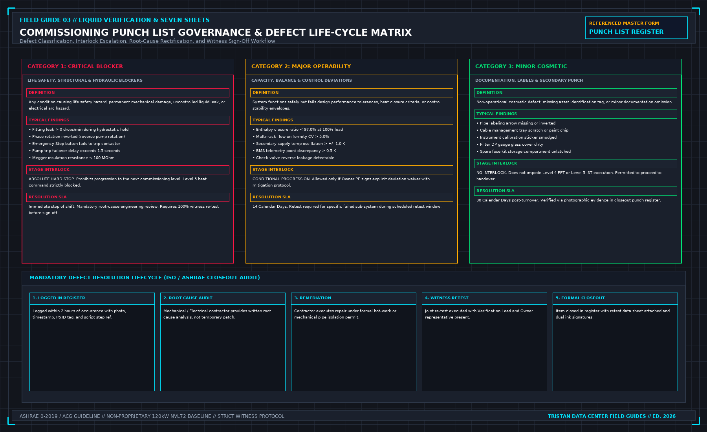

# 11. The punch list

An installation defect or performance failure that is not logged in the official Commissioning Issues Log does not legally exist. While this omission may be convenient for a contractor rushing to demobilize, it presents an unacceptable operational hazard to the facility operations team who must operate the hall once live IT loads arrive.

The master punch list is established during the Commissioning Kickoff Meeting, not after the first secondary coolant leak is discovered. Every logged entry must feature an unambiguous description that an external auditor can comprehend: the specific equipment tag, governing P&ID reference, failed script step number, failure mode, assigned contractor, required remediation, and the specific re-test criteria required for closeout. A vague log entry stating "CDU issue" is completely unacceptable.

## The Three Defect Severity Tiers

Every finding logged in the Issues Log must be classified into one of three standardized severity tiers:

**DEFECT SEVERITY CLASSIFICATION**

| TIER | DEFINITION & EXAMPLES | COMMISSIONING STAGE INTERLOCK IMPACT |
| :--- | :--- | :--- |
| CATEGORY 1 | Critical Safety / Blocker: Active leak > 0 drops/min; phase reversal; failed E-Stop; pump swap timeout > 1.5 s; insulation < 100 MOhm. | ABSOLUTE HARD STOP. Prohibits progression to the next commissioning level. Level 5 thermal energization is legally prohibited while any Cat 1 item remains open. |
| CATEGORY 2 | Major Operability Deviation: Enthalpy closure < 97.0%; rack flow variation CV > 5.0%; sensor drift > 0.5 K; control valve hunting. | CONDITIONAL PROGRESSION. Progression permitted only if Owner PE signs an explicit deviation waiver with operational mitigations. 14-calendar-day resolution. Mandatory re-test required. |
| CATEGORY 3 | Minor Cosmetic / Documentation Inverted pipe flow arrow; cable tray paint scratch; smudged calibration label. | NO INTERLOCK. Does not impede dynamic testing or milestone certificates. Verified via photographic evidence within 30 days post-turnover. |

## The Stage Interlock and the Waiver Protocol

The foundational rule governing data center commissioning is that **no project may advance across a milestone boundary while an open Category 1 defect remains unresolved**.

The punch list is where contractors frequently attempt to negotiate around this rule. A contractor plea stating, "We understand the primary check valve is leaking slightly on reverse flow, but let us proceed with the 100% heat step and we will repair the valve during demobilization," must be rejected. Initiating high-load thermal testing with a compromised check valve risks reverse-flow pump cavitation, severe hydraulic shock, and catastrophic pump motor burn-out.

If the facility owner decides to proceed despite an open Category 2 operability deviation to meet an inflexible business delivery deadline, that decision must be formalized via a signed **Deviation Waiver**. The waiver must articulate:
1. The exact technical deficiency and governing specification clause.
2. The operational risk assessment and potential failure modes.
3. The specific compensatory safety controls deployed during the test window.
4. The contractual commitment and schedule for remediation and witnessed re-testing.

A verbal agreement or casual text message is completely invalid. An unwritten waiver is merely an agreement to be surprised by an operational failure.

## Remediation and Retest Governance

The division of responsibility during punch list resolution must be strictly maintained:
- **The Trade Contractor**: Performs physical repairs under formal facility work permits.
- **The Verification Party**: Audits the repair, inspects physical work, directs the re-test script, and records the new data. The verification team never repairs mechanical or electrical plant, as doing so destroys their independent audit posture.
- **The Facility Owner**: Witnesses the re-test and countersigns the closeout entry.

A punch list line item cannot be closed by a contractor submitting an email stating, "The technician adjusted the valve parameter." Closing a line item requires the exact same level of engineering evidence demanded by the original script: a fully executed, witnessed re-test data sheet demonstrating that the parameter meets specification.

## Retesting Scope and Commercial Boundaries

A witnessed re-test incurs real costs in engineering hours, facility utility power, and temporary equipment rental. The Commissioning Plan must explicitly define upfront whether re-testing is covered within the base project scope or requires a formal change order.

Establishing this commercial boundary early prevents disputes when a complex test must be repeated due to a contractor's defective installation. However, commercial negotiations must never compromise technical standards: an unapproved re-test executed without a formal script revision is not a valid verification; it is merely an unrecorded equipment cycle.

## Post-Demobilization Desktop Defects

Certain defects become apparent only after demobilization, when high-frequency telemetry logs and power meter CSVs are analyzed on an engineering workstation.

If an enthalpy heat balance calculation reveals that closure dropped to 92.0% during the final thermal hour, or if frequency analysis detects low-amplitude VFD hunting, that finding must be formally logged in the master Issues Log with its post-processing discovery date.

The Test Lead must carefully distinguish between:
- **A Data Acquisition Defect**: Such as a desynchronized NTP clock, corrupted CSV formatting, or an uncalibrated current transducer.
- **A Physical Plant Failure**: Such as a slipping pump belt, scaling on a heat exchanger plate, or a failing thyristor module.

Conflating a data acquisition error with a physical plant defect wastes contractor resources investigating healthy equipment; conversely, mislabeling a physical plant failure as a telemetry glitch allows a defective cooling system to be handed over to live IT operations.

## The Closeout Requirement

When every Category 1 and Category 2 defect logged across the executed commissioning levels is fully resolved and verified through witnessed re-testing, the Commissioning Authority may certify the closeout. An oral agreement during the final closeout meeting that "everything is resolved" carries no legal weight. The completed master Issues Log must be printed, reviewed, and signed in ink by all three parties.

## Decisions to record before test start

- The location, hosting security, and software platform for the master Issues Log.
- Named individuals authorized to log defects, execute repairs, witness re-tests, and close entries.
- The formal Deviation Waiver template, including mandatory risk assessments and mitigation plans.
- The commercial agreement governing re-testing costs and schedule allocations.
- The printed, signed master Issues Log with all items verified as closed prior to Level 6 turnover.
