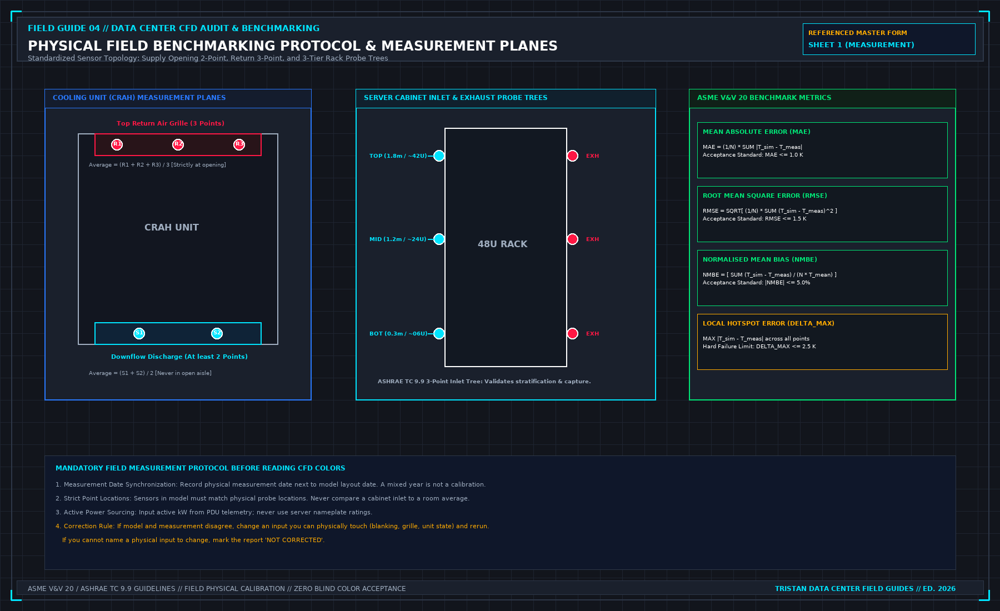

# 1. The points: field measurement protocol

A computational fluid dynamics report that has not been benchmarked against calibrated physical instruments is an artistic opinion rendered in partial differential equations. If an engineering consultant presents a simulation report based entirely on uncalibrated assumptions, that document must be stamped on its cover: **"UNVERIFIED DESIGN HYPOTHESIS"**. 

If the report is intended to serve as an operational baseline for an existing, physical data hall, physical field benchmarking must precede any interpretation of the results.



## The Minimal Field Benchmarking Grid

Do not attempt to deploy hundreds of temporary thermocouples in an undisciplined mesh across the whitespace. An unorganized cloud of sensor readings creates confusion rather than calibration. The standard benchmarking protocol focuses on high-precision data capture at critical fluid boundaries:

### 1. Cooling Unit (CRAH / In-Row / Fan Wall) Openings
- **Supply Air Discharge**: Measure air temperature at the discharge opening using calibrated fast-response thermistors or PT100 probes. You must average **at least two distinct points** across the discharge plane (S_1, S_2). Taking a casual reading with a handheld thermometer standing two meters out in the aisle is unacceptable; room air entrainment cools or warms the air stream before it reaches the floor, distorting the unit's true thermodynamic discharge.
- **Return Air Grille**: Measure air temperature across the return grille using **at least three distinct points** (R_1, R_2, R_3) distributed across the top, center, and bottom of the intake face. Return grilles frequently exhibit thermal stratification of 3.0 K to 6.0 K between their lower and upper edges. A single sensor taped to the center of the grille produces a misleading return temperature value.

$$\bar{T}_{\text{supply}} = \frac{1}{2} \sum_{i=1}^{2} S_i, \quad \bar{T}_{\text{return}} = \frac{1}{3} \sum_{j=1}^{3} R_j$$

### 2. Cabinet Intake and Exhaust Profiles
At every cabinet position designated in the project claim (or every high-density load-bank rack footprint), measure air temperature along a standardized vertical intake tree:
- **Bottom Intake (T_1)**: 0.3 m above finished floor (approximately rack unit U06). Evaluates floor jet entrainment and underfloor tile plume delivery.
- **Middle Intake (T_2)**: 1.2 m above finished floor (approximately rack unit U24). Serves as the core reference intake temperature for the server chassis array.
- **Top Intake (T_3)**: 1.8 m above finished floor (approximately rack unit U42). Evaluates hot air recirculation rolling over the top of the cabinet or escaping containment roof joints.

In uncontained or partially contained rows, T_3 is frequently 5.0 K to 10.0 K hotter than T_1. Averaging all three points into a single "cabinet temperature" obscures localized thermal stress. Each vertical elevation must be recorded independently on Sheet 1.

### 3. Exhaust Discharge Face
Measure exhaust temperature at the rear perforated door at the same three vertical elevations. The local delta-T across the server chassis (ΔT_rack = T_exhaust - T_intake) provides the empirical boundary condition needed to verify internal server fan mass flow rates:

$$\dot{m}_{\text{server}} = \frac{P_{\text{rack}}}{c_p \cdot (\bar{T}_{\text{exhaust}} - \bar{T}_{\text{intake}})}$$

## The Electrical Nameplate Fallacy

Thermal heat input into the CFD model must be sourced directly from active electrical feed telemetry, never from manufacturer nameplate ratings.

The power rating stamped on a server power supply unit (e.g., 1600 W PSU on a 2U chassis) represents an electrical safety maximum, sizing the branch circuit conductors and overcurrent protective devices. Under actual production compute workloads, that chassis may consume only 650 W to 850 W; an idle server may draw less than 250 W.

```
+----------------------------------------------------------------------------------------------------+
| THE NAMEPLATE INFLATION TRAP |
+--------------------------+-----------------------+-----------------------+-------------------------+
| EQUIPMENT CLASS | NAMEPLATE RATING (kW) | ACTIVE MEASURED (kW) | MODEL OVERESTIMATION |
+--------------------------+-----------------------+-----------------------+-------------------------+
| High-Density AI Rack | 160.0 kW (PSU Sum) | 120.0 kW (Active PDU) | + 33.3% False Heat |
| Enterprise Server Rack | 14.5 kW (PSU Sum) | 8.2 kW (Active PDU) | + 76.8% False Heat |
| Core Network Spine Rack | 22.0 kW (PSU Sum) | 11.4 kW (Active PDU) | + 93.0% False Heat |
+--------------------------+-----------------------+-----------------------+-------------------------+
```

If a CFD modeler inputs server nameplate ratings into their software, the model injects 40% to 80% more thermal energy into the simulated whitespace than physically exists. The simulation will predict widespread thermal throttling, red hot spots, and cooling plant failure. 

The data center operator will then be urged to spend capital adding unnecessary CRAH units or lowering chilled water setpoints. Always read active 3-phase kW from the PDU smart meter or revenue-grade branch circuit monitor on the day of testing, and verify that this number is the heat source term assigned to that rack in the simulation software.

## Spatial Alignment of Numerical Probes

Every measurement point logged on Sheet 1 must correspond to an identical numerical sampling probe within the CFD solver's computational domain.

A numerical probe placed in the center of the cold aisle in software cannot be compared against a physical thermocouple taped to a server front bezel. Air velocity and temperature gradients in the boundary layer immediately adjacent to the perforated door are steep. 

If the numerical probe coordinates do not match the physical coordinates within ± 50 mm, the delta between simulation and reality is a spatial sampling error, not a model defect.

## Date Synchronization and Layout Freezes

Record the calendar date and shift timestamp of the physical field measurements alongside the geometry freeze date of the CAD model.

Data centers are dynamic environments. Over the course of three months, facility technicians install blanking panels, re-route underfloor power cables, adjust CRAH fan speed setpoints, and add floor grilles. 

If your temperature measurements were taken in November on an as-built layout, and the CFD consultant ran their model using an architectural schematic from the previous February, the model does not represent the room you measured. The report must state which layout revision is modeled; an undocumented mixture of dates invalidates the calibration.

## Decisions to record before test start

- The specific cooling units measured, noting supply opening points (S_1, S_2) and return opening points (R_1, R_2, R_3).
- The surveyed cabinet rows, recording vertical inlet probe readings at 0.3 m, 1.2 m, and 1.8 m.
- Sourcing of electrical heat: documented from active PDU meters, with the nameplate rating explicitly rejected.
- Physical coordinates of all field probes mapped to the numerical model grid.
- Measurement execution date compared against model CAD freeze date.
