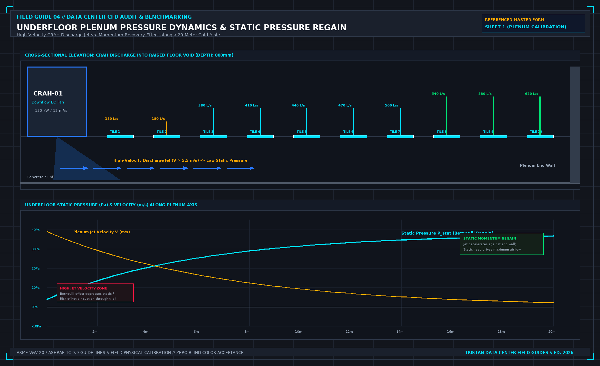
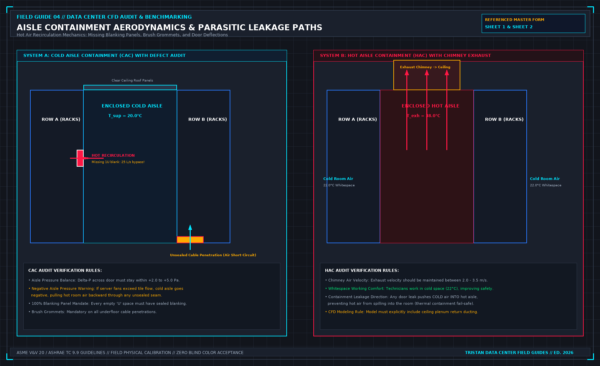
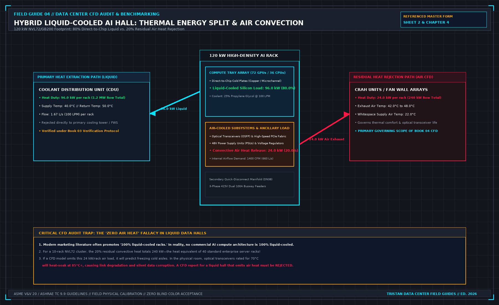

# 3. Aerodynamics and how to read the report

Before evaluating the conclusions of a computational fluid dynamics report, you must understand the physical aerodynamics governing data center airflow, and audit the report block by block in the order it has to be true.

A CFD report that opens with colorful 3D rendering slices is attempting to secure your approval before you examine the underlying physics. Ignore the color plots on your first reading. Turn immediately to the mechanical boundary conditions and verify the fluid dynamics.

## Underfloor Plenum Dynamics and Static Pressure Regain

In a raised-floor data hall, the space beneath the floor acts as a shared pressurized distribution plenum. Airflow exiting a downflow CRAH unit behaves according to fundamental fluid mechanics governed by the Bernoulli principle and momentum conservation:

$$P_{\text{total}} = P_{\text{static}} + \frac{1}{2} \rho v^2$$

As shown in Figure 02, high-velocity air discharged from a CRAH fan (v > 5.0 m/s) possesses high dynamic pressure ($\frac{1}{2} \rho v^2$) but depressed static pressure (P_static). 

As this air jet travels along the plenum axis away from the unit, frictional drag against the subfloor slab and deceleration against the plenum end-wall cause the fluid velocity to decay. As velocity drops, kinetic energy converts into static pressure—a phenomenon known as **static pressure regain** (the momentum recovery effect):

1. **Near-CRAH Floor Tiles**: Perforated tiles installed directly adjacent to the CRAH discharge face experience low static pressure (frequently < 5 Pa). In poorly designed plenums, the Bernoulli effect can cause local static pressure to drop below zero relative to the whitespace (P_static < 0 Pa). When this occurs, the perforated tile behaves as an intake: instead of discharging cold air, it sucks hot air from the aisle downward into the plenum.
2. **Plenum Dead-End Tiles**: Perforated tiles located at the far end of the row (near plenum bulkheads) experience the highest static pressure (frequently 30 Pa to 45 Pa) and discharge the highest volumetric flow rates.

A competent CFD model must resolve these underfloor momentum vectors with high spatial resolution. If a model treats the raised floor void as a uniform, constant-pressure reservoir (a lumped parameter box), it completely fails to predict near-unit tile starvation.

## Aisle Containment and Parasitic Leakage Aerodynamics

Aisle containment systems—Cold Aisle Containment (CAC) and Hot Aisle Containment (HAC)—are designed to eliminate the thermodynamic mixing of supply and exhaust air. However, their physical performance depends on pressure balance and airtight sealing, as shown in Figure 03:

### 1. Pressure Differential Across Containment Doors
The pressure inside an enclosed cold aisle must be maintained slightly positive relative to the hot whitespace (+2.0 Pa to +5.0 Pa). 
- If cooling units supply excess air, aisle pressure rises (> 15 Pa), forcing containment doors open and wasting fan energy through ceiling seams.
- If cooling unit airflow falls below the aggregate demand of the server fans ($\sum Q_{\text{CRAH}} < \sum Q_{\text{server}}$), the cold aisle drops into **negative pressure**. A negative cold aisle pulls hot exhaust air backward through cable penetrations, unsealed floor tiles, and door sweeps, triggering rapid server intake temperature spikes.

### 2. Parasitic Leakage Paths
A simulation that treats containment structures as perfectly hermetic seals is fundamentally flawed. In actual data halls, air escapes through multiple parasitic pathways:
- **Missing Blanking Panels**: A single missing 1U blanking panel in an active rack allows up to 25 L/s (50 CFM) of hot exhaust air to short-circuit directly back into the server intake.
- **Underfloor Cable Penetrations**: An unsealed 200× 200 mm cable cutout allows 150 L/s of cold plenum air to escape into the hot aisle, bypassing compute equipment entirely.
- **Brush Grommets**: Even high-quality nylon brush grommets exhibit a leakage area of 10% to 15% under a 20 Pa plenum differential pressure.

Every containment model must explicitly include leakage coefficients based on physical site audits.

## The Hybrid Liquid-Cooled AI Hall Reality

The most dangerous assumption in modern data center engineering is the belief that high-density liquid-cooled compute clusters (such as NVL72 or GB200 architectures) require no airflow modeling.

As demonstrated in Figure 04, direct-to-chip liquid cooling extracts approximately **80% of total rack heat** (typically 96.0 kW on a 120.0 kW rack footprint) directly from GPU and CPU silicon into the secondary glycol loop. However, the remaining **20% of rack heat (24.0 kW per rack)** is convected directly into the whitespace air by:
- Optical transceivers (OSFP/QSFP modules) on high-speed network switches.
- Switched-mode power supply units (PSUs) and 48V busbar resistance.
- Voltage regulator modules (VRMs), memory buffers, and auxiliary motherboard silicon.

For a modest row of ten NVL72 compute racks, that residual 20% air heat totals **240.0 kW**—the convective heat equivalent of 40 standard enterprise server racks dumped directly into the room. 

If a CFD model ignores this 240 kW convective load under the assumption that the hall is "liquid-cooled," optical transceivers rated for 70.0°C will heat-soak at 85.0°C+, resulting in optical signal degradation, dropped network packets, and training cluster halts. A CFD report for a liquid-cooled data hall that omits the air-side convective thermal split must be rejected immediately.

## The Six Mandatory Input Blocks of a CFD Report

To audit a CFD report systematically, examine the document in six sequential blocks:

1. **The Statement of Purpose**: Exactly one unambiguous sentence stating what operational question the simulation is commissioned to answer. If the purpose is absent or vague ("optimize the room"), halt the review.
2. **The Whitespace Geometry Block**: Room dimensions, slab-to-slab clear height, raised-floor void depth (H_void), structural drop beams, overhead cable tray congestion percentage, and partition locations.
3. **The IT Equipment Block**: Rack layouts, physical server form factors, front-to-back airflow direction, active electrical kW per rack (from PDU telemetry), internal fan P-Q curves, and blanking panel status.
4. **The Mechanical Cooling Block**: CRAH or fan wall locations, unit supply opening dimensions, supply air discharge velocities, operating setpoints, return opening dimensions, and fan curve definitions.
5. **The Discretization and Mesh Block**: Grid topology (structured hexahedral vs. unstructured polyhedral), total cell count (N_cells), boundary layer inflation layers, and Grid Convergence Index (GCI) verification.
6. **The Solver Convergence Block**: The specific Navier-Stokes turbulence model utilized (e.g., standard k-ε, Realizable k-ε, or SST k-ω), convergence residual histories, and global mass/energy balance closure.

## Mandatory Solver Convergence Standards

A simulation cannot be evaluated until its mathematical convergence is proven:
- **Momentum Residuals**: Normalized continuity, x-velocity, y-velocity, and z-velocity residuals must decay monotonically below **10^{-4}**.
- **Energy Residual**: Normalized enthalpy/energy residual must decay below **10^{-6}**.
- **Global Mass Imbalance**: The net difference between total air mass entering the room and total air mass exiting the room must be less than **0.1%**:

$$\left| \frac{\sum \dot{m}_{\text{supply}} - \sum \dot{m}_{\text{exhaust}}}{\sum \dot{m}_{\text{supply}}} \right| \times 100\% \le 0.10\%$$

- **Point Monitor History**: Point temperature monitors placed at critical server intakes must be plotted over solver iterations. If point temperatures are still drifting upwards or oscillating when the solver stops, the calculation was halted prematurely and the results are invalid.

## Quantitative Air-Management Indices: SHI, RHI, RCI, and Capture Index

Reading a CFD report requires translating qualitative 3D streamline ribbons into dimensionless thermodynamic performance indices. Industry standards—including ASHRAE TC 9.9 and Uptime Institute whitespace metrics—evaluate airflow separation using four coupled mathematical indices that expose whether a cooling problem is caused by insufficient cold air supply (starvation) or parasitic mixing of hot exhaust (recirculation).

### 1. Supply Heat Index (SHI) and Return Heat Index (RHI)

Defined by Sharma et al. and adopted across enterprise data hall audits, the **Supply Heat Index ($\text{SHI}$)** measures the fraction of total rack heat pickup that occurs *before* the cooling air ever enters the server intake bezel due to hot-aisle infiltration, over-the-top roll, or missing blanking panels:

$$\text{SHI} = \frac{\delta Q}{Q + \delta Q} = \frac{\sum_{j} \sum_{i} \dot{m}_{i,j}^{\text{rack}} c_p \left( T_{\text{in}, i,j}^{\text{rack}} - T_{\text{ref}}^{\text{supply}} \right)}{\sum_{j} \sum_{i} \dot{m}_{i,j}^{\text{rack}} c_p \left( T_{\text{out}, i,j}^{\text{rack}} - T_{\text{ref}}^{\text{supply}} \right)}$$

Conversely, the **Return Heat Index ($\text{RHI}$)** measures the fraction of cooling air that actually absorbs server heat rather than bypassing directly from the floor tiles into the CRAH return grilles:

$$\text{RHI} = \frac{Q}{Q + \delta Q} = 1 - \text{SHI}$$

In a well-sealed cold-aisle or hot-aisle containment architecture, $\text{SHI}$ must satisfy $\text{SHI} \le 0.15$ (and $\text{RHI} \ge 0.85$). When $\text{SHI} > 0.25$, lowering the CRAH supply water setpoint is a waste of chiller energy because more than a quarter of the cooling stream is being contaminated by hot exhaust recirculation before reaching the silicon.

### 2. Rack Cooling Index ($\text{RCI}_{\text{HI}}$ and $\text{RCI}_{\text{LO}}$)

While $\text{SHI}$ evaluates aerodynamic mixing, the **Rack Cooling Index ($\text{RCI}$)** evaluates compliance against the ASHRAE TC 9.9 Recommended and Allowable thermal envelopes across all $N$ rack intake nodes:

$$\text{RCI}_{\text{HI}} = \left[ 1 - \frac{\sum_{i=1}^{N} \max\left(0, \, T_{\text{in}, i} - T_{\text{max, rec}}\right)}{N \cdot \left( T_{\text{max, allow}} - T_{\text{max, rec}} \right)} \right] \times 100\%$$

$$\text{RCI}_{\text{LO}} = \left[ 1 - \frac{\sum_{i=1}^{N} \max\left(0, \, T_{\text{min, rec}} - T_{\text{in}, i}\right)}{N \cdot \left( T_{\text{min, rec}} - T_{\text{min, allow}} \right)} \right] \times 100\%$$

For ASHRAE Class A1/A2 whitespace ($T_{\text{max, rec}} = 27.0^\circ\text{C}$, $T_{\text{max, allow}} = 32.0^\circ\text{C}$ for A1 or $35.0^\circ\text{C}$ for A2), an auditable hall requires $\text{RCI}_{\text{HI}} \ge 96.0\%$. If a vendor report claims "average room temperature is $23.5^\circ\text{C}$" while four end-of-row racks sit at $31.2^\circ\text{C}$, $\text{RCI}_{\text{HI}}$ immediately drops and exposes the localized violation.

| Aerodynamic Diagnostic Metric | Mathematical Formula | Target Commissioning Pass Band | Physical Failure Mode Indicated by Violation |
| :--- | :--- | :--- | :--- |
| **Supply Heat Index ($\text{SHI}$)** | $\delta Q / (Q + \delta Q)$ | $\le 0.15$ (Contained) / $\le 0.20$ (Open) | Hot exhaust roll-over, unblanked U-slots, negative aisle $\Delta P$ |
| **Return Heat Index ($\text{RHI}$)** | $Q / (Q + \delta Q) = 1 - \text{SHI}$ | $\ge 0.85$ (Contained) / $\ge 0.80$ (Open) | Excessive tile supply flow bypassing racks directly to return |
| **Rack Cooling Index High ($\text{RCI}_{\text{HI}}$)** | $1 - \frac{\sum (T_i - T_{\text{rec}})_+}{N(T_{\text{allow}} - T_{\text{rec}})}$ | $\ge 96.0\%$ ($100\%$ ideal) | Localized top-of-rack or end-of-row thermal excursions |
| **Flow Provisioning Ratio ($\Phi$)** | $\sum Q_{\text{tile, aisle}} / \sum Q_{\text{rack, demand}}$ | $1.05 \le \Phi \le 1.25$ | $\Phi < 1.0$: Severe aisle starvation; $\Phi > 1.35$: Fan energy waste |
| **Containment Differential ($\Delta P_{\text{CAC}}$)** | $P_{\text{cold\_aisle}} - P_{\text{hot\_aisle}}$ | $+1.5\,\text{Pa} \le \Delta P_{\text{CAC}} \le +5.0\,\text{Pa}$ | $\Delta P < 0$: Hot air sucked into cold aisle; $\Delta P > 10\,\text{Pa}$: Door force hazard |

## Auditing Capture Index ($\text{CI}$) and Containment Pressurization Balance

In addition to $\text{SHI}$ and $\text{RCI}$, modern whitespace audits evaluate the **Cold-Aisle Capture Index ($\text{CI}_{\text{cold}}$)** and **Hot-Aisle Capture Index ($\text{CI}_{\text{hot}}$)** using passive tracer-species transport equations in the CFD solver:

$$\text{CI}_{\text{cold}, i} = \frac{\sum_{t} \dot{m}_{i, t}^{\text{tile}\to\text{rack}}}{\dot{m}_i^{\text{rack}}}, \qquad \text{CI}_{\text{hot}, i} = \frac{\sum_{c} \dot{m}_{i, c}^{\text{rack}\to\text{CRAH}}}{\dot{m}_i^{\text{rack}}}$$

 specifically:
- $\text{CI}_{\text{cold}, i}$ is the mass fraction of air ingested by Rack $i$ that originated directly from the dedicated cold-aisle supply tiles (target $\ge 92\%$).
- $\text{CI}_{\text{hot}, i}$ is the mass fraction of hot exhaust discharged by Rack $i$ that is captured directly by the return plenum or CRAH intakes without escaping into the room (target $\ge 92\%$).

### Mass-Flow Balance and Door-Opening Force Limits in Contained Aisles

When sizing cold-aisle containment (CAC) or hot-aisle containment (HAC), total CRAH supply volumetric flow ($\sum Q_{\text{CRAH}}$) must exceed total server fan demand ($\sum Q_{\text{server}}$) by a controlled positive over-provisioning margin ($\Delta Q_{\text{excess}} = 5\%$ to $15\%$) so that air leaks *out* of the cold aisle rather than infiltrating *in*:

$$\Delta P_{\text{CAC}} = \frac{\rho_{\text{air}}}{2} \left( \frac{\sum Q_{\text{CRAH}} - \sum Q_{\text{server}}}{C_d \cdot A_{\text{containment\_leak}}} \right)^2 \in [+1.5\,\text{Pa}, \, +5.0\,\text{Pa}]$$

However, if a tight containment enclosure is over-pressurized beyond $+12.0\,\text{Pa}$ to $+15.0\,\text{Pa}$, the pneumatic force exerted across a $2.1\,\text{m} \times 1.0\,\text{m}$ hinged containment door ($F = \Delta P \cdot A_{\text{door}} \approx 30\,\text{N}$) prevents the mechanical door closer from latching shut, or violates NFPA 101 life-safety egress force limits! Always verify both the lower bound ($\ge +1.5\,\text{Pa}$) and upper bound ($\le +8.0\,\text{Pa}$) during the physical walk.

## Evaluating Thermal Stratification Gradients ($\partial T / \partial z$) in High-Bay Whitespace

In modern hyperscale data halls with $4.5\,\text{m}$ to $6.0\,\text{m}$ slab-to-ceiling heights and overhead hot-aisle return plenums, vertical temperature stratification $\partial T / \partial z$ governs whether hot exhaust air stays buoyant above the rack line or mixes downward into the cold aisle. The dimensionless Archimedes / Richardson number across the aisle height $H_{\text{rack}}$ must be evaluated at the lowest turndown CRAH fan speed to confirm that buoyancy forces do not stall cold supply jets before they reach the $1.8\,\text{m}$ top server intake elevation.

| Rack Elevation Zone | Standard Measurement Height | Typical Dominant Aerodynamic Mechanism | Primary Diagnostic Signature of Failure |
| :--- | :--- | :--- | :--- |
| **Lower Zone (U01–U14)** | $z = 0.3\,\text{m}$ | High-momentum floor tile jet & Venturi entrainment | $T_{0.3\text{m}} > T_{\text{sup}} + 3\,\text{K}$ indicates subfloor Venturi reverse induction |
| **Middle Zone (U15–U30)** | $z = 1.2\,\text{m}$ | Core horizontal cross-flow into server fan array | $T_{1.2\text{m}} > T_{0.3\text{m}} + 2\,\text{K}$ indicates unblanked adjacent U-slot bypass |
| **Upper Zone (U31–U48)** | $z = 1.8\,\text{m}$ | Buoyant exhaust plume roll-over & roof curtain leakage | $T_{1.8\text{m}} > T_{0.3\text{m}} + 5\,\text{K}$ indicates aisle starvation ($\Phi < 1.0$) or roof gap |

## Decisions to record before test start

- Verification that underfloor plenum static regain and tile momentum were physically resolved.
- Sourcing of aisle containment leakage coefficients and door delta-P.
- The convective air heat fraction assigned to liquid racks (verifying ≈ 20% convective air split).
- Audit of the six mandatory input blocks.
- Verification that solver residuals satisfied continuity < 10^{-4} and energy < 10^{-6}.
