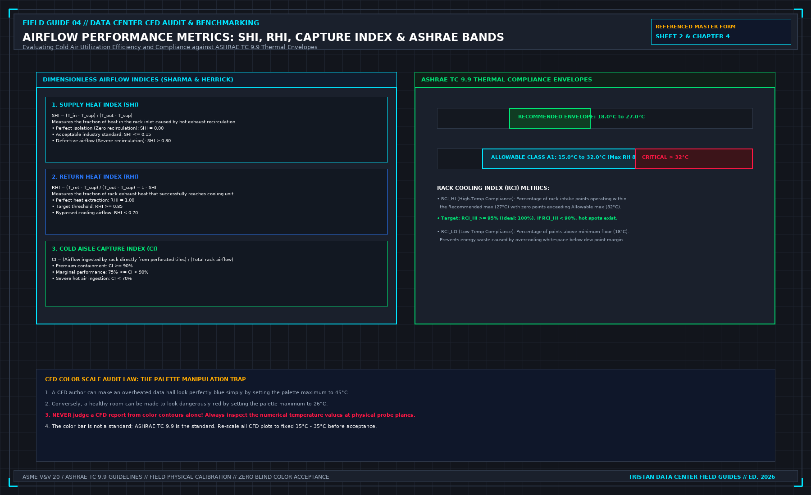

# 4. What the report is allowed to decide

A computational fluid dynamics report is contractually permitted to support exactly **one decision**. State that decision on the cover before reviewing the simulation plots. 

In mission-critical data center engineering, four distinct decision domains are legitimate. Using a report commissioned for one domain to justify decisions in another—or attempting to address multiple domains simultaneously—inevitably leads to misapplied engineering and flawed capital expenditures.



## The Four Permitted Decision Domains

### 1. Pre-Construction Design Comparison
- **Permitted Scope**: Comparing Layout Option A against Layout Option B before any physical construction begins (for example, comparing an 800 mm raised-floor plenum against a flooded-aisle flat slab, or evaluating hot aisle containment versus cold aisle containment).
- **Authorized Finding**: The report may conclude: *"Option A achieves 3.8 K lower peak rack intake temperatures and a 12% higher Cold Aisle Capture Index than Option B under identical boundary conditions."*
- **Boundary Restriction**: The report **cannot** state that Option A meets as-built contract specifications. Nothing has been built. This use requires zero physical field measurements; its validity depends entirely on ensuring that both options were discretized with identical mesh density and executed under identical solver convergence criteria.

### 2. Built-Hall Compliance Audit
- **Permitted Scope**: Verifying that a completed, physical data hall satisfies contract airflow and thermal specifications prior to IT hardware deployment.
- **Authorized Finding**: The report may conclude: *"The calibrated model demonstrates that with all designated cooling units active at nominal setpoints, 100% of server intake planes operate within the ASHRAE Recommended A1 thermal envelope."*
- **Boundary Restriction**: This use **requires** the multi-point physical field measurements from Chapter 1 and the statistical validation audit (MAE ≤ 1.0 K) from Chapter 2. Without physical benchmarking, a built-hall compliance report is merely a pre-construction design model that arrived late.

### 3. Operational Hotspot Root-Cause Analysis
- **Permitted Scope**: Diagnosing the physical cause of localized overheating in an operating data hall, and evaluating proposed physical remediation measures.
- **Authorized Finding**: The report may conclude: *"The 31.5°C intake hotspot at Rack 18 is caused by severe underfloor plenum jet entrainment depleting static pressure to -2.5 Pa at Tile 07. Simulating the addition of underfloor air baffles restores plenum pressure to +14.0 Pa and reduces peak intake temperature to 23.2°C."*
- **Boundary Restriction**: The identified root cause must correspond to a physical input you can touch in the room. Furthermore, a proposed remediation is not a verified conclusion until the consultant executes a formal **rerun script** demonstrating that the modification eliminates the hotspot without creating secondary deficits elsewhere in the hall.

### 4. N-1 Emergency Failure Ride-Through
- **Permitted Scope**: Evaluating airflow redistribution, intake temperature excursions, and thermal runaway timelines following the sudden loss of an active CRAH unit or chiller feed.
- **Authorized Finding**: The report may conclude: *"Upon the simulated trip of CRAH-02, cold aisle static pressure decays within 4.5 seconds, and Rack 09 intake temperature breaches the ASHRAE Allowable threshold of 32.0°C after 8.5 minutes of continued operation."*
- **Boundary Restriction**: This application requires **transient, time-accurate numerical solving** (dt ≤ 1.0 s). A steady-state simulation cannot narrate a timeline; evaluating thermal ride-through using a steady-state run falsely assumes that fluid velocities and thermal plumes transition instantaneously without thermal inertia.

## Dimensionless Airflow Performance Indices

A rigorous CFD report moves beyond simple temperature plots to evaluate objective, dimensionless airflow performance indices:

### 1. Supply Heat Index (SHI) and Return Heat Index (RHI)
Developed by Sharma and Herrick, these indices quantify the degree of thermal contamination across the whitespace:

$$\text{SHI} = \frac{T_{\text{in}} - T_{\text{supply}}}{T_{\text{exhaust}} - T_{\text{supply}}}, \quad \text{RHI} = \frac{T_{\text{return}} - T_{\text{supply}}}{T_{\text{exhaust}} - T_{\text{supply}}} = 1 - \text{SHI}$$

Where:
- T_in is the rack intake temperature.
- T_supply is cooling unit discharge temperature.
- T_exhaust is server rear discharge temperature.
- T_return is cooling unit return grille temperature.

**Acceptance Standard**:
- SHI = 0.00 represents perfect containment (zero recirculation of hot exhaust air into the intake stream).
- Industry standard for modern contained data centers is **SHI ≤ 0.15**.
- An SHI > 0.30 indicates defective aisle containment, severe blanking panel leakage, or gross airflow deficits.

### 2. Cold Aisle Capture Index (CI)
Quantifies the percentage of air ingested by a server intake that originates directly from local perforated tiles or supply grilles, rather than recirculated room air:

$$\text{CI} = \frac{Q_{\text{conditioned\_intake}}}{Q_{\text{total\_server\_demand}}} \times 100\%$$

**Acceptance Standard**:
- **High-Performance Containment**: CI ≥ 90%.
- **Marginal Aisle**: 75% ≤ CI < 90%.
- **Severe Ingestion Deficit**: CI < 70% (indicates cold aisle starvation where server fans pull hot exhaust air from the room).

## Compliance against ASHRAE TC 9.9 Thermal Envelopes

The performance of server intakes must be audited directly against the governing **ASHRAE TC 9.9 Thermal Guidelines for Data Processing Environments** (Class A1 envelope):

```
+----------------------------------------------------------------------------------------------------+
| ASHRAE CLASS A1 THERMAL ENVELOPE AUDIT |
+--------------------------+-----------------------+-----------------------+-------------------------+
| ENVIRONMENTAL PARAMETER | RECOMMENDED ENVELOPE | ALLOWABLE ENVELOPE | AUDIT VIOLATION LIMIT |
+--------------------------+-----------------------+-----------------------+-------------------------+
| Dry-Bulb Temperature | 18.0°C to 27.0°C | 15.0°C to 32.0°C | > 32.0°C or < 15.0°C |
| Dew Point Temperature | 5.5°C to 15.0°C | -12.0°C to 17.0°C | > 17.0°C (Condensation) |
| Maximum Relative Humidity| 60% RH | 80% RH | > 80% RH |
+--------------------------+-----------------------+-----------------------+-------------------------+
```

### The Rack Cooling Index (RCI)
To summarize row-wide compliance mathematically, the report should compute the **Rack Cooling Index**:
- **RCI_HI (High-Temperature Compliance)**: Measures the percentage of intake points operating within the Recommended maximum (27.0°C) without any points breaching the Allowable ceiling (32.0°C). Target: RCI_HI ≥ 95% (Ideal: 100%).
- **RCI_LO (Low-Temperature Compliance)**: Measures protection against overcooling below the minimum floor (18.0°C). Target: RCI_LO ≥ 95%.

## The Palette Manipulation Trap

The primary mechanism of visual deception in CFD reporting is the arbitrary manipulation of the temperature color contour scale:
- A modeler who wishes to present a dangerously overheated room as healthy can simply adjust the palette upper bound to 45.0°C. On that scale, a server intake operating at 30.0°C (severely overheated) renders in a calming blue-green hue.
- Conversely, a modeler seeking to justify an unnecessary cooling expansion can set the palette upper bound to 24.0°C. On that scale, a healthy intake at 23.5°C renders in an alarming fiery red.

**The Color Scale Audit Law**: Never evaluate a CFD report from color contours alone. Always extract the numerical probe values from cutting planes, and insist that all comparative plots be normalized to an identical, fixed scale (15.0°C to 35.0°C).

## Decisions to record before test start

- The single permitted decision domain selected for this report, with the other three marked as not applicable.
- The specific edition of ASHRAE TC 9.9 cited in the project specification.
- Verification that dimensionless metrics (SHI ≤ 0.15, CI ≥ 90%) are reported.
- Confirmation that color contour scales are normalized to fixed numerical limits.
