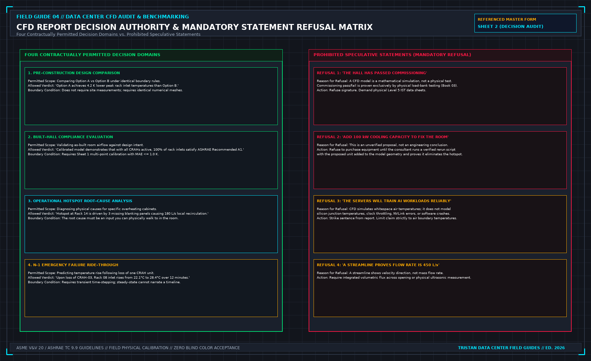

# 5. Sentences you do not write

A CFD simulation report will invariably present conclusions and recommendations drafted by the model author. Most of these sentences are not yours to sign.

As a Commissioning Lead, technical auditor, or facility engineer, your professional duty is to maintain strict evidentiary standards. You must identify speculative or unverified statements in the consultant's draft and formally strike them from the executive summary before the report is accepted.



## The Four Primary Refused Statements

```
+----------------------------------------------------------------------------------------------------+
| PROHIBITED CFD REPORT STATEMENTS |
+------------------------------------+---------------------------------------------------------------+
| PROHIBITED STATEMENT IN DRAFT | MANDATORY AUDIT REFUSAL RATIONALE & REMEDIATION |
+------------------------------------+---------------------------------------------------------------+
| 1. "The data hall has passed | REFUSED. CFD is a mathematical simulation, not a physical |
| commissioning." | test. Commissioning pass/fail is proven exclusively by Level 5|
| | physical load-bank testing (Book 03). Strike sentence. |
+------------------------------------+---------------------------------------------------------------+
| 2. "Add 100 kW of cooling capacity | REFUSED. An untested proposal is not an engineering result. |
| to eliminate the hotspot." | Must be modeled as a verified rerun script with the new unit |
| | added. If not rerun, label: "PROPOSAL - NOT DEMONSTRATED". |
+------------------------------------+---------------------------------------------------------------+
| 3. "Compute servers will train AI | REFUSED. CFD simulates whitespace air temperatures; it does not|
| workloads reliably." | model silicon junction temperatures, throttling, or NVLink. |
| | Strike sentence. Limit claim strictly to intake air envelope. |
+------------------------------------+---------------------------------------------------------------+
| 4. "Streamline velocity confirms | REFUSED. A streamline shows flow direction, not mass flux. |
| airflow rate is 450 L/s." | Demand numerical surface integral or physical hood data. |
+------------------------------------+---------------------------------------------------------------+
```

### Refusal 1: "The Data Hall Has Passed Commissioning"
A consultant whose simulation shows comfortable blue contours across all server aisles will frequently conclude: *"Based on CFD modeling, the data hall cooling system has successfully passed commissioning and is cleared for IT deployment."*

**The Refusal**: You must refuse this sentence in ink. A numerical fluid dynamics model—no matter how finely meshed or beautifully rendered—is a simulation of reality, not reality itself. 

The physical data hall has not passed commissioning until physical liquid load banks are energized on the floor, electrical breakers are closed, secondary fluid pumps undergo physical N+1 trip failovers, and thermal enthalpy balance closures exceed 97.0% under the witnessed Level 5 protocols of Book 03. 

If the consultant's sentence is allowed to stand, an insurer or client auditor can argue that physical load-bank testing was deemed unnecessary because a computer model "passed" the facility. Strike the sentence; replace it with: *"The calibrated simulation predicts that the whitespace airflow distribution satisfies design thermal envelopes under the specified steady-state boundary conditions."*

### Refusal 2: "Add 100 kW of Cooling Capacity to Fix the Hotspot"
When a model reveals an intake hotspot exceeding 30.0°C, the report frequently offers a broad remedial recommendation: *"It is recommended that the operator add an additional 100 kW CRAH unit to Row 4 to resolve the hotspot."*

**The Refusal**: This is an untested proposal, not an engineering finding. In data center fluid dynamics, blindly adding airflow or cooling capacity to an existing room frequently exacerbates localized hot spots:
- Adding a high-velocity CRAH discharge near an existing unit can increase underfloor velocity, deepening Bernoulli static pressure depression and starving adjacent floor tiles.
- The additional fan energy increases overall heat rejection demand.

A remedial recommendation becomes an accepted engineering finding **only when the consultant incorporates the proposed unit into the model geometry, reruns the simulation under identical scene rules, and proves that the modification resolves the hotspot without creating new secondary deficits**. If the rerun script is not included in the report, label the sentence: *"UNVERIFIED PROPOSAL — RERUN NOT PERFORMED"*.

### Refusal 3: "Compute Servers Will Train AI Workloads Reliably"
Consultants frequently extrapolate macro-scale airflow predictions into silicon reliability claims: *"The model confirms that the AI accelerator clusters will operate continuously without thermal throttling during multi-node model training."*

**The Refusal**: A room-scale CFD model computes macro-scale convective air patterns in the whitespace. It possesses zero visibility into:
- Micro-scale thermal resistance across the cold plate interface (TIM-1 and TIM-2 thermal interface materials).
- Localized hotspot heat fluxes on GPU silicon dies exceeding 100 W/cm².
- Autonomous dynamic frequency scaling (DVFS) algorithms embedded within the processor microcode.
- High-speed NVLink optical transceiver bit error rates.

A server operating in a 22.0°C cold aisle can still experience catastrophic silicon throttling if its internal cold plate possesses microchannel scaling, or if secondary glycol flow is throttled. Strike any sentence purporting to predict silicon reliability or workload stability. The report speaks exclusively about the fluid boundary at the rack face.

### Refusal 4: "Streamline Velocity Confirms Tile Flow Is 450 L/s"
A report that displays elegant 3D particle traces or ribbon streamlines will sometimes assert volumetric airflow quantities based on the visual density of the lines: *"The streamlines exiting Tile 06 indicate a delivery rate of 450 L/s into the cold aisle."*

**The Refusal**: A streamline is a mathematical line everywhere tangent to the instantaneous fluid velocity vector. It visualizes the direction of travel; it does not measure volumetric mass flux. 

Volumetric flow rate across a boundary must be calculated via a formal surface integral of the normal velocity vector across all boundary face cells:

$$Q = \int_{A} (\vec{v} \cdot \vec{n}) \, dA \approx \sum_{k=1}^{M} v_{n, k} \cdot A_k$$

If the report does not present this numerical integration—or if physical flow hood measurements were not taken—the flow rate claim is an unverified visual estimate.

## Decisions to record before test start

- The comprehensive list of speculative sentences struck from the consultant's draft.
- Documentation that all proposed physical remedies are accompanied by formal rerun scripts.
- Formal reaffirmation that the CFD report does not replace Book 03 physical load-bank testing.
- Sign-off by the Commissioning Lead that the executive summary contains only authorized findings.
