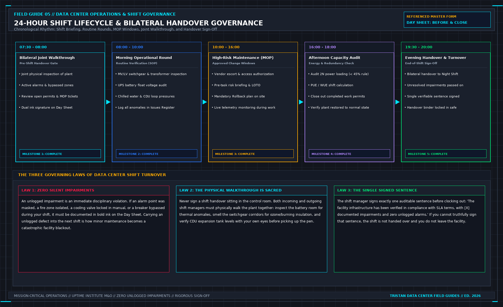

# 0. How to Use This Book

This book is for the person who manages a data center day. It is the shift, the work that is allowed to happen, the thing that went wrong, and the sentence you can still say at the end of the day.

It is not a facilities-operations course. It is not a substitute for sitting one. Certified Data Centre Facilities Operations Manager (CDFOM) and Certified Data Centre Facilities Operations Specialist (CDCS) are course titles. This book does not retell their slides, their multiple-choice exercises, or their examinations. If you need the credential for your client's vendor matrix, take the course from the organization that owns it.

It is not a copy of a service-management library, a security standard, a design standard, or a safety code. ITIL, ISO/IEC 20000, ISO 22301, ISO 55001, NFPA 70E, and OSHA 1910 have titles and editions. Cite them. Do not paste them. A manager who pastes sixty pages of corporate boilerplate into a shift folder has not run the facility; they have built a paper wall to hide behind when a chiller trips.

The earlier books in this series stop at a machine, a file, a test, or a model:
- Book 01 builds the liquid load bank and instruments the manifold.
- Book 02 reads the thermal and hydraulic flash report.
- Book 03 executes the seven sheets of commissioning verification.
- Book 04 audits the computational fluid dynamics model against physical measurements.

This book starts when the commissioning agents have packed their pelican cases, the temporary load banks are on the flatbed trucks, the IT servers are live, and someone will be blamed if the hall goes dark.

```
+-----------------------------------------------------------------------------+
| DATA CENTER SHIFT LIFECYCLE |
| |
| [07:00] Incoming & Outgoing Joint Walkthrough (30 min, 6 physical stations)|
| | |
| [07:30] Shift Handover Gate (Sign Day Sheet: Impairments, Permits, MOPs) |
| | |
| [08:00] Morning Baseline Telemetry & Catch-Pan Inspection |
| | |
| [10:00] Authorized Maintenance Window (MOP Execution, LOTO, Active Escort) |
| | |
| [14:00] Afternoon Deep Round (Acoustic, Thermal IR, Refractometer, DPs) |
| | |
| [18:30] Pre-Close Audit: Clear Permits, Verify Normal Configurations |
| | |
| [19:00] The Closeout Sentence: The single binding statement of the day |
+-----------------------------------------------------------------------------+
```



When you finish each day, you must be able to hand over one day sheet. It names who is on shift, what work is permitted, what changed, what you physically walked, what failed, and what you will not claim. It is in Chapter 10 and in `sheets/day.md`. If you are the incoming manager tomorrow morning, start there.

## What You May Copy

You may copy the sheet headings into your own operations logbook or site management software. You may not paste a sentence from this book into a customer Service Level Agreement (SLA) and call it their operational rule. Their facility has its own operating permits, its own contractual notice windows, and its own emergency escalation paths. This book tells you what those documents must enforce. It does not replace them.

## Decisions to Record

- The single binding sentence the day is allowed to support.
- The standard, code, or contract you will cite by title and edition, and not paste.
- The day sheet you will physically sign before you hand the radio to the next shift.
