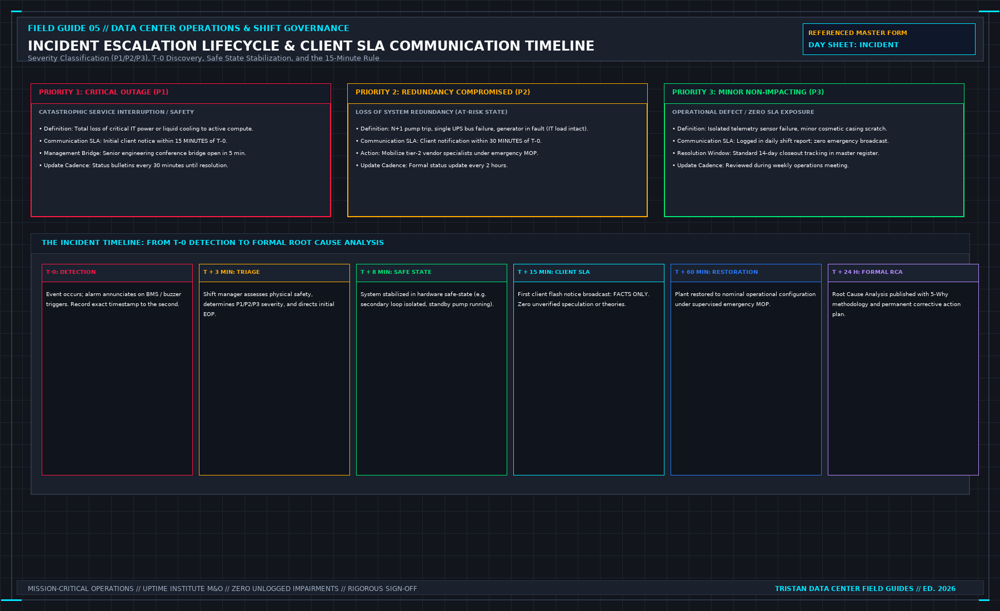

# 8. When It Fails

An incident is any event where critical infrastructure fails to deliver the contractual service envelope, where a human life is endangered, or where the facility enters an unstable state that will imminently cause either outcome.

| **INCIDENT ESCALATION TIMELINE** |
| :--- |
| [T = 00:00] EVENT DISCOVERY (Telemetry trip, acoustic alarm, visual) |
| ↓ |
| [T + 02:00] STOP & ASSESS: Silence horn; identify failing subsystem |
| ↓ |
| [T + 05:00] EXECUTE EOP: Stabilize nearest safe state; isolate hazard |
| ↓ |
| [T + 10:00] SUMMON INCIDENT COMMAND: Establish incident log; assign roles |
| ↓ |
| [T + 15:00] CLIENT SLA NOTIFICATION: Send factual notice (NO HYPOTHESES) |
| ↓ |
| [T + 60:00] TECHNICAL CONTAINMENT: Deploy MOP repairs; continuous updates |
| ↓ |
| [POST-EVENT] ROOT CAUSE ANALYSIS (RCA): Fishbone, 5-Whys, 1 owned action |

A noisy alarm that does not threaten service delivery or human safety is an annoyance. Do not elevate it to an emergency. Conversely, never downgrade a genuine service degradation because the equipment room appears quiet and calm. The sole metric of an incident is service delivery and personnel safety.

## The Incident Severity Classification

Every abnormal event must be classified into one of three strict severity tiers within two minutes of discovery:

**INCIDENT SEVERITY CLASSIFICATION**

| Tier | Classification | Operational Impact Client Noti | fication |
| :--- | :--- | :--- | :--- |
| P1 Cr | itical Total lo | ss of power or cooling <= 15 M | in; Hourly Upd |
| to IT | load; human li | fe safety |  |
| P2 Ma | jor Loss of sys | tem redundancy <= 30 Min; 2-Ho | ur Upd |
| (N-1 | state); high te | mp warning |  |
| P3 Mi | nor Single comp | onent failure with Shift Summa | ry Log |
| zero | redundancy impa | ct |  |

## The First Hour: The Incident Clock

During a live incident, human memory degrades rapidly under adrenaline. Technicians remember actions out of sequence; managers compress twenty minutes of hesitation into five minutes of remembered decisiveness.

The duty manager must open an immutable, time-stamped **Incident Chronology Log** at the exact minute the event begins:

| **INCIDENT CHRONOLOGY LOG** |
| :--- |
| [09:14:22] EPMS reports Breaker B-SWG-02 instantaneous trip on feeder B |
| [09:16:00] Duty Manager initiates EOP-E-04 (Loss of 2N Feeder B) |
| [09:18:45] Technician Chen confirms Bus A carrying 82% total load |
| [09:21:10] Safe State 1 reached: IT load stable on single feed |
| [09:24:00] Client SLA Notice 1 transmitted via portal (T+10 min) |
| [09:32:00] Infrared scan of Bus A switchgear shows 58°C; stable |
| [09:45:00] Switchgear vendor called; ticket #84920 opened |

Log every event with exact timestamps:
- The minute the alarm was detected on the monitoring console.
- Exactly what was observed on the physical instruments, not what someone assumed happened.
- The exact EOP executed, the safe state achieved, and the minute that state was confirmed.
- The names of all individuals summoned to the incident team.
- The minute the client notification was transmitted, and the exact text sent.
- What actions were intentionally rejected or deferred to protect the remaining live systems.

## Muscle Memory Safe State vs. Heroic Troubleshooting

When alarms sound and equipment trips, an untrained technician's instinctive reaction is to start flipping switches, resetting tripped breakers, or opening bypass valves in a desperate attempt to restore the offline unit.

This "heroic troubleshooting" is how a minor single-component trip escalates into a catastrophic full-facility blackout:
- A circuit breaker that tripped on instantaneous overcurrent may have cleared a catastrophic phase-to-phase dead short. Resetting that breaker without testing will cause an explosive arc-flash that destroys the entire switchgear line-up.
- A secondary CDU pump that tripped on low suction pressure may indicate an empty expansion tank or a burst pipe. Forcing the standby pump to start without investigating will run the mechanical seal dry and burn out the motor.

The absolute operational rule during an incident is:
1. **Execute the Emergency Operating Procedure (EOP)** to establish the nearest pre-engineered Safe State.
2. **Stop**. Take your hands off the controls.
3. Verify that surviving redundant systems are carrying the load stably.
4. Begin systematic forensic investigation under an approved MOP.

The hero who attempts to repair live equipment while sirens are wailing belongs in an action movie, not an industrial data center. In an industrial data center, we value the disciplined technician who stabilizes the plant, stands back, and adheres to procedure.

## Keeping Hypotheses Off the First Client Notice

When drafting the initial incident notification to the customer, follow this rigid rule: **Report only confirmed physical facts; keep hypotheses completely off the notification.**

| **CLIENT NOTIFICATION DISCIPLINE** |
| :--- |
| [PERMITTED FACTUAL NOTICE] |
| "At 09:14 UTC, Electrical Feeder B experienced an automatic trip. |
| All critical IT whitespace remains fully powered via redundant |
| Feeder A. The facility is currently operating in an N-1 state. |
| Operations teams are investigating the cause of the Feeder B trip. |
| The next formal update will be provided at 10:15 UTC." |
| [PROHIBITED SPECULATIVE NOTICE] |
| "We think a contractor bumped a relay on Feeder B, or maybe the |
| utility had a lightning strike down the road. We are resetting the |
| breaker now and hope to have it back in ten minutes." |

If you transmit a speculative theory in your first notice and subsequent engineering forensics prove that theory wrong:
- You destroy the customer's trust in your operational competence.
- You provide the customer's legal team with ammunition to claim gross negligence.
- You force your team to spend hours explaining why the initial story changed instead of focusing on technical restoration.

State the symptom, the timestamp, the affected systems, the current containment state, and the time of the next update. Say nothing else.

## The Single Owned Action (Post-Incident RCA)

An incident is not closed when the equipment is re-energized and the alarms clear. An incident is closed only when a formal Root Cause Analysis (RCA) is conducted and results in **one concrete, owned, dated operational change**.

A post-incident review meeting where managers gather to commiserate, retell their anxiety, and conclude that *"technicians need to be more careful"* is an utter waste of time. "Being more careful" is not an engineering control.

An authentic post-incident corrective action changes:
- An engineering design (e.g., install interposing isolation relays to eliminate common-mode trip circuits).
- A maintenance procedure (e.g., revise MOP to mandate dual torque checks on 480V cable lugs).
- An inspection round (e.g., add daily refractometer sampling to the CDU shift checklist).
- A physical tool or spare (e.g., procure calibrated vacuum filling skids to eliminate air binding in cooling loops).

The corrective action must have a single named owner and a binding completion deadline. If the post-incident review proposes five diffuse recommendations, none of them will be implemented. Select the single most impactful structural fix, assign it to an owner, and track it to completion on the daily handover log.

## Decisions to Record

- Incident classification (P1 / P2 / P3) and exact discovery timestamp.
- Chronology log detailing all actions, safe states reached, and personnel involved.
- Copy of the initial client notification, verifying zero speculative hypotheses were included.
- Technical restoration confirmation signed under steady-state load conditions.
- The single owned, dated corrective action resulting from the Root Cause Analysis.

## Post-Incident Root Cause Analysis (RCA) and the Five-Layer Evidence Hierarchy

When an unplanned equipment trip or SLA excursion occurs, the shift manager's immediate duty during the shift is **stabilization at the First Safe State** and **forensic preservation of transient evidence**. Volatile waveform buffers inside protective relays and UPS event logs overwrite themselves if power is cycled or if a technician clears latches before downloading the fault record.

### The Forensic Evidence Preservation Sequence

Within the first $60$ minutes after stabilizing the plant, before any reset button is pressed or any vendor replaces a circuit board, the shift team must capture and lock five layers of timestamped evidence:
1. **COMTRADE Oscillography Waveforms (IEEE C37.111)**: Export high-speed ($4\,\text{kHz}$ to $16\,\text{kHz}$) voltage and current fault waveforms from MV/LV protective relays and UPS inverters covering $10$ cycles pre-fault and $30$ cycles post-fault.
2. **Sequence of Events (SOE) Microsecond Ledger**: Export the PTP-synchronized ($\pm 1\,\text{ms}$) digital state transitions showing the exact first-out initiator breaker or sensor contact.
3. **Physical Relay Targets and Mechanical Flags**: Photograph mechanical drop-flags, breaker spring-charge indicators, and pressure relief rupture discs *before* resetting any latch.
4. **Fluid and Chemical Samples**: If a liquid cooling loop or diesel generator tripped, draw a sealed $500\,\text{mL}$ fluid sample for particulate/glycol/fuel analysis before flushing or refilling.
5. **Witness Timeline Statements**: Record independent written timestamps from each shift technician before group discussion merges their recollections.

## Customer Incident Communication Cadence and Factual Bulletin Rules

During an active Severity 1 or Severity 2 incident, external customer notifications are issued on a strict **15-Minute / 30-Minute Factual Heartbeat** by the Incident Commander—never by the hands-on switching technicians on the floor. Every bulletin states three verified facts only: (1) UTC timestamp and affected boundary, (2) current physical state of the plant (e.g., *Load supported on N+1 Generator Bus B; Hall Temperatures 23.4°C*), and (3) timestamp of the next scheduled update. Speculating on root cause before COMTRADE and SOE logs are analyzed is strictly prohibited.
