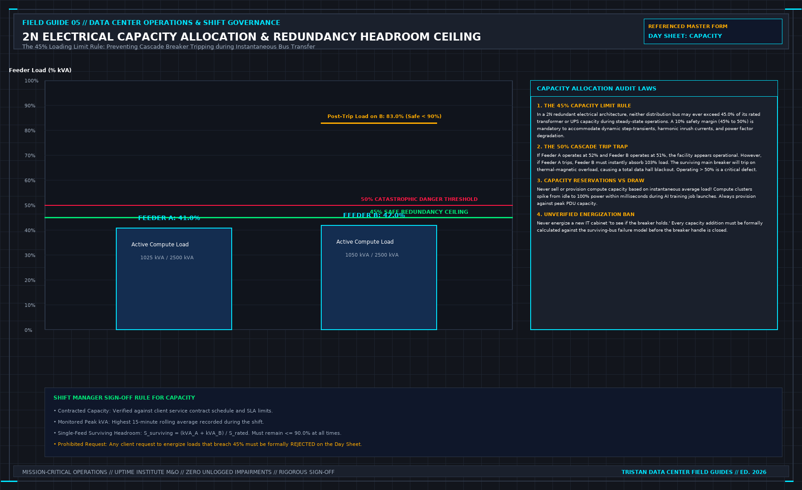

# 9. Capacity, Without an Invented Number

A facility manager's daily capacity duty is governed by three fundamental questions:
1. What capacity did you contractually sell to the customer?
2. What capacity is physically utilized at this exact moment?
3. What capacity will survive if your largest single component fails right now?

```
+-----------------------------------------------------------------------------+
| THE 2N CAPACITY REDUNDANCY CEILING |
| |
| 100% +----------------------------------------------------------------+ |
| | UNUSABLE DANGER ZONE | |
| | If Bus A trips, Bus B instantly overloads and blackouts | |
| 90% +================================================================+ |
| | MAXIMUM SURVIVING LOAD (90%) | |
| | | |
| 50% + - - - - - - - - - - - - - - - - - - - - - - - - - - - - - - - -+ |
| | THE 45% RULE: MAXIMUM STEADY-STATE PERMITTED | |
| 45% +----------------------------------------------------------------+ |
| | | |
| | SAFE 2N OPERATING ENVELOPE | |
| | Bus A Load <= 45% | Bus B Load <= 45% | |
| 0 +----------------------------------------------------------------+ |
+-----------------------------------------------------------------------------+
```



If you cannot answer those three questions with mathematical certainty from verified metering records, you do not know whether today's proposed maintenance or server deployment is safe.

## The Mathematics of 2N Redundancy: The 45% Rule

The most widespread and deadly operational myth in data center management is the belief that in a 2N redundant electrical architecture, each power path can be safely operated up to **50% of its rated nameplate capacity**.

This is a mathematical trap that has caused catastrophic multi-megawatt cascade outages across the industry:

$$P_{\text{total}} = P_{\text{Bus A}} + P_{\text{Bus B}}$$

Consider a 2N electrical busbar rated for 2000 kVA. The operations manager observes that Bus A is carrying 1040 kVA (52% load) and Bus B is carrying 1020 kVA (51% load). The manager assumes that because neither busbar is overloaded, the system is operating comfortably within its safety margin.

Now, an upstream transformer feeding Bus A trips.
Within milliseconds, all dual-corded IT server power supplies attached to Bus A transfer their electrical load onto Bus B.

The total instantaneous load imposed on Bus B becomes:

$$P_{\text{Bus B, transient}} = 1040\,\text{kVA} + 1020\,\text{kVA} = 2060\,\text{kVA} \quad (103\% \text{ of rated capacity})$$

Bus B is instantly overloaded. The main circuit breaker for Bus B senses sustained overcurrent and trips after a brief time-delay curve, plunging the entire data hall into total darkness. A facility designed for complete 2N fault tolerance experienced a 100% catastrophic blackout from a single component failure.

To prevent cascade tripping, every 2N electrical distribution path must adhere strictly to **The 45% Loading Rule**:

$$P_{\text{steady-state}} \le 0.45  \times P_{\text{rated}}$$

Under the 45% rule:
- Bus A carries ≤ 45% (900 kVA).
- Bus B carries ≤ 45% (900 kVA).
- If Bus A trips, the surviving Bus B inherits a total load of 900 + 900 = 1800 kVA (90% of rated capacity).
- Bus B operates stably with a 10% safety buffer, well below the thermal-magnetic trip threshold, allowing technicians to manage the contingency safely.

Any shift manager who permits a 2N electrical busbar to exceed 45% steady-state utilization has compromised the facility's redundancy and is operating in an unrated, high-risk state.

## Secondary Cooling Loop Hydraulic Capacity

In liquid-cooled AI whitespace housing high-density compute racks (such as NVIDIA NVL72 architectures consuming up to 132 kW per rack), hydraulic capacity governance is as vital as electrical capacity:

```
+-----------------------------------------------------------------------------+
| CDU HYDRAULIC CAPACITY CEILING |
| |
| Parameter Rated Design Limit Operational Redundancy Limit |
| ------------------ ------------------------ --------------------------- |
| Total Heat Removal 1200 kW per CDU <= 1000 kW (83% of PHE cap) |
| Secondary Flow Rate 1440 LPM (24 LPS) <= 1200 LPM (Single Pump N) |
| Supply Temperature 25.0°C - 32.0°C (W3/W4) <= 30.0°C (At Max Ambient) |
| Pump Configuration N+1 Dual VFD Pumps 1 Pump Run / 1 Standby Auto |
| Loop Pressure 0.15 - 0.90 MPa Head Loss Delta-P < 1.0 bar |
+-----------------------------------------------------------------------------+
```

When evaluating a customer's request to install additional high-density liquid-cooled racks, the duty manager must evaluate hydraulic constraints:
1. **Total Flow Availability**: Verify that the secondary pumps can deliver the required volumetric flow rate (q_v) to maintain cold plate turbulent flow:

$$q_v = \frac{Q}{\rho \cdot c_p \cdot \Delta T}$$

Where:
- Q is the total thermal heat dissipation ( kW).
- $
- ρ is the density of 25% propylene glycol (1026\, kg/m^3at30°C$).
- c_p is the specific heat capacity (3.92 kJ/( kg· K)).
- ΔT is the fluid temperature rise across the rack manifold (typically 10.0 K).

2. **Hydraulic Imbalance and Direct-Return Starvation**: As additional racks are connected to a secondary distribution manifold, friction losses (ΔP_f) increase quadratically with flow velocity (v):

$$\Delta P_f = f \cdot \frac{L}{D} \cdot \frac{\rho v^2}{2}$$

If the manifold was plumbed in a direct-return configuration rather than a reverse-return (Tichelmann) loop, adding load to the far end of the row will starve the index rack, causing immediate thermal throttling on the GPUs.

Never approve a liquid load addition based on a verbal assurance from the customer that "the pumps look big enough." Demand the certified hydraulic flow simulation and pressure drop calculations before issuing a connection permit.

## The Myth of "Trying" the Load

When a customer or project installation team requests permission to energize additional server racks that exceed the calculated capacity envelope, they will often suggest:
> *"Let's just energize the racks and watch the meters for twenty minutes to see if the breakers hold."*

This is the operational equivalent of testing the thickness of ice by driving a thirty-ton truck onto it.

Energizing equipment "to see if it holds":
- Subjects electrical busbars and transformers to massive inrush currents and thermal shock.
- Risks tripping upstream protective relays, triggering an instantaneous outage for adjacent live customers.
- Replaces rigorous mathematical engineering with reckless gambling.

If a requested load deployment exceeds either the contractual allocation or the 45% redundancy ceiling, the Duty Manager must refuse authorization immediately. Halt the energization. The customer must submit a formal engineering study and negotiate an amended contract before a single additional circuit breaker is closed.

## Decisions to Record

- Contractual capacity sold, cited by customer contract clause and rack ID.
- Active electrical load recorded per busbar, verifying compliance with the 45% redundancy rule.
- Hydraulic secondary loop flow rate, supply temperature, and differential pressure logged per CDU.
- Remaining capacity after a single worst-case component failure: verified via named engineering study, or recorded as unknown.
- Any request exceeding safe operational capacity rejected in writing; zero energization "to try."
