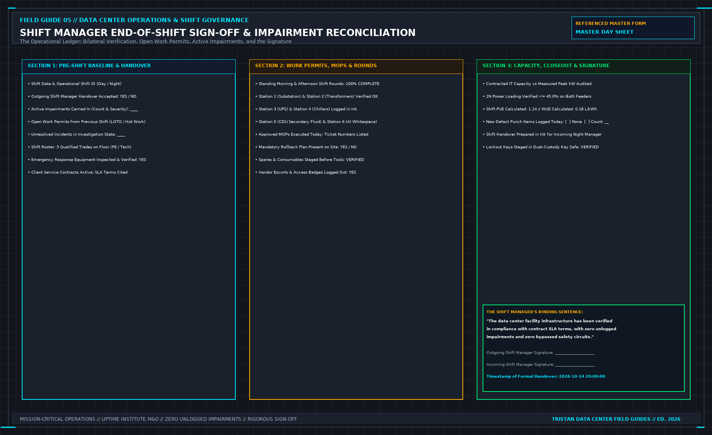

# 10. The Master Day Sheet

The Master Day Sheet is the binding legal, technical, and operational ledger of the data center shift.

```
+-----------------------------------------------------------------------------+
| MASTER DAY SHEET STRUCTURE |
| |
| [SECTION 1] Pre-Shift Turnover Audit (Impairments, Permits, Incidents, MOP)|
| | |
| [SECTION 2] Authorized Work & PTW Registry (Scope, LOTO, Expiration Clocks)|
| | |
| [SECTION 3] Physical Shift Round Log (6 Stations, Multi-Sensory Parameters)|
| | |
| [SECTION 4] Incident & Escalation Chronology (Classification, T-15 SLA) |
| | |
| [SECTION 5] Capacity & Redundancy Audit (45% Power Rule, CDU Hydraulics) |
| | |
| [SECTION 6] The Final Closeout Sentence (The single immutable signature) |
+-----------------------------------------------------------------------------+
```



Copy the headings below into your facility's operational software or printed turnover logbook. A blank line on the Day Sheet represents a part of the facility you did not inspect, a risk you did not manage, and an outage you will own.

---

## 1. Before the Shift (Handover Gate)

- **Shift Date & Time Window**: `________________________________________`
- **Duty Manager On Duty**: `___________________________________________`
- **Outgoing Duty Manager**: `_________________________________________`
- **Contractual SLA Standard Operating To**: `__________________________`
- **Notice Period for SLA Excursions**: `_____ Minutes`
- **What Operations Will Explicitly NOT Promise Today**: `_______________`
- **On-Shift Personnel & Verified Trade Qualifications**:
 - Lead Electrician (License # & Expiration): `_________________________`
 - Cooling Specialist (License # & Expiration): `______________________`
 - Shift Technicians on Duty: `________________________________________`
- **Tasks / Systems Not Covered by Today's Roster**: `___________________`
- **Handover from Previous Shift Read, Walked, and Accepted**: `[YES / NO]`
- **Active Impairments Carried In**:
 - Fire Suppression (VESDA / Gas Disarmed): `__________________________`
 - Electrical Redundancy Impairments (Bypass / N-0): `__________________`
 - Mechanical Redundancy Impairments (Manual VFD / Single Pump): `______`
- **Open Permits to Work (PTW) Carried In & Expiration Times**: `________`
- **Active Incidents Carried In & Assigned Technical Owners**: `__________`
- **Scheduled Changes for Today's Window & Named Risk Acceptors**: `______`

---

## 2. Authorized Work & Maintenance

- **Standing Shift Routines (SOPs) Completed**: `[YES / NO]`
- **Specific Intrusive Jobs Executed (Approved MOPs Only)**:
 - Job 1: Tag: `_________` Scope: `___________________` MOP #: `_______`
 - Job 2: Tag: `_________` Scope: `___________________` MOP #: `_______`
- **Permits Issued Today & Exact Expiration Timestamps**:
 - PTW #: `_________` Location: `____________` Closes at: `___________`
- **LOTO Zero-Energy Verification Completed (Lock IDs)**: `______________`
- **Critical Spares Inspected at Worksite Prior to Tool Touch**: `[YES / NO]`
- **Changes Executed Today**:
 - Asset ID: `____________` Old Parameter: `_________` New: `___________`
 - Risk Acceptor Name: `__________________` CAB Approval #: `___________`
 - Back-Out Plan Verified Prior to Window: `[YES / NO]`
- **Abnormal Operating State Displayed on Control Room Board**: `[YES / NO]`
- **Third-Party Vendors on Site**:
 - Vendor Name: `______________` Assigned Site Host: `__________________`
 - Work Kept Strictly Within Written Scope: `[YES / NO]`

---

## 3. Physical Shift Inspection Round

- **Inspection Round Route Walked**: `Station 1 through Station 6 Completed`
- **Round Start Time**: `________` **Completion Time**: `________`
- **Technician Name**: `________________________________________________`
- **Station 1 (MV Switchgear)**: SF6 Pressure Normal `[Y/N]` | Springs Charged `[Y/N]` | DC Bus Voltage: `____ V`
- **Station 2 (Transformers)**: Winding Max Temp: `____ °C` | Acoustic Normal `[Y/N]` | Oil Level: `____`
- **Station 3 (UPS & Battery)**: Ambient Temp: `____ °C` | DC Float: `____ V` | Zero Bulging / Leaks `[Y/N]`
- **Station 4 (Chiller Plant)**: Approach Temp: `____ K` | Oil Press: `____ bar` | VFD Vibration Normal `[Y/N]`
- **Station 5 (CDU Stations)**: TCS Supply Press: `____ MPa` | Glycol Refractometer: `____ % PG` | Catch Pans Dry `[Y/N]`
- **Station 6 (AI Whitespace)**: Containment DP: `____ Pa` | Max PDU IR Temp: `____ °C` | Couplings Dry `[Y/N]`
- **Defects Entered on Formal CMMS Register Before Exiting Rooms**: `[YES / NONE]`
- **Contractual SLA Maintained During Round**: `[YES / NO]`

---

## 4. Incident & Escalation Log

- **Incident Status**: `[NONE / ALARM ONLY / ACTIVE INCIDENT]`
- **Severity Classification**: `[P1 - CRITICAL / P2 - MAJOR / P3 - MINOR]`
- **Discovery Timestamp**: `HH:MM:SS UTC`
- **Observed Physical Symptoms (Facts Only)**: `__________________________`
- **EOP Executed & Safe State Achieved Timestamp**: `HH:MM:SS UTC`
- **Client Notification Transmitted Timestamp**: `HH:MM:SS UTC (<= 15 min)`
- **Confirmation: Hypotheses Kept Off Client Notice**: `[YES / NO]`
- **Incident Resolved or Carried Forward**: `[RESOLVED / CARRIED FORWARD]`
- **Single Owned Corrective Action Resulting from Event**: `______________`
 - Action Owner: `_____________________` Due Date: `____________________`

---

## 5. Capacity & Redundancy Governance

- **Contractual Power Sold**: `_______ kW` (Clause: `____________________`)
- **Active Power Utilized**: `_______ kW` (Revenue Meter Timestamp: `_____`)
- **2N Redundancy Rule Audit**:
 - Feeder / Bus A Utilization: `_______ %` (Must be <= 45.0%)
 - Feeder / Bus B Utilization: `_______ %` (Must be <= 45.0%)
- **Secondary Cooling Hydraulic Utilization**:
 - CDU Thermal Load: `_______ kW` (Must be <= 83% of PHE rating)
 - Secondary Flow Rate: `_______ LPM` | Supply Temp: `_______ °C`
- **Remaining Capacity After Worst-Case Single Failure**:
 - Calculated Value: `_______ kW` (Engineering Study Date: `___________`)
 - Status: `[VERIFIED BY STUDY / UNKNOWN]`
- **Unverified Load Energization Requests Rejected**: `[YES / NONE]`

---

## 6. End-of-Shift Closeout & Sign-Off

- **All Maintenance Windows Closed or Paused with Named Owner**: `[YES / NO]`
- **Abnormal Operating States Cleared from Control Room Board**: `[YES / NO]`
- **Handover Dossier Prepared for Incoming Shift**: `[YES / NO]`
- **The Single Binding Sentence You Can Honestly Sign**:
 > *"I certify on my professional license that during this shift, all critical power and cooling systems operated within contractual SLA boundaries, all work was executed under approved procedures without unrecorded impairments, and all logged defects possess named owners."*

- **Duty Manager Signature**: `__________________________________________`
- **License / Certification Number**: `_________________________________`
- **Date & Exact Timestamp**: `_________________________________________`
