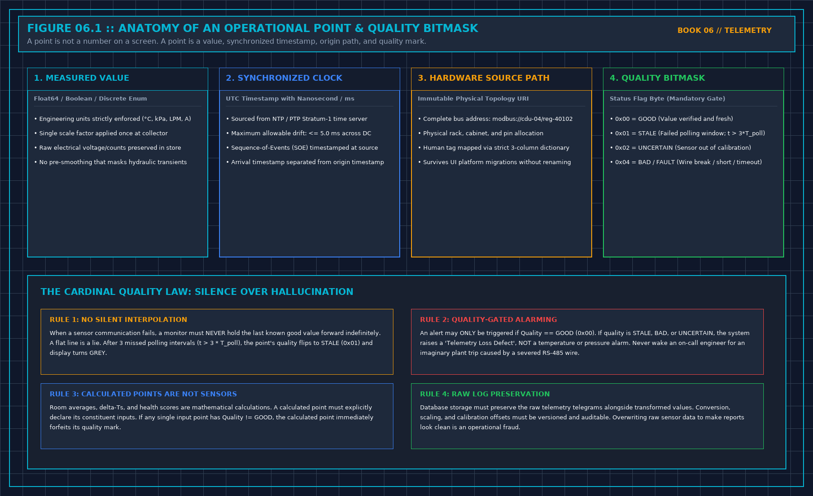

# 1. What a Point Must Have

A point is not a colorful widget, a sparkline, or a text label on an operator workstation. A point is an immutable data structure composed of four indispensable elements:

$$P = \{ V, \, t_{\text{UTC}}, \, \text{URI}_{\text{source}}, \, Q \}$$

Where:
- V is the measured engineering value (Float64, Boolean, or Discrete Enum).
- t_UTC is the synchronized UTC timestamp with millisecond resolution.
- URI_source is the physical hardware origin path down to the terminal block.
- Q is the quality bitmask certifying the integrity of the signal.

```
+-----------------------------------------------------------------------------+
| THE FOUR PILLARS OF A POINT |
| |
| [1. VALUE] Float64 / Boolean / Discrete State |
| • Strictly defined engineering units (°C, kPa, LPM, A) |
| • Scaling applied once at ingestion; raw counts logged |
| |
| [2. TIMESTAMP] UTC Timestamp synchronized via PTP / NTP Stratum-1 |
| • Source generation time, NOT database arrival time |
| • Sub-millisecond resolution for electrical SOE events |
| |
| [3. SOURCE PATH] Immutable Physical Hardware Address |
| • modbus://cdu-04/reg-40102 or bacnet://bms-pod3/ai-14 |
| • Fully decoupled from UI display labels |
| |
| [4. QUALITY MASK] Hardware & Communication Status Bitmask |
| • 0x00 = GOOD (Verified fresh and valid) |
| • 0x01 = STALE (Missed polling intervals; t > 3*T_poll) |
| • 0x02 = UNCERTAIN (Out of calibration range) |
| • 0x04 = BAD / FAULT (Wire break, short, CRC failure) |
+-----------------------------------------------------------------------------+
```



Without the timestamp, you cannot distinguish an instantaneous physical change from an echo of the last good reading. Without the physical source path, you cannot distinguish a direct physical transducer from a software calculation that consumed five other unverified inputs. Without the quality mark, a communication timeout or a severed RS-485 cable will dress itself as a perfectly calm, steady horizontal line.

If any of the four elements is missing or corrupted, the point is **SILENT**.
It may be archived to disk for diagnostic debugging. It may never trigger an audible horn, page an on-call engineer, close an active incident ticket, or populate a contractual capacity ledger. Silence is not a failure of the physical plant; silence is the mandatory operational quarantine of an unverified data point.

## The Operational Taxonomy of Points

Every data point entering the facility monitoring fabric must be classified into its precise structural category:

1. **Polled Points**: An active request-response inquiry (e.g., Modbus RTU/TCP read holding registers, SNMP GET requests). The supervisory engine queries the device, and the device responds or times out. Silence following a scheduled poll is a communication failure (Q = STALE); it is not proof that the plant is resting in a safe state.
2. **Pushed Points**: Asynchronous or periodic telemetry transmitted autonomously by an edge controller (e.g., MQTT publish, OPC UA subscription, syslog datagrams). A pushed point requires an explicit heartbeat specification: if the edge controller transmits only on value change, a periodic heartbeat message must be mandated. Without a heartbeat, prolonged silence cannot be distinguished from a crashed CPU.
3. **Unsolicited Traps / Exceptions**: An asynchronous alert declaring that an internal threshold was crossed (e.g., SNMP trap, BACnet Change-of-Value notification). A trap is an historical claim about a past state transition; it is not a continuous measurement of the state right now. A trap delayed in network transit is an old story. Never plot an unsolicited trap as a real-time analog trend.
4. **Calculated / Synthetic Points**: A mathematical transformation derived from other base points (e.g., plate heat exchanger approach temperature ΔT_approach = T_TCS, supply - T_FWS, supply, total hall power $P_{\text{total}} = \sum P_{\text{PDU}}$, or room average temperatures). A calculated point is never a physical sensor. Every synthetic point must declare its exact mathematical formula and constituent input tags. If any single input tag forfeits its `GOOD` quality flag, the calculated point immediately drops to `BAD` or `UNCERTAIN`.
5. **Discrete Contact States**: A binary open/closed or energized/de-energized circuit (e.g., auxiliary dry contact on a circuit breaker, optical float switch on a leak basin). A contact is an instantaneous electrical state; it is not a proxy for fluid flow, cooling capacity, or thermal performance. A closed breaker contact does not prove that current is flowing through the busbar.

## The Name Is Not the Source

Never confuse a user interface tag with a physical hardware address.

A label that reads *"Secondary Loop Supply Temperature"* is a cosmetic alias written for human operators. Platforms change, database schemas are refactored, and graphical screens are rebuilt during upgrades. The immutable hardware source path must be recorded down to the physical wiring layer:

$$\text{modbus://cdu-04-rtu/slave-01/reg-40102} \quad \longrightarrow \quad \text{CDU-04 TCS Supply RTD (PT100 Channel A)}$$

The site configuration management database must maintain a rigorous three-column translation dictionary:
1. **Hardware Source URI**: Protocol, controller network address, register/object ID, and physical terminal pin.
2. **Engineering P&ID / SLD Tag**: The exact alphanumeric tag appearing on the certified construction drawings (e.g., `TT-CDU-101A`).
3. **Engineering Units & Scaling**: Physical unit ( kPa, °C, LPM, kW) and the single mathematical multiplier applied at ingestion.

If a point's hardware address cannot be traced directly to a terminal block on a verified schematic, the point is an unmapped orphan. It does not speak.

## Scaling Applied Once

Engineering scale factors must be applied exactly once in the data ingestion pipeline, and that location must be documented in writing.

A raw 16-bit unsigned integer value of `2845` read from a Modbus register representing 28.45°C requires a scale multiplier of 0.01. If the field RTU applies the scaling factor and transmits `28.45`, and the central SCADA collector subsequently applies the same 0.01 multiplier, the console displays 0.28°C, triggering an immediate false Low-Temperature freeze alarm.

Conversely, if an edge gateway strips the decimal scaling and the central platform fails to apply it, the system displays 2845°C, triggering a High-High emergency trip.

The immutable rule of data scaling is: **Store the raw integer counts in the telemetry archive alongside the engineering conversion formula.** Never overwrite the raw transducer telemetry with a transformed value. Overwriting raw sensor data destroys the audit trail needed for forensic root-cause analysis following a catastrophic plant transient.

## Decisions to Record

- The physical hardware source URI, engineering P&ID tag, and verified unit for every active point.
- The single software layer where scaling multipliers and calibration offsets are applied.
- The mathematical formula and constituent input dependencies for every calculated synthetic point.
- The explicit rule declaring that any point lacking a verified hardware path or quality mark remains silent.
