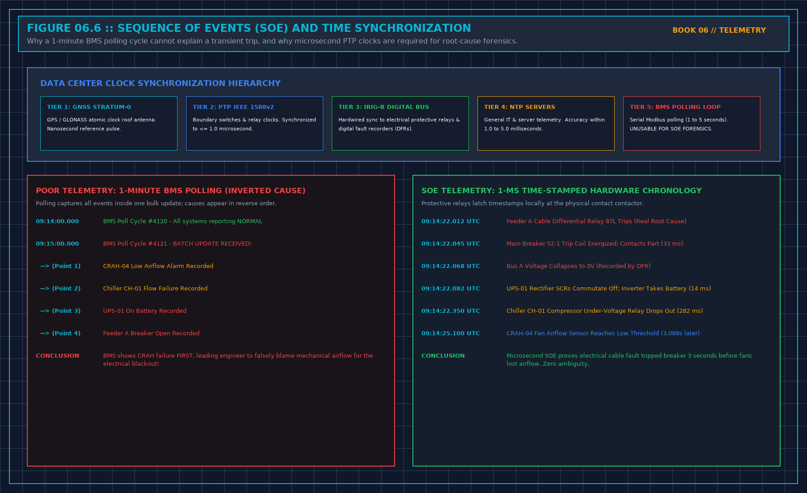

# 3. The Clock

In mission-critical data center operations, time is not a cosmetic label formatted for human readability; time is the primary coordinate of physical causality.

$$\Delta t = t_2 - t_1$$

If the clock on your Electrical Power Monitoring System (EPMS) drifts by even two seconds relative to the Building Management System (BMS), cause and effect will be mathematically inverted during post-incident forensics. A chiller electrical trip that caused a primary cooling flow collapse will appear in the combined logs as a cooling flow collapse that magically caused an upstream electrical trip three seconds before the breaker opened.

**TIME SYNCHRONIZATION ACCURACY ENVELOPE**

| Protocol / Standard S | ynchronization Precision Ta | rget Subsystems |
| :--- | :--- | :--- |
| IEEE 1588v2 (PTP) <= | 1.0 Microsecond (1 µs) Prot | ective Relays, DFRs |
| IRIG-B (Hardwired) <= | 10.0 Microseconds (10 µs) | MV Switchgear, Breakers |
| NTP Stratum-1 (GNSS) | <= 1.0 Millisecond (1 ms) B | MS Servers, RTUs, PLCs |
| Modbus Serial Polling | 1.0 to 5.0 Seconds (UNRATE | D) Field Sensors (No SOE) |

## Measurement Time vs. Ingestion Arrival Time

Every operational data point entering a database must record two distinct temporal timestamps:
1. **Measurement Timestamp (t_meas)**: The precise instant the physical transducer sampled the electrical current, temperature, or pressure at the edge controller.
2. **Ingestion Timestamp (t_ingest)**: The instant the central database server received, parsed, and committed the telemetry record to disk.

The difference between the two is the transmission latency skew:

$$\Delta t_{\text{skew}} = t_{\text{ingest}} - t_{\text{meas}}$$

A common architectural failure in cheap monitoring platforms is stamping telemetry exclusively with t_ingest at the database gateway. When network congestion, message queue backlogs, or database disk I/O bottlenecks delay message processing by thirty seconds, all telemetry packets arriving in that delayed burst receive identical ingestion timestamps.

When plotted on a graph, thirty seconds of dynamic physical transients collapse into a single vertical step, obscuring pump ramp-down curves, breaker trip sequences, and pressure shock waves.

Any system used for incident root-cause analysis must timestamp points at the edge transducer source (t_meas). Ingestion time (t_ingest) is an IT pipeline performance metric; it is not the time the plant changed.

## Sequence of Events (SOE) and Microsecond Resolution

In medium-voltage and low-voltage electrical switchgear, physical circuit breaker clearing events occur on the order of cycles (16.6 ms at 60 Hz, 20.0 ms at 50 Hz):
- A zone-selective interlocking (ZSI) restraint signal travels in 10 ms.
- A high-speed vacuum circuit breaker mechanism parts its primary contacts in 30 ms to 50 ms.
- An automatic transfer switch (ATS) detects voltage loss and signals generator cranking in 100 ms.

If your electrical monitoring architecture relies on a central SCADA server polling power meters over serial Modbus RTU at 5-second scan intervals, you do not have a Sequence of Events recording system. You have an historical ledger that tells you what already happened five seconds ago.

For critical electrical switchgear and generator paralleling buses, Sequence of Events (SOE) recording must be executed at the protective relay level using **IEEE 1588 Precision Time Protocol (PTP)** or dedicated **IRIG-B** optical timing distribution. Protective relays (e.g., SEL, ABB, Schneider) must latch event timestamps locally in non-volatile memory with **1-millisecond resolution** (1.0 ms) at the physical auxiliary contact bounce.

## Clock Skew, Drift, and Rejection of Artificial Merges

When auditing an incident involving multiple independent logging systems (e.g., utility revenue meters, mechanical chillers, server operating system syslog servers), verify the time synchronization source of each platform before attempting to correlate events.

If the mechanical chiller plant controller synchronizes via an unsynchronized internal crystal oscillator that drifts by 45 seconds per month, and the electrical switchgear synchronizes via a roof-mounted GPS antenna:
- **Do not average the clocks** to make the charts align aesthetically. Averaging two drifting clocks invents an imaginary third timeline that matches no physical reality.
- **Do not stretch or compress the timeline** using digital interpolation to force breaker trips to line up with water temperature spikes.
- Calculate the mathematically verified offset (Δt_offset) between the two systems at a known common physical anchor point (e.g., the exact millisecond utility grid power collapsed). Apply that constant offset explicitly as an annotated correction, or state in writing on the incident log: *"Thermal logs and electrical logs cannot be correlated with sub-minute precision due to uncalibrated clock drift."*

An explicit statement of temporal uncertainty is an honest engineering finding. An artificially manipulated chart is a falsification of telemetry evidence.

## Decisions to Record

- The primary synchronization standard (PTP / NTP Stratum-1 / IRIG-B) deployed for each subsystem.
- The verified clock drift tolerance (≤ 1.0 ms for electrical switchgear, ≤ 1.0 s for thermal BMS).
- The explicit separation between edge measurement timestamp (t_meas) and central database ingestion timestamp (t_ingest).
- Any observed clock offset between disjoint monitoring databases documented prior to joint forensic analysis.

## IEEE 1588v2 PTP vs. NTP Clock Skew Mathematics in Fault Reconstruction

During an electrical fault cascade, protective relays operate in $0.5$ to $3.0$ power cycles ($8.3\,\text{ms}$ to $50.0\,\text{ms}$ at $60\,\text{Hz}$). Suppose Main Breaker `52-M1` trips on instantaneous overcurrent at $t_0 = 0.000\,\text{s}$, causing UPS Static Bypass Switch `STS-01` to transfer at $t_1 = +0.004\,\text{s}$ ($+4.0\,\text{ms}$), and Downstream PDU Breaker `PDU-04` to drop under-voltage at $t_2 = +0.018\,\text{s}$ ($+18.0\,\text{ms}$).

If the switchgear IED and the UPS controller are polled over unsynchronized NTP or local RTC crystal oscillators with a relative clock skew of $\Delta t_{\text{skew}} = -45.0\,\text{ms}$, the historian records `PDU-04` tripping $27\,\text{ms}$ *before* `52-M1`! The incident review team will waste days tearing apart a healthy downstream PDU searching for a phantom short circuit.

$$\Delta t_{\text{SOE\_resolution}} \le \frac{1}{4} \min \left( t_{\text{relay\_pickup}}, \, t_{\text{STS\_transfer}} \right) \approx 1.0\,\text{ms}$$
