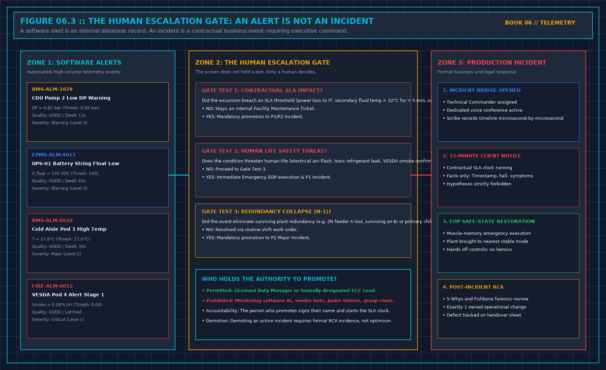

# 7. What a Page Must Contain

Waking an on-call engineer at 02:30 in the morning is a severe operational intervention. When a human being is ripped from deep sleep by an emergency pager or phone siren, their cognitive faculties are impaired by sleep inertia for at least five to ten minutes.

If the emergency page consists of a cryptic string of hexadecimal characters, a raw database error dump, a vague corporate slogan, or a five-page automated telemetry report, the engineer will spend crucial minutes trying to decipher what broke.

Every automated emergency page dispatched by a critical monitoring system must fit into **The Five Mandatory Lines**:

```
+-----------------------------------------------------------------------------+
| THE FIVE-LINE EMERGENCY PAGE |
| |
| LINE 1: EXACT TIME --> 2026-10-14 02:34:12 UTC (Source measurement t) |
| LINE 2: POINT & PATH --> CDU-04 TCS Supply Temp (modbus://cdu-04/40102) |
| LINE 3: THE VALUE/LINE --> T = 33.4°C (Exceeded High Alarm Line: 32.0°C) |
| LINE 4: PERSON WOKEN --> Lead Mech Engineer (Shift Roster Tier 1) |
| LINE 5: THE FIRST STOP --> Verify EOP-M-02 (CDU-04 Staging) & Confirm Live|
+-----------------------------------------------------------------------------+
```



If a page cannot deliver those five clean lines, the page must not be transmitted.

## Detailed Breakdown of the Five Lines

1. **Line 1: Exact Measurement Timestamp**:
 The exact UTC time the physical condition was sampled at the edge transducer, including date, minute, and second. Not the time the database server processed the message, and not a relative timestamp like *"5 minutes ago."*
2. **Line 2: Point Name and Hardware Origin Path**:
 The human-readable engineering tag from the mechanical or electrical drawings (`TT-CDU-101A`), followed immediately by the physical hardware address (`modbus://cdu-04/reg-40102`). The engineer must know the exact physical machine to walk toward.
3. **Line 3: The Active Value and the Line It Crossed**:
 The measured engineering value, its units, and the exact threshold that was violated:
 `Measured: 33.4°C | Threshold: 32.0°C (Dwell: 15s verified)`.
 Never transmit a generic message stating *"Temperature Alarm."* The engineer must know whether the value is creeping 0.5 K over warning, or screaming 15.0 K over catastrophic trip.
4. **Line 4: The Person Woken and Coverage Tier**:
 The specific individual's name and role from today's active shift roster:
 `Dispatched to: M. Vance (Lead Mechanical) | Roster Shift 2`.
 This eliminates ambiguity over who holds the active response obligation.
5. **Line 5: The First Look and the First Stop (EOP Action)**:
 The immediate, pre-engineered operational directive citing the site Emergency Operating Procedure:
 `Action: Confirm sensor LIVE; Execute EOP-M-02 (CDU Standby Pump Engagement). Hands off controls until safe state confirmed.`
 Do not include speculative diagnostic theories. Name the pre-approved safe-state action.

## What You Must Never Put in a Page

To preserve cognitive clarity and comply with strict information security requirements, never include the following items in an automated page:
- Passwords, API tokens, VPN credentials, or internal SSH connection strings.
- Complete network topology diagrams, internal IP addresses, or customer server hostnames.
- Unfiltered customer application logs, database stack traces, or memory dumps.
- Speculative root-cause hypotheses (e.g., *"We think the vendor broke the valve"*).
- Corporate marketing language, apology statements, or executive reassurances.

## The Mandatory Four-Part Reply

An emergency page is not closed when the engineer acknowledges the notification on their mobile phone. Clicking an "Acknowledge" button in an app simply proves that a finger touched glass; it does not prove the plant is safe.

Within fifteen minutes of receiving the page, the responding engineer must log **The Mandatory Four-Part Reply** into the central operations ledger:
1. **Timestamp Acknowledged**: The exact minute the engineer opened the telemetry console or arrived on the plant floor.
2. **Quality Verification**: Confirmation of whether the telemetry point was still reporting `LIVE` quality when inspected, or if it had dropped to `STALE` or `BAD`.
3. **Physical Reality Observed**: What the engineer saw on the ground (e.g., *"Local analog dial gauge on CDU-04 reads 0.45 MPa; mechanical seal dry; no fluid pooling"*), keeping physical observations strictly separated from speculative guesses.
4. **Escalation / Promotion Verdict**: Whether the event was resolved under standard operating procedures, or promoted to a formal P1/P2 Incident under the three promotion tests.

If the engineer fails to log the four-part reply within the contractual escalation window (typically 15 minutes), the monitoring engine automatically escalates the page to the next senior leader named on the roster.

## Decisions to Record

- The strict Five-Line message format enforced across all automated paging gateways.
- The active paging escalation ladder, defining names, phone numbers, and timeout windows.
- The Four-Part Reply protocol required from every responding engineer.
- The post-shift audit logging every emergency page transmitted and verifying compliance.
