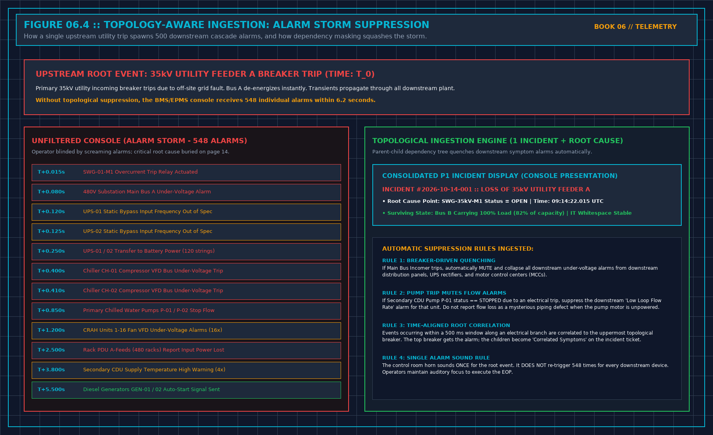

# 8. Many Alerts, One Event

When a major electrical or mechanical failure strikes a hyperscale data center, the supervisory console does not receive a polite, single notification stating *"Transformer 1 Tripped."*

Instead, within a six-second window, the console is hit by an explosive **Alarm Storm** of 500 to 2,000 cascading alarms:
- High-voltage switchgear reports breaker trip.
- 480V distribution boards report under-voltage.
- Uninterruptible power supplies report static bypass out of frequency.
- UPS battery strings report rapid high-rate discharge.
- Central chillers report compressor VFD DC-bus undervoltage shutdown.
- Primary chilled water pumps report loss of flow.
- Hundreds of computer room air handling (CRAH) units report fan failure.
- Thousands of server rack power distribution units report loss of A-feed input voltage.

```
+-----------------------------------------------------------------------------+
| TOPOLOGICAL ALARM STORM SUPPRESSION |
| |
| [UPSTREAM ROOT EVENT] 35kV Utility Feeder Breaker Trip (Time: T_0) |
| | |
| +---> [PARENT NODE] Main Incomer Breaker Open |
| | | |
| | v |
| | TOPOLOGICAL INGESTION ENGINE: Ingests parent event; |
| | ACTIVELY QUENCHES all downstream dependent symptom alarms: |
| | | |
| | +---x [SUPPRESSED] 480V Substation Under-Voltage |
| | +---x [SUPPRESSED] UPS Transfer to Battery (12 units) |
| | +---x [SUPPRESSED] Chiller Compressor Trips (4 units) |
| | +---x [SUPPRESSED] CRAH Fan Low Airflow (32 units) |
| | +---x [SUPPRESSED] Server Rack PDU A-Lost (480 racks) |
| | |
| v |
| [CONSOLIDATED DISPLAY] Single P1 Incident Ticket: "Feeder A Incomer Open" |
| Symptom count: 548 suppressed | Surviving: Bus B OK |
+-----------------------------------------------------------------------------+
```



An operator presented with 2,000 screaming alarm banners on five monitors is rendered cognitively blind. The critical root-cause alarm—the tripped utility feeder breaker—is buried on page 18 of the alarm list, while the operator fruitlessly attempts to silence hundreds of secondary fan alarms.

## The Principle of Topological Dependency Masking

A professional data center supervisory engine must implement **Topology-Aware Ingestion**:

$$E_{\text{child}} \prec E_{\text{parent}}$$

If an upstream physical parent node transitions into an unpowered or isolated state, the supervisory engine must **automatically quench and consolidate all downstream child symptom alarms**.

### Core Suppression Rules:
1. **Breaker-Driven Electrical Quenching**:
 When an electrical circuit breaker opens (e.g., `SWG-01-M1`), the monitoring engine identifies all downstream electrical panels, transformers, UPS rectifiers, and PDUs fed from that breaker bus. The system raises a single primary incident for the breaker trip; it mutes and collapses all downstream under-voltage alarms into a collapsible symptom list attached to the parent ticket.
2. **Pump-Driven Hydraulic Quenching**:
 When a primary chilled water pump trips on an electrical fault (`P-01 Status == STOPPED`), the engine immediately quenches the downstream *"P-01 Low Discharge Flow"* and *"P-01 Low Differential Pressure"* alarms. Reporting that an unpowered pump is failing to generate flow is noise. The alarm belongs to the pump motor trip, not the fluid flow.
3. **Chiller-Driven Thermal Quenching**:
 When a central chiller shuts down, downstream chilled water supply temperature alarms for that specific evaporator barrel are correlated directly to the chiller shutdown event.

Topological suppression reduces 500 chaotic alarms into **exactly one actionable incident ticket**.

## Time-Aligned Correlation Windows

Parent-child relationships must be evaluated within a strict, pre-calculated temporal correlation window:

$$\Delta t_{\text{correlation}} \le T_{\text{window}} \quad (\text{typically } 500\,\text{ms to } 2.0\,\text{s})$$

When an upstream electrical event occurs:
- All alarms occurring along that electrical branch within T_window are ingested into the correlation engine.
- The topological root (the highest breaker in the single-line diagram) is designated as the **Root Cause Candidate**.
- The control room horn sounds **exactly once**. It does not re-sound 500 times for every downstream branch breaker. Operators maintain cognitive composure to execute the Emergency Operating Procedure.

## Preserving the Count and the Audit Trail

Suppression does not mean deletion.
Muting downstream symptom alarms on the live operator console must never delete those records from the historical database.

The consolidated incident ticket displayed on the Duty Manager's workstation must display:
- **The Primary Root Event**: `INCIDENT #1049 :: 35kV Feeder A Breaker Trip (09:14:22 UTC)`.
- **The Correlated Symptom Count**: `548 Downstream Alarms Ingested & Collapsed`.
- **The Drill-Down Capability**: A single click allows the engineer to expand the ticket and inspect every individual millisecond timestamp, voltage decay curve, and relay trip flag across all 548 devices.

An operations manager who suppresses alarms by permanently disabling database logging has destroyed the legal and forensic record. An operations manager who uses topological dependency masking presents a clean, actionable screen to the operator while preserving full forensic fidelity in the archive.

## Decisions to Record

- The physical single-line diagrams (SLD) and mechanical P&IDs ingested into the topological correlation engine.
- The exact temporal correlation window (T_window = 2.0 s) configured for alarm storm collapsing.
- The rule mandating that control room sirens trigger once per topological incident rather than once per symptom.
- The audit verification confirming that all collapsed symptom alarms remain fully inspectable in the database.
