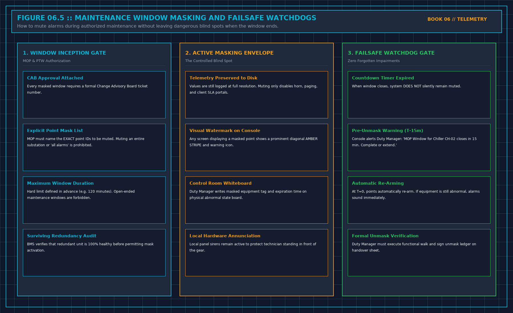

# 9. A Window You Already Opened

The second most common cause of catastrophic data center outages—behind changes called maintenance—is the forgotten alarm suppression window.

When technicians execute maintenance under an approved Method of Procedure (MOP) (e.g., overhauling a centrifugal chiller compressor, replacing a secondary CDU pump seal, or testing an emergency diesel generator), the equipment being serviced will generate continuous, violent alarm excursions.

To prevent these expected maintenance transients from sounding control room horns, triggering automated paging escalation ladders, or falsely penalizing contractual SLA availability metrics, the Duty Manager places the affected equipment points into **Maintenance Window Masking**.

| **MAINTENANCE WINDOW GOVERNANCE ENVELOPE** |
| :--- |
| [PRE-WINDOW GATE] |
| • Approved MOP & PTW Attached \| CAB Ticket Verified |
| • Explicit Point Mask List (Muting entire plant/hall is strictly forbidden) |
| • Countdown Timer Initialized (Hard ceiling: e.g. 120 minutes) |
| [DURING THE WINDOW] |
| • Telemetry fully recorded to disk; only horns and paging muted |
| • Workstation displays diagonal AMBER WATERMARK on masked screens |
| • Physical abnormal state whiteboard updated in central control room |
| [FAILSAFE WATCHDOG GATE] |
| • T - 15 min: Pre-Unmask Warning dispatched to Duty Manager console |
| • T = 0 min: Window EXPIRES; points automatically RE-ARM |
| • Duty Manager must sign physical unmask verification ledger |

A maintenance mask is a temporary, highly dangerous operational blind spot. If a maintenance window is opened without a hard expiration countdown, or if an engineer forgets to unmask the points when the shift ends, the facility operates in an unmonitored state.

Three days later, when that newly overhauled chiller experiences an oil pump seizure, the monitoring system remains completely silent because the alarm suppression was never removed.

## The Rules of Maintenance Masking

Every maintenance window masking operation must adhere to five mandatory structural constraints:

1. **Explicit Point Scope (No Wildcard Muting)**:
 The MOP must name the exact, individual point tags to be masked (e.g., `TT-CH-02-COND-OUT`, `PT-CH-02-OIL`). Muting an entire mechanical plant, an entire electrical substation, or using wildcard masks (`CH-02-*`) is strictly prohibited. If a technician is servicing the compressor oil pump, the evaporator freeze protection points must remain fully active.
2. **Hard Countdown Timers (No Open-Ended Windows)**:
 Every maintenance mask must possess an immutable, hard expiration timestamp (e.g., `Start: 10:00 UTC | End: 12:00 UTC`). An open-ended maintenance window with no pre-programmed expiration is an operational defect. The SCADA software must reject any mask configuration that lacks an end time.
3. **Telemetry Preserved to Disk**:
 Masking disables control room sirens, automated paging relays, and client SLA portal notifications. Masking **never** stops the logging of raw telemetry to disk. Every pressure pulsation, current spike, and valve transition during the maintenance window must be recorded at full resolution for post-maintenance commissioning review.
4. **Visual Watermarking on the Console**:
 Any workstation screen, mimic diagram, or dashboard displaying a point currently under maintenance masking must display a prominent, impossible-to-ignore visual indicator: a bold, diagonal amber-striped watermark across the tile with the text: `POINT UNDER MOP MASKING - EXPIRATION IN 42 MIN`.
5. **The Physical Whiteboard Interlock**:
 The Duty Manager must physically write the masked equipment tag, the MOP ticket number, and the exact expiration time on the central control room whiteboard before issuing the Permit to Work.

## The Failsafe Watchdog and Auto-Rearm

When the scheduled maintenance window reaches its pre-programmed end timestamp, the monitoring engine **must not silently remain masked**.

The system must execute a **Failsafe Watchdog Sequence**:
- **At T - 15 minutes**: The central console generates a high-priority yellow warning prompt to the Duty Manager: *"MOP Window for Chiller CH-02 expires in 15 minutes. Prepare for unmasking or submit formal CAB extension."*
- **At T = 0 (Expiration)**: The system automatically unmasks all suppressed points and re-arms all alarm rules.
- If the equipment is still opened, unpowered, or in an abnormal operating state when the window expires, **the alarms sound immediately**.

This design forces operational accountability. If the contractor is running behind schedule, they cannot quietly pack their tools and leave the facility in a broken, muted state. The manager must formally review the situation, verify plant safety, and explicitly authorize a window extension.

## Formal Post-Maintenance Unmask Verification

Before a maintenance ticket can be closed, the Duty Manager must execute a formal **Unmask Verification Walk**:
1. Verify that all temporary mechanical bypass hoses, electrical grounding clusters, and Lockout/Tagout (LOTO) padlocks have been removed.
2. Verify that equipment isolation valves have been returned to their normal operating positions and locked/car-sealed.
3. Observe the SCADA console as the equipment is re-energized and operated under live load for a minimum 30-minute dwell period.
4. Verify that all telemetry channels are reporting `LIVE (0x00)` quality with normal operating values.
5. Physically sign the unmasking ledger on the Master Day Sheet, documenting that the plant has returned to a fully monitored, fully redundant operational baseline.

## Decisions to Record

- The explicit registry of all points masked during the shift, linked to approved MOP ticket numbers.
- The hard start and expiration timestamps for every active maintenance window.
- The formal verification that all masked telemetry was recorded to disk at full resolution.
- The signed unmasking ledger confirming that all points were re-armed and verified live under load.
