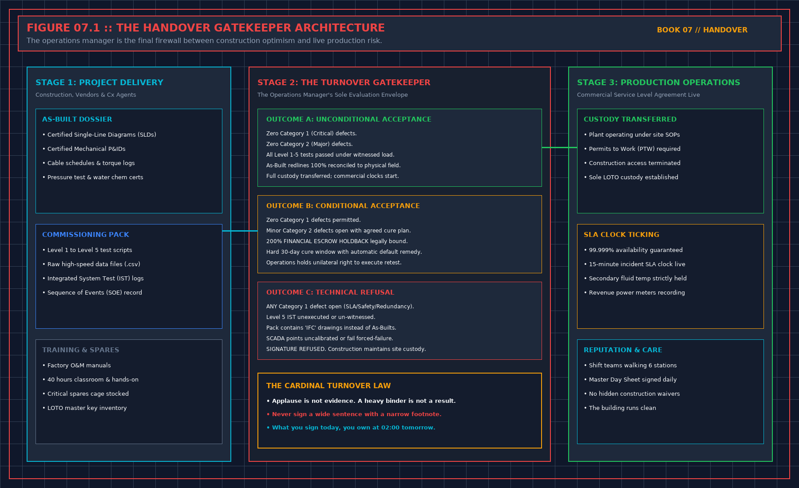

# 1. A signature is a sentence

People put three different acts under one word. A tester signs that a named scope was proved, not proved, or proved only for the systems named. An owner signs turnover for the scope that was actually run. An operator signs that they can run what was handed over, with the stops and the open items in view. This book is the third act. It may happen in the same meeting as the second. It is not the same sentence.

If the page in front of you says the building is commissioned, and the pack only ran a liquid verification in a finished hall, the page is wider than the evidence. You do not fix that by signing and adding a footnote nobody will read. You replace the sentence, or you refuse. A footnote under a wide sentence is how the wide sentence becomes the one the next person quotes.

Read the sentence before the meeting, not during the applause. If a lawyer needs to read it, the lawyer reads it before the meeting. The third book already said that about the tester's certificate. It is repeated here because the operator is the person most likely to be handed a pen at the end, when refusing feels like delay.

## What the sentence may say

A sentence you may sign names the scope, the date, and the limit. Proved for the systems named. Not proved for the levels that were not run. Open items listed, or an explicit none. The monitor accepted only for the points that passed a forced failure, or not accepted. The model accepted only as a picture, unless the measurement book was followed. Capacity left blank if the only number in the pack is a design value.

A sentence you may not sign says the hall is finished, the air is proved, the alarms are live, the staff are trained, or the capacity is the number on the drawing, unless each of those was evidenced in the way the earlier books require. Bundling them into "accepted" is the defect this book exists to stop.

Write your sentence in ink on the sheet, in words a stranger can compare to the page they asked you to sign. If the two do not match, you have not accepted their page. Say that in the meeting. Do not discover the mismatch in a later audit.

## Clocks you did not mean to start

A signature is sometimes the event that starts a warranty, a care period, or a payment. Those clocks are commercial. They are real, and they are not your evidence problem. Read them before the meeting so you are not surprised. Do not let them onto your sentence as the reason you accepted a missing sheet. If their page says acceptance and warranty in one paragraph, strike the acceptance words you cannot support and leave their commercial words for the person whose hat is commercial. Two pages are cleaner than one paragraph that makes a warranty depend on a lie about the file.

If you cannot strike, and the only page starts the clock only when you sign the wide sentence, you still do not sign the wide sentence. Their clock is their problem to redraft. Your name does not repair their form. Say that before the meeting, when there is time to split the page. Saying it during the applause is true and late. Late and true is still better than a false yes.

## Applause is not evidence

A meeting that ends on time is not a result. A pack that is heavy is not a result. A vendor who says the remaining items are minor has not closed them. Minor is a judgment you make after you have read the line, and only if you can operate with it open. If you cannot, it is not minor. It is a refusal.

Do not sign a page you have not read, including the attachments the page incorporates by reference. A sentence that says "including all appendices" incorporates the empty tabs too. Either you have seen them, or you strike the words. Striking words is allowed. Pretending you saw them is not.

## Legal & Technical Anatomy of the Three Handover Signatures

### Separating Commissioning Proof from Commercial Warranty Clocks

In institutional data center project delivery, the transition from construction and commissioning (ASHRAE Guideline 0 / Guideline 202 Levels 1 through 5) to live 24/7 operations is governed by measurable engineering gates rather than schedule milestones. Whenever a handover package asks the receiving operations lead to certify a plant attribute, that attribute must satisfy the quantitative gating relationship:

$$T_{\text{warranty\_start}} \neq T_{\text{operational\_acceptance}} \text{ when } N_{\text{Cat\_A}} > 0$$

If any supporting evidence file, witnessed test script, or as-built redline verification falls outside its acceptance corridor, the operations representative must either issue a formal **Notice of Handover Refusal** or execute a narrow **Conditional Acceptance with 200% Retainage Escrow** that explicitly bounds the permitted operating envelope until the defect is cured and re-tested.

| Handover Audit Dimension | Contractor / Project Team Submission | Operations Gatekeeper Verification Protocol | Mandatory Refusal or Escrow Action |
| :--- | :--- | :--- | :--- |
| **Primary Governance Focus** | Drafting the Bounded Operator Acceptance Sentence | Independent line-by-line audit against Volumes 01–06 criteria | Strike unsupported words from certificate before signing |
| **Quantitative Proof Standard** | Summary pass/fail cover sheet or verbal assurance | Raw 1-second telemetry CSV, signed witness sheet, and field walk | Classify missing proof as Category A/B defect on Refusal Sheet |
| **Financial & Operational Lever** | Request for 100% milestone release and full load | Enforce $200\%$ retainage holdback ($E = 2.0 \times C_{\text{fix}}$) and load cap | Hold plant at zero or derated load until remediation passes |
| **Post-Meeting Custody Rule** | Unfettered contractor access to finish open work | Transition space to Operations LOTO; require approved MOP per fix | Deny unescorted access; log all post-handover interventions |

## Decisions to record

- Their sentence, copied before you edit it.
- Your sentence, with scope, date, and limit.
- Words you struck, and that you said so in the meeting.
- Whether you are signing as operator, as owner, or refusing both.
- Warranty or payment clocks read, and kept off the sentence you sign.
