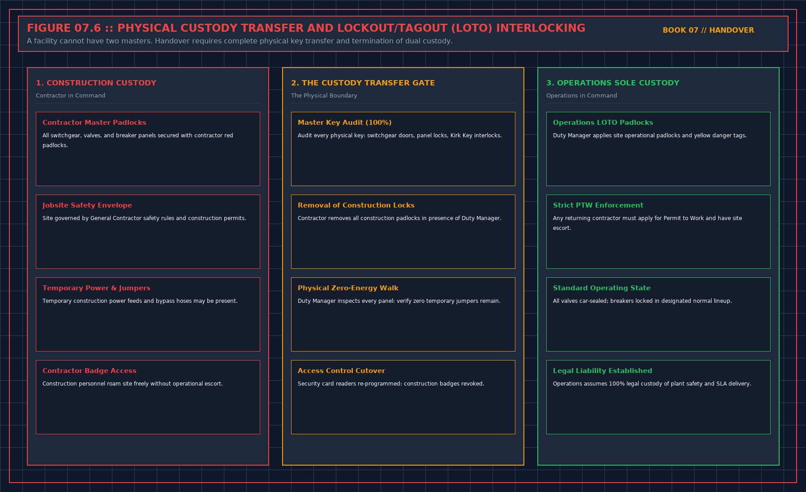

# 9. Slides are not a staff

If the sentence says the hall can be operated, the pack needs the pages the operator will use on a bad night, and a signature that those pages were shown to the people who will use them. A training slide deck is not that signature. A sign-in sheet for a slide deck is not that signature. The third book already said training, when the claim includes handing the plant to operators, is a signature that they were shown the operator pages. You check the pages, then the signature. If either is missing, you refuse the operated-sentence. You may still accept a narrower sentence that the plant was tested and the staff were not handed over. Those are different deliveries. Vendors bundle them because the slides are easy and the pages are not.

## The pages

The pages name what was tested, what was not, where the stops are, and what deviation is still in force. They do not name a person' s private number in a book that will be copied. Contacts stay in the site file. The stop is the first safe state, cited from their emergency paper, not pasted into this book and not invented in the meeting. If the pages have no stop, the staff have a tour, not a handover.

A page that only a specialist can follow will not be followed at night. If you cannot read the stop aloud, the page is not ready. This is the same test as the five lines on a page from the sixth book. A document that cannot be read aloud cannot be used asleep.

Deviations still in force are waivers. Chapter 8. If the operator pages do not list them, the staff will treat the plant as clean. That is a false document of a quieter kind. Refuse the pages until the deviations are on them.

## Spares

A spare is a part you will not start a named job without. It has a human name, a quantity, a place a second person can find, and an owner. A price list is not a spare list. A vendor catalog is not a spare list. A promise to deliver within a number of days is not a part on the shelf. If the job you will not start without the part is in the claim, and the part is not findable, you refuse the sentence that says you can run that job. You do not refuse the whole hall because a filter is on order, unless the job is the one the signature covers.

Do not paste their spare catalog into the pack you sign, and do not copy it here. Your sheet says whether the named job has its part, yes or no. Their part numbers stay in their file.

## Maintenance paper

An operations and maintenance document that exists only as a template with the project name typed on the cover is a missing sheet. You are not collecting manuals to fill a shelf. You are checking that the stops, the isolation, and the deviation are written where the night shift will look. If the manual contradicts the operator pages, the pages win until the manual is corrected, and you do not sign that the manual was handed over. Two documents that disagree are not a set. They are a dispute you would be accepting.

## Decisions to record

- Operated-sentence refused, or staff-handover split from plant-tested.
- Operator pages readable aloud, stops present, deviations listed. Or refused.
- Named job whose spare is missing, sentence for that job refused.
- Manual that contradicts the pages, not signed as handed over.

