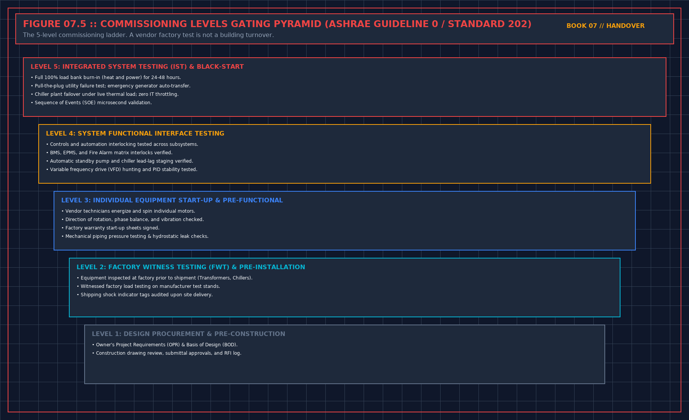

# 10. The certificate must match the map

The third book keeps two numberings apart. The certificate pack's Level 1 is factory testing. A landed dialect that calls static acceptance Level 1 is not that certificate. Close-out is Level 6. A heat-test report is not a turnover certificate. You do not reteach the seven levels. You refuse any page that files a result in the wrong slot, and any page that says the building is commissioned when the map shows levels that were not run.

Ask for the map first. Issued, attached from earlier work, refused. If they hand you certificates without the map, you cannot tell a refused level from a missing tab. Chapter 3. Treat the certificates as unread until the map exists. Unread is not accepted.

## Wrong slot

A static-day report in the factory slot is a false certificate, even if the static day was honest. You refuse the certificate, not the static day. The static day can still support a narrower sentence, under the level it actually was. Say which. Do not make them reprint the whole pack in the meeting. Make them strike the wrong title before you sign anything that points at that tab.

A heat report filed as turnover is the same defect. Turnover is the later signature, after the punch on the levels they actually ran is closed, and after the map says which levels they did not run. If they want both signatures today, the turnover sentence has to be as narrow as the map. "Level 6 complete" is not available when Level 6's work is the meeting you are still in, and the punch is open.

Attached certificates from earlier work are only as good as their scope. A factory certificate for a machine that is not this machine, or for a revision that is not this revision, is not attached work. It is a borrowed sheet. Chapter 3. You refuse the attachment. You do not need to reopen the factory. You need the words on the certificate to name what you have.

## What "commissioned" may mean

It may mean the levels named on the map were signed, with the limits written. It may not mean every system in the building, every season, every code chapter, or every alarm. If their sentence uses the word commissioned, you either define it as the map, in the same sentence, or you strike the word. Leaving it undefined is how a later reader imports the long list you correctly did not demand.

You may sign that named levels were not run, and that you are not claiming them. That sentence is useful. It stops the next person from assuming silence means pass. Write it even if they did not ask. A map that hides the refused levels is a brochure. Your sentence puts them back.

## Reconciling Commissioning Level Numbering Systems (L1–L5)

### Preventing Factory Witness Certificates from Posing as Site IST

In institutional data center project delivery, the transition from construction and commissioning (ASHRAE Guideline 0 / Guideline 202 Levels 1 through 5) to live 24/7 operations is governed by measurable engineering gates rather than schedule milestones. Whenever a handover package asks the receiving operations lead to certify a plant attribute, that attribute must satisfy the quantitative gating relationship:

$$\text{Level}_{\text{site}}(k) \leftrightarrow \text{ASHRAE Guideline 0 / 202 Stage } k$$

If any supporting evidence file, witnessed test script, or as-built redline verification falls outside its acceptance corridor, the operations representative must either issue a formal **Notice of Handover Refusal** or execute a narrow **Conditional Acceptance with 200% Retainage Escrow** that explicitly bounds the permitted operating envelope until the defect is cured and re-tested.

| Handover Audit Dimension | Contractor / Project Team Submission | Operations Gatekeeper Verification Protocol | Mandatory Refusal or Escrow Action |
| :--- | :--- | :--- | :--- |
| **Primary Governance Focus** | Auditing the Certificate-to-Level Map Across All Subsystems | Independent line-by-line audit against Volumes 01–06 criteria | Strike unsupported words from certificate before signing |
| **Quantitative Proof Standard** | Summary pass/fail cover sheet or verbal assurance | Raw 1-second telemetry CSV, signed witness sheet, and field walk | Classify missing proof as Category A/B defect on Refusal Sheet |
| **Financial & Operational Lever** | Request for 100% milestone release and full load | Enforce $200\%$ retainage holdback ($E = 2.0 \times C_{\text{fix}}$) and load cap | Hold plant at zero or derated load until remediation passes |
| **Post-Meeting Custody Rule** | Unfettered contractor access to finish open work | Transition space to Operations LOTO; require approved MOP per fix | Deny unescorted access; log all post-handover interventions |

## Decisions to record

- Map present: issued, attached, refused. Or certificates unread.
- Wrong-slot titles struck before any signature that points at them.
- The word commissioned defined as the map, or struck.
- Levels not run, written in your sentence, not left as silence.

