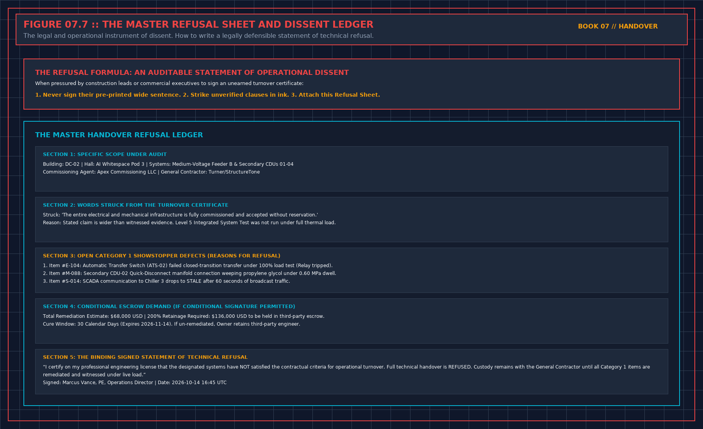

# 15. The refusal sheet

Copy the headings. Fill them before you pick up the pen, not from memory after you have signed. A sheet completed after the signature is a story. The blank sheet is also in `sheets/refusal.md`. Chapter 14 is the shape of a meeting. Do not paste that chapter into a site file and change the names.

## Their page

- Their sentence, copied before you edit it:
- Words you will strike:
- Attachments that sentence incorporates, and whether you have read them: Y / N
- If N, you do not sign.

## Your hat and your name

- Hat in this meeting: reader and signer / tester. Not both in the same hour.
- Name allowed to sign the operator's sentence, written before the meeting:
- You are that person, or you leave the page unsigned:

## The gates

- File judgment present, and the proved-sentence matches it: Y / N. If N, heat-proved is refused.
- Kinder summary offered: not signed.
- Model: picture only / measurement sheet present. Airflow-proved only if the sheet exists.
- Limit copied from a slide or an unread title: refused.
- Points that would wake a person: forced failure on this image, clock, quality sentence, line written before the night: Y / N.
- If N, the monitor is installed, not accepted. Those points do not page.
- Score kept out of the signature: Y
- Capacity cell: measured and live, or blank. Design is not inside the cell.
- Redundancy proved by a test of remaining capacity: Y / N. If N, that sentence is refused.

## The pack

- Level map: issued, attached, refused. Or certificates unread.
- Wrong-slot titles struck before you sign anything that cites them: Y / N
- The word commissioned defined as the map, or struck:
- Punch print matches page two: Y / N. If N, page two is refused.
- Open lines that block a proved-sentence, by function:
- Waivers you can operate, with what you will do if the defect appears, and an end: or refused.
- Witnessed, accepted as a document, or not done, for each script you are asked to treat as proved:
- Operator pages readable aloud, stops present, deviations listed: Y / N
- If N, staff-handover is refused. Plant-tested may still be a separate sentence.
- Named job whose spare is missing: that job's sentence refused.
- Second person who can open the backups: named, or the pack is refused.

## The two sentences

- The sentence you will sign, with scope, date, and limit:
- The sentence you will not sign:
- Both in the same document: Y / N. If N, you sign nothing.
- What you will not do on the next working day on the strength of this meeting:
- Each open condition: party, evidence that closes it, date it expires into refusal. Not into acceptance.
- A gate you refused to turn into "subject to":

## Drawings and custody

- Design, shop, and as-built told apart: Y / N. If N, the drawing does not support a proved-sentence.
- As-built check dated after the last change your sentence depends on: Y / N / not accepted as current.
- Isolation a second person on your side can reach: Y / N. If N, operated-sentence refused.
- Tools and temporary plant you are not taking, owner and end date: or none left.
- Bypass or drum with no sheet: that loop or that program refused.

## The day after

- Prohibitions written the same day: Y
- Person who watches each expiry date:
- A quiet week will not be treated as a close: Y

## After

- Schedule and cost kept off this page: Y
- Their identifiers, logs, and drawings left in their file: Y

## The Master Handover Refusal & Conditional Acceptance Ledger

### Twelve Mandatory Audit Fields Required Before Picking Up the Pen

In institutional data center project delivery, the transition from construction and commissioning (ASHRAE Guideline 0 / Guideline 202 Levels 1 through 5) to live 24/7 operations is governed by measurable engineering gates rather than schedule milestones. Whenever a handover package asks the receiving operations lead to certify a plant attribute, that attribute must satisfy the quantitative gating relationship:

$$\forall k \in \{1..12\}: \text{Field}_k \neq \text{Blank} \implies \text{Eligible for Signature}$$

If any supporting evidence file, witnessed test script, or as-built redline verification falls outside its acceptance corridor, the operations representative must either issue a formal **Notice of Handover Refusal** or execute a narrow **Conditional Acceptance with 200% Retainage Escrow** that explicitly bounds the permitted operating envelope until the defect is cured and re-tested.

| Handover Audit Dimension | Contractor / Project Team Submission | Operations Gatekeeper Verification Protocol | Mandatory Refusal or Escrow Action |
| :--- | :--- | :--- | :--- |
| **Primary Governance Focus** | Filing the Completed Sheet in Both Project and Operations Archives | Independent line-by-line audit against Volumes 01–06 criteria | Strike unsupported words from certificate before signing |
| **Quantitative Proof Standard** | Summary pass/fail cover sheet or verbal assurance | Raw 1-second telemetry CSV, signed witness sheet, and field walk | Classify missing proof as Category A/B defect on Refusal Sheet |
| **Financial & Operational Lever** | Request for 100% milestone release and full load | Enforce $200\%$ retainage holdback ($E = 2.0 \times C_{\text{fix}}$) and load cap | Hold plant at zero or derated load until remediation passes |
| **Post-Meeting Custody Rule** | Unfettered contractor access to finish open work | Transition space to Operations LOTO; require approved MOP per fix | Deny unescorted access; log all post-handover interventions |
