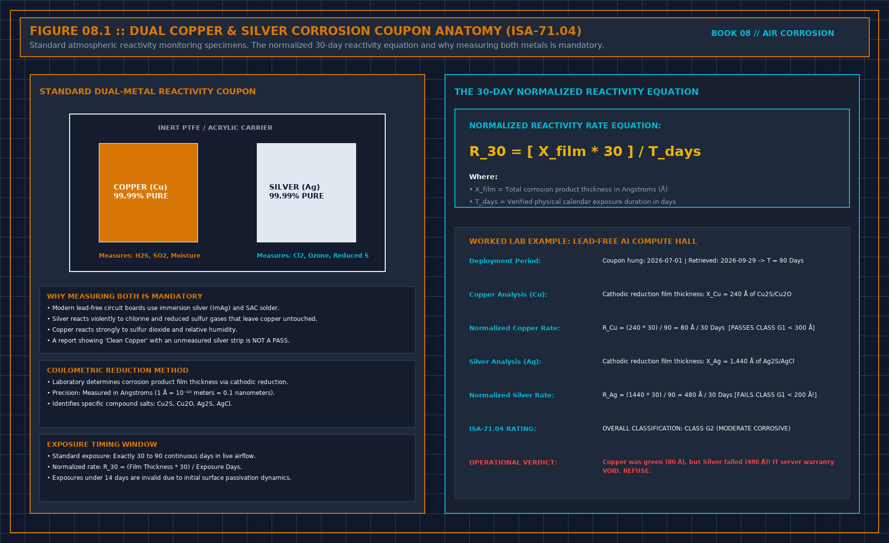

# 0. How to use this piece

This piece is for the person who must decide whether the air in a hall is attacking the boards. The attack is gas on metal, not dust on a filter, and not rust in a water pipe. Those are other problems. They do not get this sheet.

It is not a product brochure. It is not a course slide. It is not a customer's coupon report rewritten in cleaner English. The method is the one used when a room looked treated and the silver still moved: hang a coupon where the boards live, keep it there long enough to see the season, seal the leaks before you buy a machine, and treat the air that enters, or do not claim the room is held.

A standard may already name the severity classes. Cite the edition. Do not paste the table, and do not invent a class from a photograph of a tarnished strip. The number comes from the report you are allowed to use. This piece does not contain one.

When you finish, you should be able to hand over one coupon sheet. It names the metal, the place, the start, the end, who read it, and the sentence you are allowed to write. The sheet is in chapter 9. If a vendor is already in the room with a before-and-after picture, start at chapter 8. If they are selling media, start at chapter 14, then chapter 15. The gas families, without a concentration table, are chapter 12. How to read the lab pdf is chapter 13. The blank that has to travel with the strip is chapter 19. The shift, after you refuse the class, is chapter 20. When to hang again, without a magic number of days, is chapter 21.

```
+-----------------------------------------------------------------------------+
| ATMOSPHERIC CORROSION GATING PIPELINE |
| |
| [OUTDOOR SMOG] ---> [CHEMICAL SCRUBBERS] ---> [DATA HALL WHITESPACE] |
| H2S, SO2, NOx, Cl2 Carbon & Permanganate Positive Pressure: +20 Pa |
| Breakthrough <= 5% Class G1: Cu < 300Å, Ag<200Å|
+-----------------------------------------------------------------------------+
```



## What you may copy

You may copy the sheet headings. You may not paste a sentence from this piece into a customer's procedure and call it their limit. Their report, their media, and their room names stay in their file.

## Decisions to record

- The sentence this coupon is allowed to support.
- The metal you will not ignore because the other metal looked calm.
- The makeup path you have not treated, if you are about to claim the room is held.
