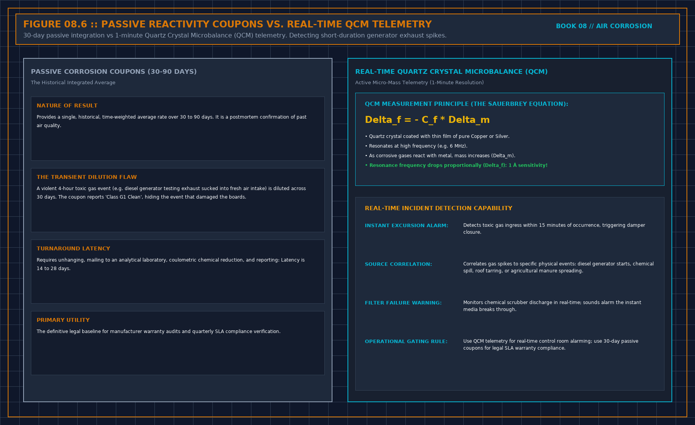

# 7. A live box is not a coupon

A real-time corrosion box is a point. The sixth book already said when a point may speak: a clock, a quality mark, a source path, a line written before the night, and a forced failure on the image you will run. Until those exist, the box may be watched. It may not page, and it may not close a coupon sentence.

The box and the coupon are not the same measurement even when both are honest. The coupon is metal that sat in the air for the whole interval. The box is a signal sampled on its own interval, often from a different place, often with a different metal or a different proxy. Write both sentences. Do not average them into one class. If they disagree, you have a disagreement, not a pass. The walked coupon, read by a method you accept, wins for the interval it covered, until you understand the box. The box does not win by being automatic. That is the same rule the fourth book used for a model and the sixth used for a screen.

## What the box is for

It is for the week you cannot wait to see. A loud week, a door left open, a bed that failed, a fire, a street event. It can tell you to go look, if it has been accepted as a point. It cannot tell you the class for the year. The year is still the coupon that was there.

A box in the discharge of the treatment unit has the same limit as a coupon there. It proves the unit's outlet, not the board face. Put the one you will obey where the claim is. If you only have one box, write the sentence it does not support.

Do not let the box's vendor set the severity class inside a black box and then page you. A class you cannot tie to a named method is a mood. Chapter 6 of the monitor book refused a score that hides its inputs. This is that score, wearing a metal. If the box will not say, in one sentence, what it is measuring and what stale means, it does not wake anyone.

## Forced failure

Stop its output on purpose, the way you stop a poll. The screen must show a gap, or show stale and refuse to page. A box that holds the last rate forward with a new time has failed acceptance. Corrosion boxes are especially tempting to hold forward, because the last rate looks like a calm room. Calm and stale are different. Stale does not prove the air recovered. It proves the box stopped talking.

## Decisions to record

- Box accepted as a point under the sixth book, or watch-only.
- Coupon sentence and box sentence kept apart. Disagreement not averaged.
- Place matched to the claim. Discharge is not the board.
- Forced failure done, or the box does not page.

