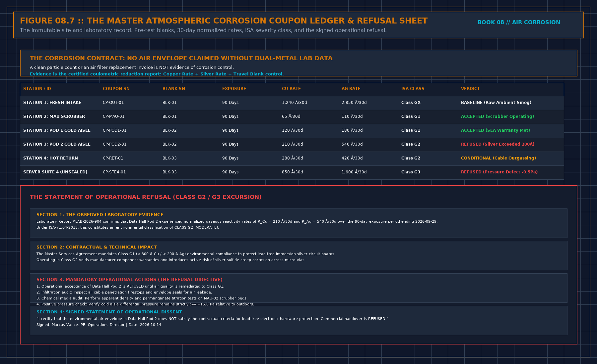

# Coupon sheet

One sheet per coupon that might support a sentence. No place, no start, no end: not a result.

## The strip

- Metal: copper / silver / other. Other does not replace the pair.
- Function of the place: board face / supply / return / makeup before / makeup after / unit discharge
- If discharge: this does not support the room sentence.
- Start, end. Not the day the report arrived.
- Who hung it. Who read it.
- Vendor-only read is a hypothesis, not the customer sentence, unless a second read agrees: Y / N
- Hang time visible on the report: Y / N. If N, rate not used.
- Moved, taken down, or left up across a seal or a treatment change: Y / N. If Y, rate not used for the after sentence.

## The pair and the season

- The other metal, same place and interval, filed: Y / N. If N, joints not claimed.
- Outside or makeup-before coupon filed: Y / N. If N, source not known.
- Interval includes the season when makeup is highest: Y / N. If N, annual sentence refused.
- Conditions recorded if you intend to explain a change: Y / N. If N, no weather story.

## The building

- Uncontrolled holes closed, dated against this interval: Y / N / not this job
- Intended paths named: door, makeup, relief.
- Life-safety path left open and treated as a source, not marked closed: Y / N / none
- Makeup treated, air going through not around, before the after coupon started: Y / N
- If N, "room held" refused.
- Bypass listed as a source: Y / N / no bypass
- Media target gas stated by them: Y / N. If N, box not accepted as treatment.

## The live box, if any

- Accepted under the point rules, including a forced failure: Y / N. If N, watch-only, does not page.
- Sentence kept apart from the coupon: Y
- Disagreement not averaged: Y

## The media, if a box is in the claim

- Category: plain carbon / impregnated / blend / oxidizing / not stated
- Family claimed, tied to which metal: or unnamed. Unnamed is not corrosion control.
- Path: makeup / recirculation / both. Fan named: Y / N. If N, bed not on a path.
- Bypass and wet answers written: Y / N. If N, those claims refused.
- Spent definition written before install, and it is not color: Y / N
- Handling procedure cited by title: Y / N. If N, change-out is not your job to improvise.
- Formula, percentage, bed depth left in their file, not copied: Y
- Drawing line treated as proposal until air goes through the bed: Y
- Blank from the same lot reported separately: Y / N. If N, no fit class.
- Next hang owned by a person, dated before the event that ends trust:

## The sentence

- Report names a class and cites the edition: Y / N. If N, you do not write a class.
- Sentence you will sign:
- Sentence you will not sign:
- Both limits in the same document: Y / N. If N, sign nothing.

