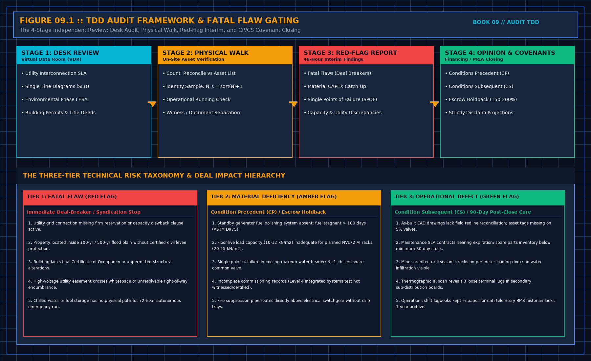

# 1. What this visit is

A technical due diligence is a reading of technical risk against a contract, done by someone who does not own the plant and will not operate it. The reader is usually a lender, sometimes a buyer. They need to know whether the thing they are financing can do the job the papers say, and what happens if a named assumption fails. They do not need a second design, and they do not need you to be enthusiastic.

Three principles are enough. You are independent of the parties. You follow risk to a delivery node or to later operation, not every interesting detail. You check compliance by citing the title the contract already names, not by pasting the standard. If a finding does not change a delivery date, a contracted performance, a permit, or the ability to operate, it is a note. Notes may be filed. They do not get the tone of a red flag.

You will be asked to certify things the financing documents name. Read that list before you travel. A certification you did not see in the engagement is not yours to invent on site. A certification you cannot evidence is refused, in the same document as any yes. The handover book already required that shape. It applies here with a lender in the room instead of an operator.

## What the visit is not

It is not a market essay. A paragraph about regional demand, geopolitics, or how competitive the platform "feels" is not a technical finding. If the engagement asks for obsolescence risk, you write what the contract assumes about the equipment generation, and whether a supply agreement covers a shortfall. You do not write a forecast. Counsel reads the warranty. You say whether the technical assumption inside it is evidenced.

It is not a commissioning. You do not issue levels. You may read a level map if one exists, and say whether the words match the tests. The third book owns how those levels are numbered. You do not reteach them in the lender's report.

It is not a safety inspection you are not qualified to sign, and it is not a legal opinion. Permits are confirmed with counsel, from the documents they accept. You do not bless a filing because the cover looks official.

## The four-stage review and the risk taxonomy

Every technical due diligence operates along a disciplined four-stage pipeline. Conflating stages or delivering an informal verdict at the curb destroys the legal insulation of the technical opinion:

1. **Stage 1: Desk Review and Virtual Data Room (VDR) Audit**: Inspect utility interconnection agreements, firm capacity reservations, Single-Line Diagrams (SLD), civil hydrology studies, building permits, Certificate of Occupancy, Phase I Environmental Site Assessments (ESA), and equipment maintenance logs.
2. **Stage 2: Physical Site Walk and Asset Verification**: Execute the four core acts—Count against inventory, sample identity under the pre-written rule (N_sample = √N + 1), sample running operational state, and verify test documentation without confusing pass certificates with witnessed tests.
3. **Stage 3: Interim Red-Flag Report (48-Hour Turnaround)**: Deliver an early, numbered ledger identifying deal-breakers, unmitigated single points of failure (SPOF), and material capital expenditure (CAPEX) catch-up requirements.
4. **Stage 4: Final Technical Opinion and Financing Covenants**: Formulate enforceable Conditions Precedent (CP) required prior to initial debt drawdown, Conditions Subsequent (CS) post-closing cure milestones, and formal escrow holdbacks (150%–200% of remediation cost).

Findings are rigorously segregated into a three-tier hierarchy:
- **Tier 1: Fatal Flaw (Red Flag)**: Unresolvable utility clawbacks, location within unmitigated 100-year/500-year flood plains, lack of fundamental zoning or occupancy permits, unresolvable right-of-way encumbrances, or total absence of emergency autonomous run paths. Halts debt syndication immediately.
- **Tier 2: Material Deficiency (Amber Flag)**: Degraded fuel without polishing, floor loading deficits for dense AI racks, single-header cooling vulnerabilities, or incomplete integrated systems commissioning. Handled via mandatory Conditions Precedent and financial escrow holdbacks.
- **Tier 3: Operational Defect (Green Flag)**: Redline drawing reconciliation backlog, minor maintenance contract renewal gaps, or cosmetic non-structural defects. Resolved under Conditions Subsequent within a 90-day post-closing cure window.

## Quantitative Risk Scoring and Deal-Breaker Thresholds in Technical Due Diligence

During Stage 1 through Stage 4 of the Technical Due Diligence, every physical observation is scored against its unmitigated Single-Point-of-Failure ($\text{SPOF}$) probability and capital remediation cost ($C_{\text{remedy}}$):

$$\text{Risk Exposure}_{k} = P_{\text{failure}, k} \times \left( C_{\text{SLA\_penalty}} + C_{\text{remedy}, k} \right)$$

| TDD Risk Classification Tier | Technical Trigger Criterion | Required Financial / Legal Covenant Action | Sign-Off Owner |
| :--- | :--- | :--- | :--- |
| **Tier 1: Fatal Flaw (Red Flag)** | Unmitigated 500-yr flood plain, missing grid easement, structural slab overload | Immediate halt to debt drawdown / deal exclusivity | Investment Committee |
| **Tier 2: Material Deficiency (Amber)** | N+1 cooling shortfall at $99.6\%$ wet-bulb, unpolished fuel, missing IST | Mandatory Condition Precedent (CP) + $150\%\text{--}200\%$ Cash Escrow | Lead Technical Advisor + Counsel |
| **Tier 3: Operational Defect (Green)** | As-built redline backlog, minor PM log gaps, cosmetic seal wear | Condition Subsequent (CS) cured within $90\,\text{days}$ post-close | Asset Management / Operations |

## Decisions to record

- Reader: lender, buyer, or other. Named in the engagement, not guessed.
- Certifications the financing documents require, listed before travel.
- The 4-stage timeline agreed in the engagement letter.
- Market language strictly excised from the technical opinion.
