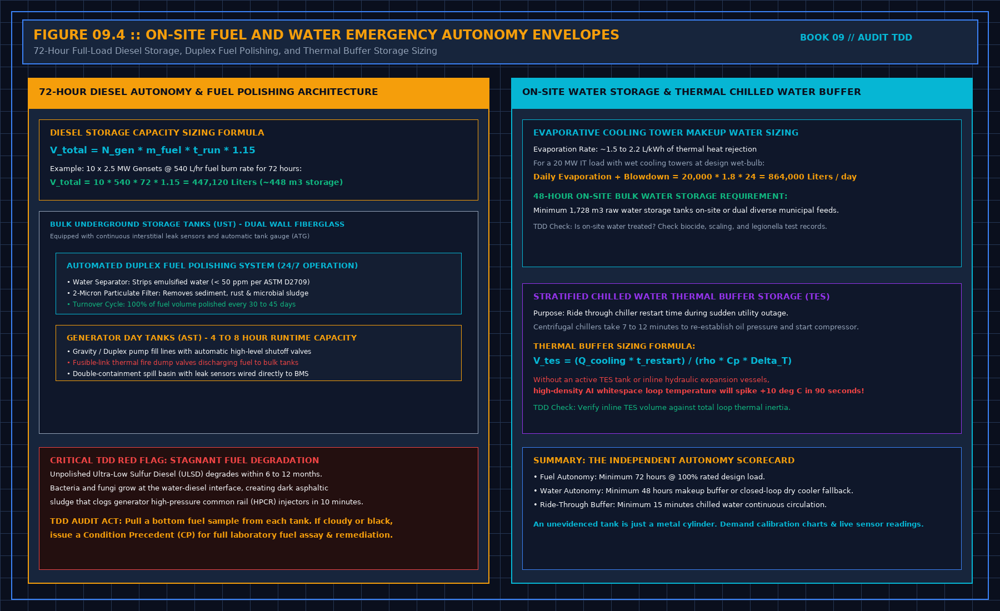

# 8. The plant, as classes of risk

You are not redrawing the single line. You are asking whether the class of risk the contract assumes is the class you can see, and whether a failure of that class has a path that does not depend on a speech.

Power: is there a second path for the equipment in scope, and is it evidenced by a drawing you accept as current plus a test document, or only by a speech? A ring, a second feed, a generator, a battery duration, are names. They become findings only when a document says they were tested, or you saw the test. A duration printed on a UPS brochure is not the test. Design kilowatts are not the operating load. The day book already refused that cell. Do not fill it here to look complete.

Cooling: condensate that can reach equipment is a risk you can see. Makeup water that has one source and no stored volume is a risk you can ask about. You do not need their pipe sizes in the report. You need the path, and whether a second source or a tank is a document or a hope.

Controls and leaks of air and water follow the same split. A screen that is green is not a handover of the monitor. If the financing depends on alarms, the points that would wake someone need the acceptance the monitor book already defined, or you write that the screen is installed and not accepted.

Write risks as: what fails, who owes the response, what you saw, what is only a document. A risk with no owner is the finding. A risk they call minor is not sized by the adjective. If it can stop the contracted performance, it is not minor.

## Emergency fuel and water autonomy envelopes

A facility that claims Tier III or Tier IV concurrently maintainable autonomy must maintain physical, unshared on-site storage envelopes capable of sustaining 100% full-load operations during a catastrophic grid or municipal water collapse:

### 1. Emergency diesel storage and fuel quality physics

The total fuel storage envelope must satisfy a minimum 72-hour full-load runtime under continuous emergency generation, augmented by an industry-standard 15% safety ullage margin:

$$V_{\text{fuel}} = N_{\text{gen}} \times \dot{m}_{\text{fuel}} \times t_{\text{run}} \times 1.15$$

For a 20 MW IT facility supported by 10 standby diesel generators (2.5 MVA each, consuming approximately 540 L/h at full load), the mandatory 72-hour on-site reserve is:

$$V_{\text{fuel}} = 10 \times 540\,\text{L/h} \times 72\,\text{h} \times 1.15 = 447,120\,\text{liters} \quad (\approx 448\,\text{m}^3)$$

A bulk tank alone does not guarantee electrical survival. Modern Ultra-Low Sulfur Diesel (ULSD) is hygroscopic and degrades rapidly in quiescent underground tanks (UST). Condensation creates a water-hydrocarbon interface where anaerobic microbes (*Cladosporium resinae*) flourish, metabolizing sulfur and generating asphaltic particulate sludge. 

During a grid blackout, fuel transfer pumps draw this bottom sludge directly into engine fuel rails. High-pressure common rail (HPCR) diesel injectors operating at 2,000 bar foul and seize within 10 to 15 minutes of startup.

**The TDD Audit Verification**:
1. Check for an automated duplex fuel polishing system operating 24/7. It must incorporate a primary centrifugal coalescer stripping free/emulsified water down to < 50 ppm (ASTM D2709), followed by a 2-micron particulate filter.
2. Confirm the system achieves 100% tank volume turnover every 30 to 45 days.
3. Draw a physical bottom thief sample from each bulk tank during the walk. If the fuel is cloudy, dark, or exhibits biological particulate matter, log a mandatory Tier 2 Condition Precedent requiring full laboratory ASTM D975 fuel assay and remediation prior to closing.

### 2. Evaporative cooling water and thermal ride-through buffer

Evaporative cooling towers reject approximately 1.5–2.2 liters of makeup water per kilowatt-hour of heat rejection (accounting for evaporation, drift, and cycles of concentration blowdown). A 20 MW facility consumes up to 864,000 liters per day (864 m³/day). The TDD auditor must verify a certified 48-hour on-site bulk raw water storage reserve (≥ 1,728 m³) or two independent, geographically diverse municipal water utility mains entering from separate rights-of-way.

Furthermore, centrifugal chillers require 7 to 12 minutes (t_restart) to restart compressors and establish refrigerant oil differential pressure following an electrical transfer transient. In high-density AI clusters, IT liquid loops heat up at rates exceeding +0.15°C/second; without active thermal buffering, coolant supply temperatures breach maximum limits (>35°C) in less than 90 seconds.

The required stratified chilled water Thermal Energy Storage (TES) volume is governed by:

$$V_{\text{tes}} = \frac{Q_{\text{cooling}} \times t_{\text{restart}}}{\rho \times C_p \times \Delta T}$$

Where:
- Q_cooling is the peak critical cooling load (kW).
- t_restart is the certified chiller restart and pull-down latency (seconds).
- ρ is water density (1,000 kg/m³).
- C_p is specific heat capacity (4.186 kJ/kg·°C).
- ΔT is the allowable temperature rise across the thermal buffer before IT thermal throttling occurs (typically 4–6°C).

If the facility lacks an inline stratified TES tank or continuous secondary loop volume sized to this equation, log an unmitigated thermal single point of failure.

## Decisions to record

- Power path: tested, documented, or spoken. Spoken is not accepted.
- 72-hour diesel storage volume reconciled against generator burn rates and 1.15 safety margin.
- Duplex fuel polishing system installed, running, and documented against ASTM D2709 / ASTM D975.
- Water makeup autonomy: 48-hour on-site bulk storage evidenced or diverse utility mains verified.
- Chilled water thermal storage buffer (TES) sized for full chiller restart duration.
- Alarms the financing depends on: accepted as points, or installed only.
- Design load kept out of the operating cell.
