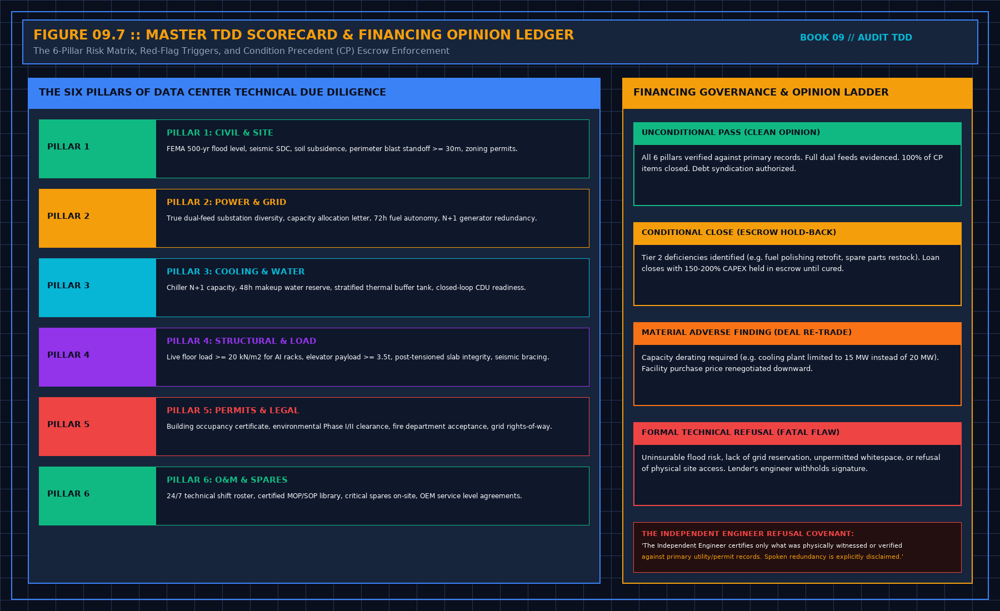

# 14. The visit sheet

Copy the headings. Fill them before you sign the opinion, not after counsel has started to quote it. The blank sheet is also in `sheets/visit.md`.

## The master TDD scorecard and financing opinion governance

A technical opinion rendered to an institutional lender or infrastructure buyer is not an informal technical narrative. It is an auditable legal instrument that directly underwrites syndicated debt or equity investment:

The assessment is anchored on Six Critical Pillars:
1. **Civil & Site**: FEMA 500-year Base Flood Elevation compliance (+1.0–1.5 m clearance), seismic SDC lateral restraints, soil subsidence surveys, perimeter blast standoff (≥ 30 m), and clear zoning use permits.
2. **Power & Grid**: True transmission substation physical diversity, uncurtailable firm capacity reservation letters, 72-hour on-site fuel autonomy with duplex polishing, and N+1 concurrently maintainable standby generation.
3. **Cooling & Water**: Concurrently maintainable chiller plant (N+1 / 2N), 48-hour on-site makeup water storage, stratified chilled water thermal energy storage buffer (TES) covering 7–12 min chiller restart latency, and closed-loop liquid CDU readiness.
4. **Structural & Space**: Floor live load rating ≥ 20 kN/m² for dense liquid-cooled AI racks, concentrated caster point loading ≥ 15 kN, heavy freight elevator capacity ≥ 3,500 kg, and GPR-scanned slab coring approval.
5. **Permitting & Legal**: Final unconditional Certificate of Occupancy, Phase I/II Environmental Site Assessment clearance, certified local fire authority sign-off, and clean utility easement rights-of-way.
6. **Operations & Spares**: Manned 24/7/365 multi-disciplinary shift roster, OEM service level agreements with 4-hour response, verified MOP/SOP library, and critical emergency spares stocked on site.

The financing outcome follows a strict four-level governance ladder:
- **Level 1: Unconditional Pass (Clean Opinion)**: All six pillars fully evidenced against primary records. Full dual feeds and unencumbered title proven. 100% of Conditions Precedent satisfied. Debt syndication authorized.
- **Level 2: Conditional Close (Escrow Holdback)**: Tier 2 material deficiencies identified (e.g. missing fuel polishing, punchlist commissioning items). Loan closes subject to mandatory Conditions Precedent and 150%–200% CAPEX escrow holdbacks.
- **Level 3: Material Adverse Finding (Deal Re-Trade)**: Certified technical capacity derated (e.g. power grid capped at 15 MW rather than 20 MW due to thermal line sag). Purchase price or debt commitment renegotiated downward.
- **Level 4: Formal Technical Refusal (Fatal Flaw)**: Uninsurable flood exposure, lack of firm utility capacity reservation, unpermitted whitespace, or denial of physical site inspection. Technical opinion formally withheld.

---

## Visit sheet structure

### 1. Scope
- Reader, from the engagement letter:
- Certifications requested by financing documents:
- Physical and technical layer in scope:
- First layer explicitly out of scope:
- Market section required: Y / N. If Y, labeled not a finding.

### 2. Chairs
- Room provider, by corporate and legal function:
- Operator, by operational and maintenance function:
- Customer / Off-taker, by commercial function:
- Contracted performance, and which chair owes it: or not shown.

### 3. Papers
- Virtual Data Room opened, date:
- Documents read, by revision and date:
- Documents requested but not provided:
- Design drawings and as-built redlines clearly distinguished: Y / N

### 4. Walk
- Sample rule, written before arrival (N_sample = √N + 1):
- Asset count: reconciled against inventory list / inventory only / not done
- Identity sample completed as written: Y / N. If N, statement narrowed.
- Operational running state: what was dark, written.
- Commissioning tests: witnessed by auditor / accepted from project document / not seen
- Rooms or spaces not entered:

### 5. Plant and people
- Utility power path: tested / documented / spoken only
- Fuel autonomy: 72-hour volume calculated and verified against burn rate: Y / N
- Fuel polishing system: installed, running, and thief sample clear: Y / N
- Water autonomy: 48-hour volume verified against evaporative demand: Y / N
- Chilled water thermal energy storage (TES) ride-through verified: Y / N
- Alarms relied on by financing: points verified / installed only / out of scope
- Operations shift roster seen: Y / N
- Emergency stop procedures understood by shift lead: Y / N
- Critical spares physically verified on shelf: Y / N

### 6. Civil, structural and security
- Finished floor level verified ≥ 1.0 m above 500-year Base Flood Elevation: Y / N
- Structural floor live load verified ≥ 20 kN/m² for dense racks: Y / N
- Freight elevator capacity verified ≥ 3,500 kg: Y / N
- Physical security: ASTM F2656 anti-ram crash rating and 30m standoff verified: Y / N
- Telecom Meet-Me Room (MMR) physical diversity verified: Y / N

### 7. Opinion and financing covenants
- The sentence you will sign:
- The sentence you will refuse to sign:
- Both sentences in the same document: Y / N. (If N, do not issue).
- Probability figures, market growth forecasts, and design kilowatts strictly excluded: Y
- Working files and serial inventories kept in office archive: Y
