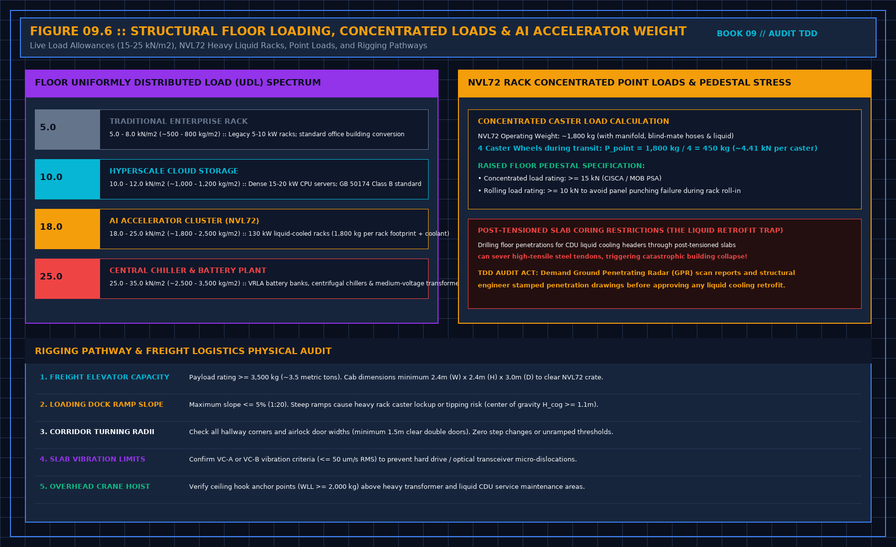

# 22. Obsolescence is a contract fact

You will be asked whether the equipment will still be the equipment the revenue assumes, a few years out. That question has a technical part and a market part. You do not answer the market part.

The technical part is short. What generation does the contract assume. Is that what you counted, on the sample, against the asset record. Does a supply document say what happens if that generation cannot be repaired or replaced. Is there a spare path for the failures you can expect in ordinary operation, evidenced on a shelf or only in a sentence. Lifespan in a brochure is not a remaining life. Depreciation in a model is not a remaining life. You may quote a document that states a manufacturer's figure, and you say you did not test it.

You do not compare the generation to whatever is newest, and you do not rank the site against other regions. A newer card existing in the world is not a finding that this contract fails. A finding is: the contract assumed a named capability, and the sample did not match, or the support path is not shown. If the contract does not name the capability, you do not invent the disappointment.

Trade restrictions, export rules, and who may buy the next generation are not your opinion. If they affect whether a spare can be obtained, counsel or the commercial adviser says so. You may note that the spare path depends on a supply you did not verify. You may not explain the politics.

Refuse a sentence that the platform is competitive, future-proof, or well positioned. Those words are not evidence. They will be quoted as if you had measured a market.

## Structural floor loading, concentrated loads, and AI rack density

When lenders or buyers ask whether a facility can support "next-generation workloads," they are rarely asking about silicon instruction sets. They are asking whether the physical civil and structural envelope can bear the extreme mechanical mass of modern AI accelerators:

### 1. Floor Uniformly Distributed Load (UDL) spectrum

Data centers engineered for traditional enterprise servers cannot physically support high-density liquid-cooled AI clusters:

| Equipment Tier | Uniformly Distributed Load (UDL) | Area Mass Equivalent | Typical Rack Thermal Envelope |
| :--- | :--- | :--- | :--- |
| **Legacy Enterprise** | 5.0–8.0 kN/m² | 500–800 kg/m² | 5–10 kW Air-Cooled |
| **Hyperscale Cloud** | 10.0–12.0 kN/m² | 1,000–1,200 kg/m² | 15–20 kW Air-Cooled |
| **AI Supercluster (NVL72)** | **18.0–25.0 kN/m²** | **1,800–2,500 kg/m²** | **120–140 kW Liquid-Cooled** |
| **Central Plant / Battery** | 25.0–35.0 kN/m² | 2,500–3,500 kg/m² | Heavy Mechanical / VRLA |

An NVL72 liquid-cooled rack footprint weighs approximately 1,360 kg dry and up to 1,800 kg operational (including manifolds, quick-disconnect hoses, internal blind-mate fluid loops, and power busbars). Under GB 50174 Class A guidelines, deploying an AI supercluster onto a slab rated for only 10–12 kN/m² creates immediate structural deflection, cracking, and eventual shear failure.

### 2. Concentrated caster point loading and pedestal stress

During roll-in and positioning, the entire static and dynamic mass of an 1,800 kg NVL72 rack rests on four caster wheels:

$$P_{\text{point}} = \frac{M_{\text{rack}} \times g}{4} = \frac{1,800\,\text{kg} \times 9.807\,\text{m/s}^2}{4} \approx 4.41\,\text{kN per caster}$$

When rolled across a raised floor, dynamic shock coefficients increase this point load to > 6.5 kN. 
The TDD auditor must review the certified raised access floor test certificates (CISCA / MOB PSA):
- **Concentrated Load Rating**: Must be certified to ≥ 15.0 kN per pedestal without exceeding L/360 deflection.
- **Rolling Load Rating**: Must be certified to ≥ 10.0 kN under 10,000 passes to prevent surface panel punch-through during rack transit.

### 3. Post-tensioned (PT) slab coring: the liquid retrofit trap

In facilities undergoing retrofit from air cooling to liquid cooling, large-diameter supply and return coolant pipes (DN100–DN200) must penetrate floor slabs to reach the sub-floor Coolant Distribution Unit (CDU) or chiller headers.

In post-tensioned (PT) concrete buildings, drilling floor penetrations without structural radar scans can sever high-tensile steel tensioning tendons. Severing a single post-tensioned tendon releases hundreds of kilonewtons of stored kinetic energy, causing catastrophic slab failure across multiple bays.

**The TDD Audit Rule**:
Demand certified Ground Penetrating Radar (GPR) slab scan reports and a structural engineer's stamped core penetration plan for all existing and planned liquid cooling piping penetrations. If penetrations were cored without GPR verification, log a mandatory Tier 1 structural safety finding.

### 4. Rigging pathways and freight logistics

Physical accessibility is a frequent hidden bottleneck:
- **Freight Elevator Payload**: Must be certified to ≥ 3,500 kg (3.5 tons) with clear internal cab dimensions of at least 2.4 m (W) × 2.4 m (H) × 3.0 m (D) to transport crated high-density racks.
- **Loading Dock Ramp Slope**: Maximum allowable incline is ≤ 5% (1:20). Ramps steeper than 5% create extreme rollover hazards for racks with a high center of gravity (H_cog ≥ 1.1 m).
- **Corridor Turning Radii**: Clear double-door openings (≥ 1.5 m) and flat transitions with zero unramped thresholds.

## Decisions to record

- Generation the contract assumes, matched or not matched on the sample.
- Structural floor live load verified from certified structural drawings (kN/m²).
- Raised access floor concentrated and rolling load ratings verified against CISCA / MOB PSA standards.
- Ground Penetrating Radar (GPR) scans verified for any slab penetrations.
- Freight elevator capacity and loading dock ramp slope verified.
- Support path: document, shelf, or not shown.
- Brochure life not converted into remaining life.
- Competitive language refused.
