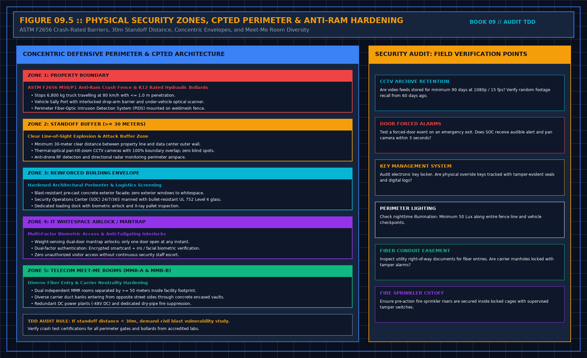

# 37. A network claim is a class, not a config

They will offer a topology, a brand, and a story about how the cluster is built. The financing question is usually narrower: does the network that was bought exist, on the sample, and does the contract assume a property you can evidence. It is not an invitation to audit how they route jobs.

Write the property the contract assumes. A redundant path between named roles. A separation between the equipment that schedules and the equipment that computes, if that separation is what they sold. A license that covers the use. Each property is evidenced by a document you opened or a thing you saw, or it is not in the opinion. A diagram with two colors is not yet a redundant path. A diagram is a claim. The claim needs the same tags as a power path: tested, documented, or spoken.

You do not copy the port list, the addressing plan, or the configuration. Those are identifiers and they go stale the week they renumber a device. Your sentence says the sample of devices matched the asset record, or did not, by function. Role names are enough. Their hostnames are not.

Do not score the architecture against one you prefer. Preference is not obsolescence, and it is not a finding. A finding is a mismatch with their contract, or a path that is only a speech where they need it to carry the performance. Another cluster you have seen, with a different fabric, is another hall. It does not set the bar.

If the tenant operates the network and your line stops under their system, you stop at identity of the boxes the operator delivered. How those boxes are configured tonight may be the tenant's chair. Say so. Do not configure-check your way across the line because the screens were open. Open screens are how scope creeps into a false network audit.

A single sample of "it pinged" is not a performance test. It is a moment. If they have a test document for the network, chapter 23 applies. Witness, accept the document, or not shown. A ping you asked for is the staged demonstration. Refuse it as the performance.

## Physical security zones, CPTED perimeter, and Meet-Me Room diversity

While logical routing protocols belong to tenant operations, the physical telecom pathways, carrier entry vaults, and facility security perimeters fall squarely within the lender's technical due diligence:

### 1. Dual Meet-Me Room (MMR) physical diversity

Under ANSI/TIA-942-B / TIA-942-C and institutional hyperscale lease covenants, true carrier neutrality and telecom resilience mandate complete physical segregation:
- **Dual Independent Meet-Me Rooms (MMR-A & MMR-B)**: Must be located in separate fire compartments separated by at least 50 meters horizontally, or on different floors, preventing a single fire or pipe rupture from severing both carrier nodes.
- **Geographically Diverse Duct Banks**: Fiber optic carrier cables must enter the campus through two concrete-encased duct banks originating from opposite public street boundaries. The two entry vaults must be separated by at least 30–50 m.
- **Dedicated Autonomous Infrastructure**: Each MMR must be powered by independent -48 V DC battery plant rectifiers providing ≥ 4 hours of battery autonomy, backed by dedicated dry-pipe pre-action fire sprinkler protection and clean-agent gaseous suppression.

### 2. Concentric security perimeters and CPTED hardening

The physical security architecture must be audited against Crime Prevention Through Environmental Design (CPTED) principles and ASTM security standards:

1. **Zone 1: Property Boundary & Anti-Ram Hardening**:
 - The outer property line must be secured by an **ASTM F2656 M50/P1** crash-rated perimeter barrier or **K12** hydraulic crash bollards capable of arresting a 6,800 kg medium-duty truck travelling at 80 km/h (50 mph) with no more than 1.0 meter of vehicle penetration.
 - Vehicle access must be controlled via an interlocked two-gate Sally Port equipped with an under-vehicle optical inspection system (UVIS) and hydraulic active wedge barriers.
 - The perimeter fence must feature a continuous Fiber-Optic Perimeter Intrusion Detection System (PIDS) detecting cutting, climbing, or fence lifting within 2 seconds.
2. **Zone 2: Standoff Explosion Buffer (≥ 30 Meters)**:
 - A minimum clear setback of 30 meters must exist between the property boundary fence and the exterior data center wall to mitigate vehicle-borne improvised explosive device (VBIED) blast overpressure.
 - Thermal-optical Pan-Tilt-Zoom (PTZ) CCTV cameras must provide 100% overlapping boundary coverage with zero blind spots.
3. **Zone 3: Hardened Architectural Shell**:
 - Blast-resistant pre-cast reinforced concrete exterior walls with zero ground-level or whitespace exterior windows.
 - A 24/7/365 manned Security Operations Center (SOC) protected by UL 752 Level 4 bullet-resistant glass.
4. **Zone 4: Whitespace Airlock Mantraps**:
 - Access to critical data halls must require two-door interlocked mantrap portals equipped with weight sensors to prevent tailgating.
 - Multi-factor authentication combining encrypted smartcards (DESFire EV3) with biometric facial or iris verification.

### 3. Physical security audit field checks

During the physical walk, the auditor must execute three active field verifications:
- **CCTV Storage & Recall**: Audit video surveillance retention. Verify that recordings are retained for at least 90 days at 1080p / 15 fps. Request a random footage recall from 45 days prior to verify archive integrity.
- **Door Forced Alarm Test**: Test a designated emergency exit door. Confirm that an unauthorized door-opening generates an immediate audible/visual alarm at the SOC workstation and triggers automatic CCTV camera preset call-up in under 3 seconds.
- **Electronic Key Management**: Verify that master manual override keys are housed in a supervised digital key locker requiring biometric authorization and logging every key release.

## Auditing Optical Fiber Entry Diversity, Meet-Me-Room Separation, and Spine Topologies

In institutional M&A acquisitions and project finance underwriting for mission-critical data centers, every qualitative observation recorded during the site walk must be translated into a deterministic commercial or contractual parameter for the investment committee and lending syndicate:

$$d_{\text{conduit\_separation}} \ge 20.0\,\text{m} \text{ across independent utility rights-of-way}$$

An observation that merely remarks on plant appearance without quantifying its impact on **Firm Deliverable IT Capacity ($\text{MW}$)**, **Single-Point-of-Failure ($\text{SPOF}$) Availability**, **Immediate Catch-Up Capital Expenditure ($\text{CapEx}$)**, or **Conditions Precedent ($\text{CP}$) / Conditions Subsequent ($\text{CS}$)** fails to protect the relying party.

| TDD Audit Evaluation Axis | Seller / Data Room Presentation | Independent Engineer Verification Protocol | Financing / Acquisition Covenant Impact |
| :--- | :--- | :--- | :--- |
| **Primary Audit Objective** | Auditing Optical Fiber Entry Diversity, Meet-Me-Room Separation, and Spine Topologies | Cross-check VDR contracts against physical nameplates & test logs | Convert unverified claims into explicit CP/CS or valuation haircuts |
| **Sampling & Evidence Rule** | Curated tour of flagship hall or summary slide | Statistical random sample ($n = \lceil\sqrt{N}\rceil + 1$) chosen by auditor | Any sample mismatch triggers expanded $100\%$ population audit |
| **Redundancy & Capacity Gate** | Nameplate sum of generators, chillers, or transformers | Derate for $99.6\%$ ASHRAE extreme wet-bulb and N+1/2N fault paths | Lock underwritten revenue model to firm derated MW ceiling |
| **Financial Protection Mechanism** | Seller warranty representation in purchase agreement | Quantify remediation cost $C_{\text{fix}}$ + schedule delay risk | Require $150\%\text{--}200\%$ cash escrow holdback at financial close |

## Decisions to record

- The network property the contract assumes, or not stated.
- Dual Meet-Me Rooms (MMR-A & MMR-B) physically separated by ≥ 50 m verified.
- Diverse carrier duct banks and entry vaults verified on site.
- ASTM F2656 anti-ram crash rating (M50/P1) and 30m standoff verified or flagged.
- Path tagged tested, documented, or spoken.
- Port lists and hostnames left in their file.
- Tenant configuration not audited if it is above the line.
