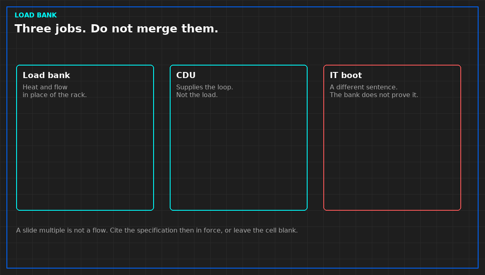

# A liquid load bank is not a CDU

*Original diagram. Not a site record.*

A liquid load bank puts heat and flow where the rack will later put heat and flow. That is the job. It is not a coolant distribution unit, and it is not a proof that the IT equipment will boot.

Teams blur those jobs because the pipes look similar. The bank rejects heat the way a loaded rack rejects heat, so the hall-side loop can be run before the racks exist. The CDU is the plant that supplies that loop. If the bank is asked to "be the CDU for a day," the test no longer has a plant and a load. It has one box doing both, and a pass that will not survive the day the real CDU is connected.

The same split applies to the IT. A stable supply temperature at the bank does not mean a GPU tray will train. Boot, optics, and job health are a different sentence. Write that limit on the requirements sheet before anyone cuts metal. A sheet that says "represents the rack" without saying what it does not represent will be quoted as a full-hall proof.

Interface numbers do not belong in a general article, and they do not belong in the book. The specification then in force is cited on your own sheet. A marketing multiple for coolant flow is not that specification. If the only flow number in the room came from a slide, stop and get the document that actually governs the test.

From *Design and Build a Liquid Load Bank for NVL72 Racks*, Tristan, Data Center Field Guides. No store link until the Kindle edition is listed.

Related: [Two documents before you cut metal](01-two-documents-before-metal.md).
