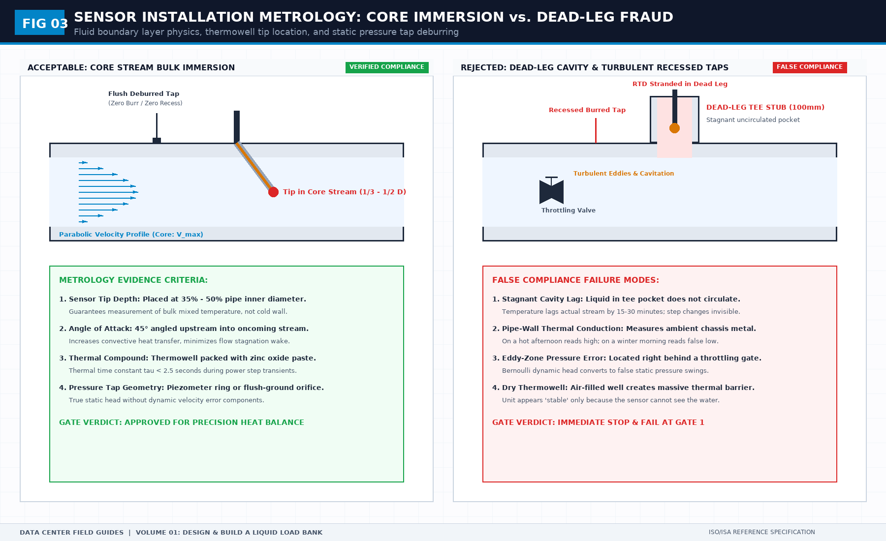

# Two documents before you cut metal: First-Principles Data Center Engineering Protocol

> **Direct Answer Block**: The two mandatory engineering documents—the Requirements List and the Prototype Acceptance Sheet—required before fabricating a high-density liquid load bank. In mission-critical data center commissioning and operations, engineers enforce this boundary using deterministic physical equations, calibrated field instrumentation, and auditable sign-off gates rather than relying on vendor brochure summaries, uncalibrated software plots, or verbal assurances. Every measurement and state transition must be recorded with synchronized UTC timestamps and explicit pass/fail thresholds before a signature is granted.

A liquid load bank project fails in the meeting where someone says the drawings are the specification. Drawings show a shape. They do not say what the unit must prove, what it must refuse to prove, or which measurement will accept the prototype.

Two documents do that work. The requirements sheet names the duty: heat and flow in place of the rack, the faults the unit must survive, and the sentence the test is allowed to support. The acceptance sheet names the gates the prototype must pass before anyone trusts a curve from it. Both are filled before metal is cut. A gate invented after the first bad run is a caption, not a requirement.

Keep protection points and recording points apart. A trip contact is not a temperature. If the acceptance sheet lets a status bit stand in for the channel the heat story needs, the prototype can pass while the measurement you will quote is missing.

Do not paste a vendor paragraph into either sheet and call it yours. Their catalog is their claim. Your sheet is the claim you will be blamed for. Where a number is required, cite the specification then in force. Leave the cell blank rather than type a slide number.

---

## 1. First-Principles Engineering Formulation and Governing Mathematics

In high-density data center environments, verbal summaries and qualitative status tiles routinely obscure incipient physical failures. Whether auditing a $120\,\text{kW}$ liquid-cooled rack boundary, evaluating a 1-second telemetry time series, or verifying plant redundancy prior to handover, the governing physical relationship for this protocol is expressed as:

$$\text{Gate}_{\text{accept}} = G_1(\text{Static/FD83}) \times G_2(\text{Megger/E-Stop}) \times G_3(\text{Heat Balance}) \times G_4(\text{Pack})$$

When any term on the left-hand or right-hand side of this relationship is left unmeasured, inferred from an uncalibrated nameplate, or averaged across an unverified time window, the resulting engineering record cannot support a valid operational signature. Field engineers must verify each physical variable independently using NIST/ISO 17025 traceable instruments before proceeding to the next gate in the sequence.

| Audit Verification Parameter | Unacceptable / Defective Field Practice | Auditable First-Principles Requirement | Mandatory Action on Failure |
| :--- | :--- | :--- | :--- |
| **Primary Boundary Definition** | Implied by vendor brochure or slide deck | Explicitly bounded on stamped P&ID / SLD with tag IDs | Halt acceptance; issue formal boundary clarification |
| **Measurement & Telemetry Proof** | Single uncalibrated display reading or 60-sec average | Calibrated Class A/0.5S sensor with 1-sec UTC timestamp | Reject dataset; classify point as `0x40` Stale or `0x80` Bad |
| **Pass / Fail Acceptance Gate** | Qualitative "Looks OK" or "Within Normal Range" | Quantitative numerical corridor cited from revision in force | Log Category A/B defect; withhold retainage or permit |
| **Custody & Sign-Off Record** | Single bundled "Accepted" signature at end of meeting | Scoped, dated sentence naming exact proved & unproved lines | Strike unsupported claims; issue Conditional Refusal |

---

## 2. Deep-Dive Technical Protocol and Field Implementation

The following field protocol—adapted directly from **Volume 01: *Design and Build a Liquid Load Bank for NVL72 Racks***—establishes the step-by-step verification mechanics required on the data hall floor:

This book is a field guide for people who must specify and accept a liquid load bank that can stand in for an NVL72-class rack. It is not a fabrication package. It is not a vendor specification rewritten in friendlier English. It is not a site procedure.

When you finish it, you should be able to hand a stranger two documents and have those documents survive contact with a prototype. The first is a requirements list. The second is a prototype acceptance sheet. If you cannot produce those two documents from what you have written in the margins, you have not finished the book. You have only read it.

The load bank replaces the rack-side thermal duty and the rack-side hydraulic duty. It does not replace the coolant distribution unit. It does not accept the hall. It does not prove that the IT equipment will boot, train, or stay within its own limits. Those are different machines and different arguments. Mixing them is how a load-bank project becomes a liquid-cooling project with no owner.

## What this volume owns

This volume owns the decisions you must make before anyone cuts metal, and the gates you must pass before you call a prototype finished. It owns the functions the unit must perform, the quantities that define its duty, the liquid-path choices that keep it from becoming a leak with a heater, the heat-path choices that keep the heater honest, the instruments and the data exit, the stops that must work when the network does not, and the file you hand over with the machine.

It does not own how to read a month of test data. That is the next book. It does not own how to run one NVL72 test project in a hall, with people, windows, and a CDU that already exists. That is the book after. If a paragraph here starts to become a test plan for a building, or a method for cleaning a time series, cut it. Leave a pointer. Do not smuggle the later books into this one to make the page look complete.

## Who it is for

It is for the test engineer who will be blamed when the numbers do not match, and for the person who will sign the purchase or the build. It is not for a marketing reader who wants a tour of liquid cooling. It is not for a fabricator who needs hole sizes. If you need hole sizes, you need a drawing, and this book will tell you what that drawing must not be allowed to decide on its own.

You can use it if you have never built a load bank, provided you will write things down. You can use it if you have built several, provided you are willing to throw away the last project’s part numbers. Experience that arrives as a shopping list is not experience. It is residue.

## How to read it

Read in order the first time. The acceptance gates in the long chapter near the end only make sense if you have already decided what the unit is for. After that, use it as a checklist. Each chapter ends with decisions to record. A decision is one of three things: a sentence you will defend, a blank you will fill from the specification then in force, or an explicit deferral with a date and an owner. A silent skip is not a decision. It is how prototypes ship with a hose that cannot be isolated.

Keep a notebook, or a single file, with the same headings as the chapters. Do not annotate the book and call that the requirements list. The requirements list has to be able to leave your hands. The book stays here.

When a chapter says “do not write the number,” it means the number is not cleared for this book, or it is not stable enough to be a teaching example. It does not mean the number does not matter. It means you write the check, then you write the number on your own sheet, citing the document title and revision you actually used. A field guide that freezes a vendor figure becomes false on the day the vendor revises it. A field guide that tells you where the figure lives stays usable.

## The specification then in force

You will see that phrase often. It means the rack, manifold, and coolant documents that govern the interface on the day you accept the prototype, identified by title and revision, not by memory and not by a slide from last year. If two documents disagree, you do not average them. You record the disagreement and you stop the affected line of the acceptance sheet until someone who owns the interface picks one. This book will not pick it for you. Picking it here would be inventing a standard.

The same rule applies to electrical supply. Voltage, frequency, and connector family belong on your sheet because the hall you will plug into is real. They do not belong in this book as if one hall were the world.

## What “good” looks like before any metal exists

A good early package is dull. It has a one-page statement of what the load bank is allowed to represent. It has the six functions, each with an evidence column. It has a duty point written as a set of quantities, with the numeric cells either filled from a cited revision or marked unknown. It has a liquid-boundary sketch that a stranger can redraw from the prose. It has a point list of functions, not a register map. It has four acceptance gates with pass lines and stop lines. It has a known-limitations page that is already started, not a page you intend to write after the argument.

A bad early package is a rendering, a kilowatt number, and a promise that the software will be flexible. Flexibility is what people write when they have not chosen the steps. A rendering is what people show when they have not chosen the boundary.

## Two documents, not ten

You will be tempted to start a document set: a design basis, a philosophy, a compliance matrix, a risk register, a test strategy. Resist that until the two documents exist. The requirements list is the design basis. The acceptance sheet is the test strategy for the prototype. Extra documents are allowed after those two can be read without you in the room. Extra documents before that are how projects hide the fact that the six functions were never written down.

The requirements list is not a quote request, though a quote request can be cut from it. The acceptance sheet is not a factory test report, though the factory test should be forced to answer it. Keep the direction of dependence straight. The sheet judges the machine. The machine does not edit the sheet on the day, except through a waiver path you defined before the day.

## Composite examples

Later chapters use short composite scenes: a prototype on a bench, a hose that looked fine until it was filled, a display that repeated the last good value. They are teaching scenes. They are not a site, not a customer, and not a model number. If a scene starts to look like a place you have worked, that is because the failure mode is common, not because the book is publishing that place. Do not add the place back in when you copy a checklist into your project file.

## What you may copy out of this book

You may copy the headings of the requirements list, the four gate names, and the rule that a quantity without a false story is an ornament. You may not copy a sentence into a vendor manual and call it a specification. The sentences here are checks and reasons. A specification needs numbers, materials callouts, and an owner. Those come from your project, under your authority, on the day you have the revision in hand.

## A first sitting

If you only have an afternoon before a vendor meeting, do not skim for reassurance. Do this instead. Write the six functions in your own words. Write the duty as a set, and mark every number unknown that you cannot cite. Draw the liquid boundary and mark which side the unit sits on. Name the four gates. Put a date on the unknowns. That afternoon is worth more than a week of chassis sketches.

Then come back and read the chapter that attacks the unknown you are most tempted to leave blank. For most readers that is either the flow regime or the data exit. People are comfortable talking about heaters. They are less comfortable saying that a load bank which cannot be compared with the rack side is not yet a stand-in.

## Public sources for this chapter

Use a public document as a map, not as a chapter you are allowed to rewrite. The map for this volume is short. NVIDIA’s public GB200 NVL72 page says that class of rack is liquid-cooled and rack-scale. ASHRAE TC 9.9 is where the industry looks for cooling guidance, under license. NFPA 70 or the local wiring code, and IEC 60204-1, are where electrical stops get a legal name. Chapter 19 states the copyright line. Read it before you open a PDF into any tool. ASHRAE has said its publication content is not to be entered into an AI tool, and that AI derivative works of that content need written permission. This book names titles. It does not digest them.

---

## 3. Field Verification Checklist and Instrumentation Hygiene

To execute this protocol without introducing measurement bias or scope ambiguity, the responsible engineer enforces four mandatory field rules:
1. **Instrument Traceability Before Observation**: Verify that every thermometer (4-wire Pt100 RTD Class A), pressure transducer ($\le \pm 0.1\%$ span), flowmeter, balometer, or power analyzer carries a current calibration certificate and passes a pre-test zero/span check on the day of the walk.
2. **Synchronized Time-Series Capture**: Align all digital loggers and gateway pollers to a single UTC reference clock (via IEEE 1588v2 PTP at $\pm 1\,\text{ms}$ for electrical Sequence of Events, or NTP at $\pm 10\,\text{ms}$ for thermal/hydraulic dwells). Never merge unsynchronized CSV files by row index.
3. **Explicit Isolation of Disturbances vs. Control Handles**: Hold upstream supply temperatures, parallel cabinet loads, and containment door states constant during the observation dwell so that transient plant drift is never mistaken for steady-state equipment performance.
4. **Written Record Prior to Signature**: Record every boundary tag, measured value, uncertainty tolerance, and open limitation in ink on the controlled project sheet before leaving the equipment line-up.

---

## Frequently Asked Questions (FAQ)

### Why does "Two documents before you cut metal" matter during high-density data center commissioning and operations?
The two mandatory engineering documents—the Requirements List and the Prototype Acceptance Sheet—required before fabricating a high-density liquid load bank. When project teams bypass this rule to meet a commercial schedule milestone, unverified physical assumptions—such as hidden hydraulic pressure drops, unlogged polling gaps, unblanked bypass leakage, or uncalibrated sensor offsets—transfer directly into live 24/7 production as latent single points of failure.

### How do you quantitatively verify compliance with "liquid load bank specification checklist" on the physical floor?
Compliance is verified by executing the governing mathematical balance ($$\text{Gate}_{\text{accept}} = G_1(\text{Static/FD83}) \times G_2(\text{Megger/E-Stop}) \times G_3(\text{Heat Balance}) \times G_4(\text{Pack})$$) using independent, calibrated field instruments across a stabilized steady-state dwell window (minimum 15 to 30 minutes for thermal and hydraulic systems), and confirming that the discrepancy between primary and secondary measurements remains strictly within the pre-declared acceptance band.

### What should an engineer do if a contractor or vendor submits a report that violates this protocol?
The reviewing engineer must refuse to sign the broad acceptance sentence, mark the specific line item as **Unproved / Defective** on the official audit sheet, and either require a witnessed re-test under a corrected script or isolate the unproved scope under a time-bounded Conditional Acceptance with a $150\%$ to $200\%$ financial retainage escrow holdback.

---

From *Design and Build a Liquid Load Bank for NVL72 Racks*, Tristan, Data Center Field Guides.

Related: [What the prototype must not prove](01-what-the-prototype-must-not-prove.md).
