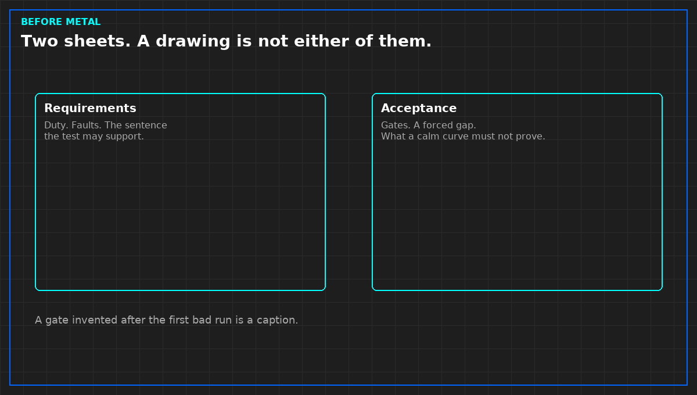

# What a load bank prototype must not prove

*Original diagram. Not a site record.*

A prototype acceptance answers a narrow question: does this unit do the duty on the requirements sheet, and does a failed read show up as a gap rather than a fresh timestamp on an old value? It does not answer whether the hall is commissioned, whether the CDU is adequate, or whether the future IT load will run.

Those extra sentences are how a bench photo becomes a project milestone. Strike them on the day. A unit that holds a setpoint on a bench has not seen the hall's pumps, strainers, or control loop. Say "prototype accepted for the duty named." Do not say "liquid cooling verified."

The acceptance also has to show a deliberate failure. Disconnect a sensor, or stop a publisher, and confirm the export marks a gap. A quiet trend with new timestamps is not a pass. It is the stale failure you will meet again when the file is judged. If that demonstration is skipped because the curve looks calm, the calm is untrusted.

Calibration belongs on the same sheet as the gate. A number with no instrument record is a number you cannot hand to the next book, the one that reads the file. Do not ship a prototype on a verbal "instruments are fine."

From *Design and Build a Liquid Load Bank for NVL72 Racks*, Tristan, Data Center Field Guides. No store link until the Kindle edition is listed.

Related: [A hit is a time, not a pass](02-a-hit-is-a-time.md).
