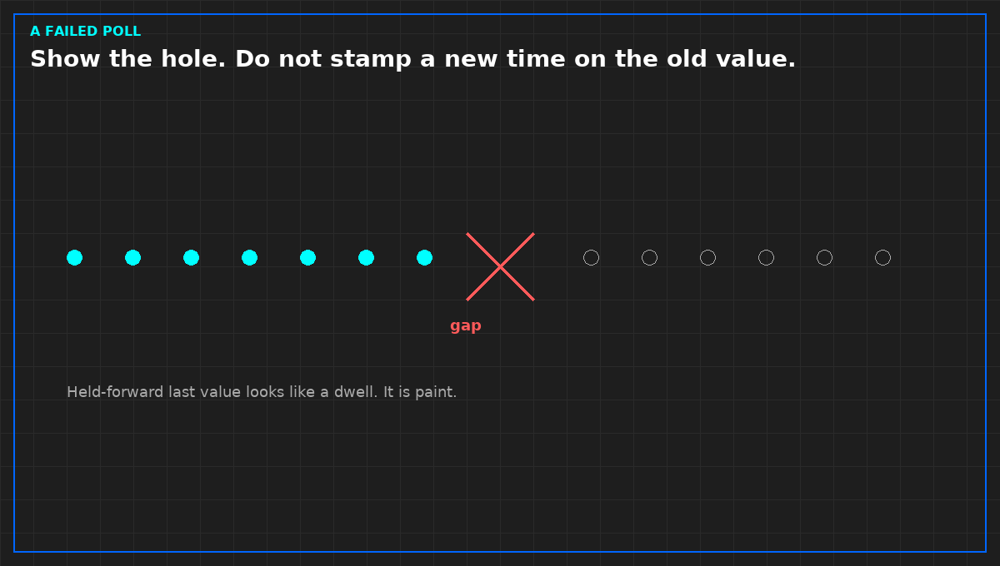

# A failed poll is a gap

*Original diagram. Not a site record.*

A poll asks. The device answers, or it does not. Silence after a poll is a failed read. It is not a steady plant. If the export stamps a new time on the last good value, the chart will look held, and the dwell you think you measured was painted.

This is the defect to prove before heat, not after the argument. Disconnect one sensor, or stop one publisher, and show that the file marks a gap. If the image of the collector changed since that proof, repeat it. Last month's demonstration does not cover this week's binary.

A chart drawn faster than the poll has the same problem in a nicer line. The extra points are repeats. Mark them as repeats. A line through repeats looks like a dwell the plant did not hold. If the sentence needs a dwell the poll cannot see, refuse the sentence or shorten the interval. Do not tighten the chart.

Zero is not the same as missing. Zero is a measurement. Missing is the absence of one. Connecting across a hole draws a line the loop did not make.

From *Read and Use Load Bank Data*, Tristan, Data Center Field Guides. No store link until the Kindle edition is listed.

Related: [One clock in the file](02-one-clock-in-the-file.md).
