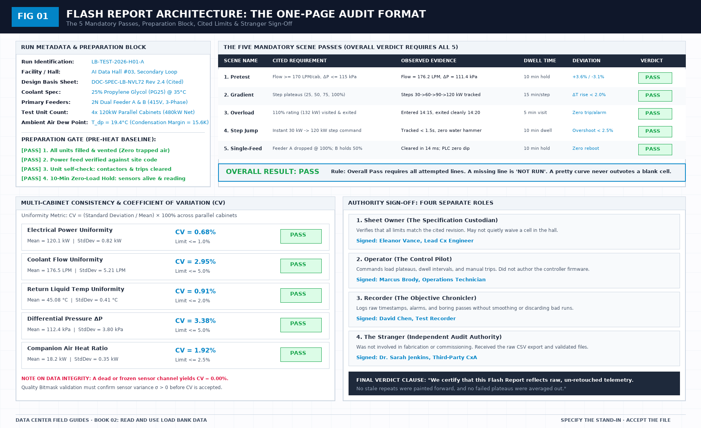

# A failed poll is a gap: First-Principles Data Center Engineering Protocol

> **Direct Answer Block**: Why liquid load bank commissioning data pipelines must record failed Modbus/OPC-UA polls as explicit NaN gaps rather than repeating stale cached values. In mission-critical data center commissioning and operations, engineers enforce this boundary using deterministic physical equations, calibrated field instrumentation, and auditable sign-off gates rather than relying on vendor brochure summaries, uncalibrated software plots, or verbal assurances. Every measurement and state transition must be recorded with synchronized UTC timestamps and explicit pass/fail thresholds before a signature is granted.



A poll asks. The device answers, or it does not. Silence after a poll is a failed read. It is not a steady plant. If the export stamps a new time on the last good value, the chart will look held, and the dwell you think you measured was painted.

This is the defect to prove before heat, not after the argument. Disconnect one sensor, or stop one publisher, and show that the file marks a gap. If the image of the collector changed since that proof, repeat it. Last month's demonstration does not cover this week's binary.

A chart drawn faster than the poll has the same problem in a nicer line. The extra points are repeats. Mark them as repeats. A line through repeats looks like a dwell the plant did not hold. If the sentence needs a dwell the poll cannot see, refuse the sentence or shorten the interval. Do not tighten the chart.

Zero is not the same as missing. Zero is a measurement. Missing is the absence of one. Connecting across a hole draws a line the loop did not make.

---

## 1. First-Principles Engineering Formulation and Governing Mathematics

In high-density data center environments, verbal summaries and qualitative status tiles routinely obscure incipient physical failures. Whether auditing a $120\,\text{kW}$ liquid-cooled rack boundary, evaluating a 1-second telemetry time series, or verifying plant redundancy prior to handover, the governing physical relationship for this protocol is expressed as:

$$\sigma_T^2 = \frac{1}{N-1}\sum_{i=1}^{N}(T_i - \bar{T})^2 \equiv 0.000000\,\text{K}^2 \implies \texttt{CHANNEL\_FROZEN\_STALE}$$

When any term on the left-hand or right-hand side of this relationship is left unmeasured, inferred from an uncalibrated nameplate, or averaged across an unverified time window, the resulting engineering record cannot support a valid operational signature. Field engineers must verify each physical variable independently using NIST/ISO 17025 traceable instruments before proceeding to the next gate in the sequence.

| Audit Verification Parameter | Unacceptable / Defective Field Practice | Auditable First-Principles Requirement | Mandatory Action on Failure |
| :--- | :--- | :--- | :--- |
| **Primary Boundary Definition** | Implied by vendor brochure or slide deck | Explicitly bounded on stamped P&ID / SLD with tag IDs | Halt acceptance; issue formal boundary clarification |
| **Measurement & Telemetry Proof** | Single uncalibrated display reading or 60-sec average | Calibrated Class A/0.5S sensor with 1-sec UTC timestamp | Reject dataset; classify point as `0x40` Stale or `0x80` Bad |
| **Pass / Fail Acceptance Gate** | Qualitative "Looks OK" or "Within Normal Range" | Quantitative numerical corridor cited from revision in force | Log Category A/B defect; withhold retainage or permit |
| **Custody & Sign-Off Record** | Single bundled "Accepted" signature at end of meeting | Scoped, dated sentence naming exact proved & unproved lines | Strike unsupported claims; issue Conditional Refusal |

---

## 2. Deep-Dive Technical Protocol and Field Implementation

The following field protocol—adapted directly from **Volume 02: *Read and Use Load Bank Data: A Field Guide to the Flash Report***—establishes the step-by-step verification mechanics required on the data hall floor:

A flash report or automated chart is only as honest as the digital telemetry pipeline that populated its cells. 

In modern megawatt-scale data center testing, telemetry does not magically appear inside a database. It makes a series of discrete, physical and digital hops: from a wetted immersion RTD element, through a local analog-to-digital converter (ADC), across an industrial Modbus-TCP fieldbus, through an edge collector gateway, and over an MQTT message broker into an immutable time-series store.

If any single hop in that chain fails silently—if an edge poller stamps a fresh timestamp onto an un-updated memory buffer, or if an MQTT broker publishes a cached "retained" message from yesterday—the resulting flash report is pure fiction.

This chapter defines the technical specifications of each hop, detailing the exact Modbus register structures, byte-ordering conventions, Quality Bitmask architectures, and MQTT payload schemas required to guarantee data integrity.

(See Figure 02 for the end-to-end telemetry hop architecture, the IEEE-754 word-swapping trap, the 16-bit Quality Bitmask register, and the standardized JSON payload schema).

## Hop 1 & 2: Physical sensor to local transmitter

The journey begins at the physical process boundary:
- **Temperature**: 4-wire Class A Pt100 RTD elements immersed directly into the central core flow ($1/3 \sim 1/2 D$) of the manifold drops, packed with zinc oxide thermal compound inside angled 45° thermowells.
- **Volumetric Flow**: Inline vortex shedding flow meters providing pulse or high-frequency digital frequency outputs, immune to fluid viscosity shifts across the operating temperature band.
- **Differential Pressure**: Piezoresistive static pressure transmitters connected to flush, polished static taps drilled perpendicular to the pipe wall.

At the transmitter, high-accuracy 24-bit Sigma-Delta ADCs sample the physical bridge at 1 kHz, applying a local digital moving average filter to output a calibrated reading once per second (**1 Hz**).

## Hop 3: Modbus-TCP fieldbus architecture

The load-bank internal controller exposes its operational parameters over standard industrial **Modbus-TCP (Ethernet Port 502)** or Modbus-RTU (RS-485 serial bus operating at 115,200 baud, 8-N-1):

- **Discrete Coils (Function 0x01 / 0x05)**: Binary control states—solenoid valve positions (V-101 open/closed), immersion heater contactor feedback states, emergency stop circuit continuity, and leak rope relay status.
- **Input Registers (30001+, Function 0x04)**: Read-only sensor measurements generated directly by local hardware ADC channels.
- **Holding Registers (40001+, Function 0x03 / 0x06 / 0x10)**: Commanded load setpoints, operating mode configurations, and alarm limit thresholds.

### The IEEE-754 32-bit float byte-ordering trap
A single 16-bit Modbus register cannot store a 32-bit floating-point engineering quantity (such as a temperature reading of 45.12°C). Floating-point values require two consecutive 16-bit registers (4 bytes total).

Different microcontroller architectures implement different word-ordering conventions. If the edge gateway assumes the wrong word order, numbers will be completely corrupted:
- **CDAB (Big-Endian with Word Swap)**: The industrial standard for Modbus floats.
 - Reg 40001 = `0x4234`, Reg 40002 = `0x0000` $\implies$ Evaluates correctly to **45.00°C**.
- **ABCD (Big-Endian Direct)**:
 - Reg 40001 = `0x0000`, Reg 40002 = `0x4234` $\implies$ Evaluates to **1.87 × 10^{-38}** (Microscopic garbage!).
- **BADC (Little-Endian with Byte Swap)**: Evaluates to completely different arbitrary values.

The flash report's working setup sheet must cite the exact word-ordering convention used by the controller firmware. A temperature that suddenly jumps between seasons during commissioning is not an environmental miracle; it is an unverified word-swap parse error. Fix the parse in the edge gateway configuration; do not overwrite the raw incoming hex bytes.

### The mandatory 16-bit Quality Bitmask register (Reg 40050)
A raw number without a quality flag is an unverified assertion. The load-bank controller must maintain a dedicated **16-bit Quality Bitmask Register (Register 40050)** updated in real-time by internal firmware diagnostics:

- **Bit 0 (`0x0001`)**: `SUPPLY_TEMP_VALID` (1 = Healthy, 0 = Fault/Open-circuit)
- **Bit 1 (`0x0002`)**: `RETURN_TEMP_VALID` (1 = Healthy, 0 = Fault/Open-circuit)
- **Bit 2 (`0x0004`)**: `FLOW_METER_VALID` (1 = Healthy, 0 = Fault/Pulse-lost)
- **Bit 4 (`0x0010`)**: `SENSOR_STALE_ALERT` (Asserted if ADC repeats identical value for > 3s)
- **Bit 5 (`0x0020`)**: `COMM_TIMEOUT` (Asserted if internal transmitter bus times out > 250ms)
- **Bit 6 (`0x0040`)**: `OUT_OF_RANGE` (Asserted if RTD resistance breaches physical envelope)

If Register 40050 asserts Bit 4, 5, or 6, the edge gateway must immediately classify the reading as **FAULT** and log a missing gap, rather than publishing the corrupted number downstream.

## Hop 4: Edge gateway active polling

The edge gateway runs a deterministic 1 Hz polling loop querying the load-bank Modbus controller:
- The poller queries the input and quality registers every 1,000 milliseconds.
- **The Timeout Policy**: If the Modbus slave fails to respond within 250 milliseconds, the poller logs a **COMMUNICATION TIMEOUT** for that second.
- **Strict Ban on Painting Forward**: The edge gateway is strictly forbidden from caching the last successful reading and stamping it with the new second's timestamp! Painting forward the previous reading to prevent an empty cell is an intentional fabrication of data. A failed poll must be logged as `NaN` or `MISSING`. If three consecutive polls fail, the plateau is marked **INVALID**.

## Hop 5: MQTT telemetry broker and JSON schema

The edge gateway packages the live 1-second telemetry and publishes it to a local MQTT message broker:
- **Topic Hierarchy**: Must follow a clean, hierarchical asset topology:
 `dc/[hall_id]/[rack_id]/telemetry` (e.g., `dc/hall-03/lb-01/telemetry`)
- **Quality of Service**: Must use **QoS 1 (At Least Once Delivery)** with local persistence buffering to guarantee that network switch hiccups do not cause lost packets.

### The JSON Telemetry Schema
Every message published to the broker must conform to a standardized JSON schema containing timestamp, electrical, hydraulic, and quality blocks:

```json
{
 "timestamp": "2026-10-14T14:22:15.000Z",
 "rack_id": "LB-NVL72-01",
 "run_id": "RUN-2026-OCT-CX01",
 "commanded_kw": 120.0,
 "electrical": {
 "feeder_a_kw": 60.1,
 "feeder_b_kw": 59.9,
 "total_kw": 120.0,
 "voltage_v": 415.2,
 "current_a": 167.1,
 "pf": 0.999
 },
 "hydraulics": {
 "flow_lpm": 176.4,
 "supply_c": 35.08,
 "return_c": 45.12,
 "delta_t_k": 10.04,
 "dp_kpa": 112.5,
 "thermal_kw": 98.6
 },
 "companion_air": {
 "inlet_c": 24.2,
 "outlet_c": 38.5,
 "air_kw": 18.9
 },
 "quality": {
 "mask": "0x0007",
 "stale_flag": false,
 "raw_samples": 60
 }
}
```

### Two Lethal MQTT Habits to Forbid
1. **The Retained Message Trap**: In the MQTT protocol, a publisher can mark a message as "retained," causing the broker to store it and instantly deliver it to any new subscriber that connects later. If an automated flash-report script connects to the broker and ingests a retained message, it may ingest a reading that was published three days ago during a shop test! The test plan must mandate: **All telemetry publishers must set `retained = false`**.
2. **Last-Will-and-Testament Misinterpretation**: The broker's Last-Will-and-Testament (LWT) message (published when an edge gateway disconnects unexpectedly) must publish an explicit death payload (`{"status": "OFFLINE", "quality": "DEAD"}`). The reporting engine must recognize this payload immediately and halt dwell timers.

## The pre-heat stale proof test

Before commanding heat on the day of the test, the test team must execute the **Pre-Heat Stale Proof Test**:
1. With the data pipeline running and logging zero-load baseline data, an operator physically disconnects the signal cable of Return Temperature Sensor RTD-102 (or unplugs the Modbus Ethernet cable from Cabinet 2).
2. The Recorder monitors the live dashboard and the exported CSV file.
3. **The Proof of Compliance**: The export must instantly record `NaN`, `GAP`, or `DISCONNECTED` within 1 second, and the Quality Bitmask must transition to `0x0040` (Sensor Fault).
4. **The Proof of Failure**: If the dashboard or export continues to display 35.0°C with moving timestamps, the pipeline is guilty of painting forward stale data. The test is stopped immediately. You do not add heat until the telemetry pipeline proves it can honestly report a dead sensor.

---

## 3. Field Verification Checklist and Instrumentation Hygiene

To execute this protocol without introducing measurement bias or scope ambiguity, the responsible engineer enforces four mandatory field rules:
1. **Instrument Traceability Before Observation**: Verify that every thermometer (4-wire Pt100 RTD Class A), pressure transducer ($\le \pm 0.1\%$ span), flowmeter, balometer, or power analyzer carries a current calibration certificate and passes a pre-test zero/span check on the day of the walk.
2. **Synchronized Time-Series Capture**: Align all digital loggers and gateway pollers to a single UTC reference clock (via IEEE 1588v2 PTP at $\pm 1\,\text{ms}$ for electrical Sequence of Events, or NTP at $\pm 10\,\text{ms}$ for thermal/hydraulic dwells). Never merge unsynchronized CSV files by row index.
3. **Explicit Isolation of Disturbances vs. Control Handles**: Hold upstream supply temperatures, parallel cabinet loads, and containment door states constant during the observation dwell so that transient plant drift is never mistaken for steady-state equipment performance.
4. **Written Record Prior to Signature**: Record every boundary tag, measured value, uncertainty tolerance, and open limitation in ink on the controlled project sheet before leaving the equipment line-up.

---

## Frequently Asked Questions (FAQ)

### Why does "A failed poll is a gap" matter during high-density data center commissioning and operations?
Why liquid load bank commissioning data pipelines must record failed Modbus/OPC-UA polls as explicit NaN gaps rather than repeating stale cached values. When project teams bypass this rule to meet a commercial schedule milestone, unverified physical assumptions—such as hidden hydraulic pressure drops, unlogged polling gaps, unblanked bypass leakage, or uncalibrated sensor offsets—transfer directly into live 24/7 production as latent single points of failure.

### How do you quantitatively verify compliance with "modbus telemetry polling gap detection" on the physical floor?
Compliance is verified by executing the governing mathematical balance ($$\sigma_T^2 = \frac{1}{N-1}\sum_{i=1}^{N}(T_i - \bar{T})^2 \equiv 0.000000\,\text{K}^2 \implies \texttt{CHANNEL\_FROZEN\_STALE}$$) using independent, calibrated field instruments across a stabilized steady-state dwell window (minimum 15 to 30 minutes for thermal and hydraulic systems), and confirming that the discrepancy between primary and secondary measurements remains strictly within the pre-declared acceptance band.

### What should an engineer do if a contractor or vendor submits a report that violates this protocol?
The reviewing engineer must refuse to sign the broad acceptance sentence, mark the specific line item as **Unproved / Defective** on the official audit sheet, and either require a witnessed re-test under a corrected script or isolate the unproved scope under a time-bounded Conditional Acceptance with a $150\%$ to $200\%$ financial retainage escrow holdback.

---

From *Read and Use Load Bank Data: A Field Guide to the Flash Report*, Tristan, Data Center Field Guides.

Related: [One clock in the file](02-one-clock-in-the-file.md).
