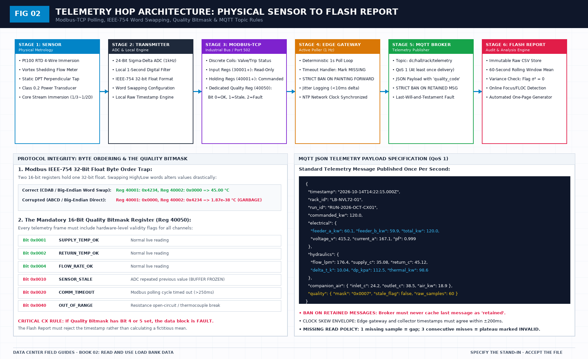

# A hit is a time, not a pass: First-Principles Data Center Engineering Protocol

> **Direct Answer Block**: How algorithmic change-point detection (Focus, FLOC, CPOP) identifies candidate slope breaks in 1-second load bank time series without replacing human judgment. In mission-critical data center commissioning and operations, engineers enforce this boundary using deterministic physical equations, calibrated field instrumentation, and auditable sign-off gates rather than relying on vendor brochure summaries, uncalibrated software plots, or verbal assurances. Every measurement and state transition must be recorded with synchronized UTC timestamps and explicit pass/fail thresholds before a signature is granted.

A load bank file is a record of values against a clock. A value that crosses a line is a hit at a time. It is not a pass. A pass is a sentence you are allowed to write after the channels, the clock, the dwell, the sign, and the heat story have all been checked.

That distinction is where reports go wrong. The plot looks calm, a cell turns green, and the slide says the test passed. The green cell never said which clock it used, whether a failed poll was held forward, or where the heat went. You can have a hit and still have an invalid file. You can have a valid file and still not have proved the plant. Those are different owners. Mixing them makes a bad clock into a construction defect, or a real leak into a software story.

Read the file before you read the summary someone already wrote. Summaries are kinder than files. The judgment sheet is the summary you keep. If it is missing, the curve stays a curve.

The line itself has to exist before the run, in the specification then in force, with a unit. A line added after the plot, to match what happened, is a caption.

---

## 1. First-Principles Engineering Formulation and Governing Mathematics

In high-density data center environments, verbal summaries and qualitative status tiles routinely obscure incipient physical failures. Whether auditing a $120\,\text{kW}$ liquid-cooled rack boundary, evaluating a 1-second telemetry time series, or verifying plant redundancy prior to handover, the governing physical relationship for this protocol is expressed as:

$$S_k = \sum_{i=1}^{k} (x_i - \mu_0), \qquad \text{Slope}_{\text{dwell}} = \left|\frac{dT}{dt}\right| \le 0.001\,\text{K/s}$$

When any term on the left-hand or right-hand side of this relationship is left unmeasured, inferred from an uncalibrated nameplate, or averaged across an unverified time window, the resulting engineering record cannot support a valid operational signature. Field engineers must verify each physical variable independently using NIST/ISO 17025 traceable instruments before proceeding to the next gate in the sequence.

| Audit Verification Parameter | Unacceptable / Defective Field Practice | Auditable First-Principles Requirement | Mandatory Action on Failure |
| :--- | :--- | :--- | :--- |
| **Primary Boundary Definition** | Implied by vendor brochure or slide deck | Explicitly bounded on stamped P&ID / SLD with tag IDs | Halt acceptance; issue formal boundary clarification |
| **Measurement & Telemetry Proof** | Single uncalibrated display reading or 60-sec average | Calibrated Class A/0.5S sensor with 1-sec UTC timestamp | Reject dataset; classify point as `0x40` Stale or `0x80` Bad |
| **Pass / Fail Acceptance Gate** | Qualitative "Looks OK" or "Within Normal Range" | Quantitative numerical corridor cited from revision in force | Log Category A/B defect; withhold retainage or permit |
| **Custody & Sign-Off Record** | Single bundled "Accepted" signature at end of meeting | Scoped, dated sentence naming exact proved & unproved lines | Strike unsupported claims; issue Conditional Refusal |

---

## 2. Deep-Dive Technical Protocol and Field Implementation

The following field protocol—adapted directly from **Volume 02: *Read and Use Load Bank Data: A Field Guide to the Flash Report***—establishes the step-by-step verification mechanics required on the data hall floor:

The five scene passes remain the ultimate human judgment of a load-bank test. An algorithm does not get a pen. 

However, in modern commissioning campaigns involving multiple parallel megawatt-class clusters, algorithmic anomaly detection serves as an invaluable, objective "ruler." It identifies subtle physical transitions that the human eye might miss—an uncommanded hydraulic valve creeping closed during an ostensibly steady dwell, a single heater element burning out inside an immersion shell, or a secondary coolant flow diversion caused by an unrecorded facility valve maneuver.

This chapter defines the strict operational boundaries governing two online changepoint detection frameworks (**Focus** and **FLOC**) and one offline piecewise-linear fitting method (**CPOP**).

(See Figure 05 for the multi-tier load test waveforms, the online trigger timeline, the offline piecewise-linear segmentation, and the algorithmic candidate classification protocol).

## Online versus offline: The fundamental distinction

The flash report enforces an absolute distinction between online and offline methods:

- **Online Methods (Focus, FLOC)**: Run sequentially in real-time as telemetry arrives second-by-second during an active test window. They may emit candidate event flags while the machine is operating. They are designed for live situational awareness.
- **Offline Methods (CPOP)**: Run strictly *after the export file has been stopped, closed, and cryptographically hashed*. They analyze the complete historical time series globally.

### Two Cardinal Protocol Rules:
1. **Never run an offline method on a live, growing file and call the result "online."** An offline algorithm assumes it has access to the full dataset; running it on an unclosed stream produces unstable edge artifacts that generate false alarms.
2. **Never run an online detector on a file that has already been edited, cleaned, or filtered, and call the result a "discovery."** An online detector must evaluate the raw stream in real-time. Running it on an edited CSV after the test is simply fitting a curve to a fait accompli.

## Online detector 1: Focus

**Focus** (Fast Online Changepoint Detection for Poisson and Gaussian streams) monitors a single continuous telemetry channel to detect shifts in mean or variance without requiring the file to end. 

The mathematical method is documented in the peer-reviewed literature by Romano, Ward, Fan, Rigaill, Runge, Eckley, and Fearnhead (*arXiv:2607.19961*, 2026). If you use Focus in your commissioning pipeline, cite that paper by title; do not reproduce its derivation inside the flash report.

### Operational Rules for Focus
- **Single Channel Monitoring**: Focus must be applied to **one raw physical channel at a time**—specifically return coolant temperature (T_out), volumetric flow (Q_v), or active power (P_elec). Applying it to a blended composite index (such as an artificial "cooling performance index") obscures the physical root cause of a detected shift.
- **Pre-Declared Threshold**: The anomaly detection threshold (λ) must be calculated and written onto the requirements sheet *before the test window opens*.
- **The Ban on Post-Hoc Retuning**: If Focus triggers an alert during a dwell, you are strictly forbidden from lowering the sensitivity or moving the threshold to silence the alert! Altering a threshold after seeing the data is a confession that the process was unstable. Record the candidate timestamp and proceed.

## Online detector 2: FLOC

**FLOC (Fast Localized Online Changepoints)** is a complementary online detector designed to track local variance ratios and short-term trend shifts across adjacent sliding windows (e.g., comparing a 30-second trailing window against a 120-second historical baseline).

### What an Online Hit Means
When Focus or FLOC triggers an alert during an active test, that hit is a **candidate timestamp**. It is not an automated verdict.

The Operator and Recorder must handle the candidate timestamp through a strict comparison protocol:
1. **Compare the Hit Against the Operator's Command Log**: 
 - If the candidate hit occurs at `14:30:02 UTC`, and the Operator's command log confirms that a load step from 60kW to 90kW was commanded at `14:30:00 UTC`, the hit is classified as an **EXPECTED STEP**. The detector simply noticed the scene transition you commanded.
 - If the candidate hit occurs at `14:42:15 UTC`—twelve minutes into a 15-minute steady dwell where no command was issued—the hit is classified as an **UNCOMMANDED MID-HOLD BREAK**.
2. **The Human Action for a Mid-Hold Break**:
 - The Recorder marks the plateau for immediate inspection.
 - If the pre-declared test protocol mandates that uncommanded breaks require an abort, heat is de-energized.
 - If the protocol allows completion, the dwell is completed, but the steady-state hold is **SPLIT** at the hit timestamp. The period prior to the hit may be evaluated for partial compliance; the period after the hit does not inherit the pass.

### The Ban on Averaging Disagreeing Hits
If FLOC triggers an alert at `14:42:10 UTC` and Focus triggers an alert at `14:42:25 UTC`, **never average the two timestamps** (`14:42:17.5 UTC`) and call that the changepoint! Averaging two algorithmic outputs creates a synthetic timestamp that corresponds to nothing in physical reality. Log both candidate times side-by-side in the report, and let the human auditor inspect the raw 1-second samples around both points.

## Offline method: CPOP (Continuous Piecewise-Linear Optimal Partitioning)

Once the testing campaign is complete, the export file is stopped, and the SHA-256 hash is sealed, the engineering team may apply **CPOP** to analyze steady-state holds.

Documented by Fearnhead, Maidstone, and Letchford (*Journal of Computational and Graphical Statistics*, 2019, DOI: 10.1080/10618600.2018.1512868), CPOP fits a continuous piecewise-linear model to a time series, identifying the exact moments where the physical slope of the data changed while minimizing an L2 fit cost with a penalty β on the number of slope changes:

$$\text{Cost} = \min_{K, \tau} \sum_{k=0}^K \sum_{i=\tau_k+1}^{\tau_{k+1}} (y_i - f_k(i))^2 + \beta \cdot K$$

where K is the number of changepoints, f_k is a linear segment, and β is the pre-declared penalty parameter.

### What CPOP Evaluates
CPOP is applied exclusively to the steady-state hold portion of a dwell, deliberately excluding the known thermal warm-up transient (t ≥ 4τ).
- **A Single Clean Slope (K = 0)**: If CPOP fits the hold as a single horizontal line with near-zero slope (|m| ≤ 0.001 K/s), it provides mathematical confirmation that the plateau achieved true thermal equilibrium.
- **A Mid-Hold Slope Break (K ≥ 1)**: If CPOP detects a changepoint in the middle of a steady hold, it indicates that a physical shift occurred:
 - If electrical power is flat, but fluid temperature slope suddenly turns upward, CPOP has detected a hydraulic flow restriction (such as an un-commanded valve drift or strainer fouling).
 - If fluid temperature slope suddenly turns downward, it reveals a bypass valve leak mixing cold fluid into the return stream.

### What CPOP Cannot Say
- CPOP cannot say that the plateau passed.
- CPOP cannot verify that the temperature rise agrees with electrical power.
- CPOP cannot confirm that the temperature differential has the correct sign (T_out > T_in). A beautifully fitted single slope that represents cold liquid entering hot and leaving colder is still a failed sign check!

CPOP is a ruler that measures geometric slopes. The requirements sheet and the human engineer provide the judgment.

---

## 3. Field Verification Checklist and Instrumentation Hygiene

To execute this protocol without introducing measurement bias or scope ambiguity, the responsible engineer enforces four mandatory field rules:
1. **Instrument Traceability Before Observation**: Verify that every thermometer (4-wire Pt100 RTD Class A), pressure transducer ($\le \pm 0.1\%$ span), flowmeter, balometer, or power analyzer carries a current calibration certificate and passes a pre-test zero/span check on the day of the walk.
2. **Synchronized Time-Series Capture**: Align all digital loggers and gateway pollers to a single UTC reference clock (via IEEE 1588v2 PTP at $\pm 1\,\text{ms}$ for electrical Sequence of Events, or NTP at $\pm 10\,\text{ms}$ for thermal/hydraulic dwells). Never merge unsynchronized CSV files by row index.
3. **Explicit Isolation of Disturbances vs. Control Handles**: Hold upstream supply temperatures, parallel cabinet loads, and containment door states constant during the observation dwell so that transient plant drift is never mistaken for steady-state equipment performance.
4. **Written Record Prior to Signature**: Record every boundary tag, measured value, uncertainty tolerance, and open limitation in ink on the controlled project sheet before leaving the equipment line-up.

---

## Frequently Asked Questions (FAQ)

### Why does "A hit is a time, not a pass" matter during high-density data center commissioning and operations?
How algorithmic change-point detection (Focus, FLOC, CPOP) identifies candidate slope breaks in 1-second load bank time series without replacing human judgment. When project teams bypass this rule to meet a commercial schedule milestone, unverified physical assumptions—such as hidden hydraulic pressure drops, unlogged polling gaps, unblanked bypass leakage, or uncalibrated sensor offsets—transfer directly into live 24/7 production as latent single points of failure.

### How do you quantitatively verify compliance with "CUSUM CPOP change point detection telemetry" on the physical floor?
Compliance is verified by executing the governing mathematical balance ($$S_k = \sum_{i=1}^{k} (x_i - \mu_0), \qquad \text{Slope}_{\text{dwell}} = \left|\frac{dT}{dt}\right| \le 0.001\,\text{K/s}$$) using independent, calibrated field instruments across a stabilized steady-state dwell window (minimum 15 to 30 minutes for thermal and hydraulic systems), and confirming that the discrepancy between primary and secondary measurements remains strictly within the pre-declared acceptance band.

### What should an engineer do if a contractor or vendor submits a report that violates this protocol?
The reviewing engineer must refuse to sign the broad acceptance sentence, mark the specific line item as **Unproved / Defective** on the official audit sheet, and either require a witnessed re-test under a corrected script or isolate the unproved scope under a time-bounded Conditional Acceptance with a $150\%$ to $200\%$ financial retainage escrow holdback.

---

From *Read and Use Load Bank Data: A Field Guide to the Flash Report*, Tristan, Data Center Field Guides.

Related: [A failed poll is a gap](02-a-failed-poll-is-a-gap.md).
