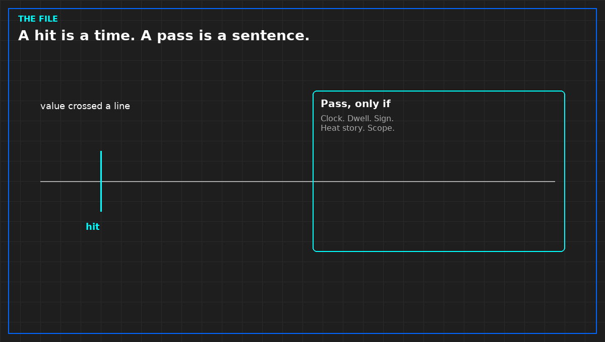

# A hit is a time, not a pass

*Original diagram. Not a site record.*

A load bank file is a record of values against a clock. A value that crosses a line is a hit at a time. It is not a pass. A pass is a sentence you are allowed to write after the channels, the clock, the dwell, the sign, and the heat story have all been checked.

That distinction is where reports go wrong. The plot looks calm, a cell turns green, and the slide says the test passed. The green cell never said which clock it used, whether a failed poll was held forward, or where the heat went. You can have a hit and still have an invalid file. You can have a valid file and still not have proved the plant. Those are different owners. Mixing them makes a bad clock into a construction defect, or a real leak into a software story.

Read the file before you read the summary someone already wrote. Summaries are kinder than files. The judgment sheet is the summary you keep. If it is missing, the curve stays a curve.

The line itself has to exist before the run, in the specification then in force, with a unit. A line added after the plot, to match what happened, is a caption.

From *Read and Use Load Bank Data*, Tristan, Data Center Field Guides. No store link until the Kindle edition is listed.

Related: [A failed poll is a gap](02-a-failed-poll-is-a-gap.md).
