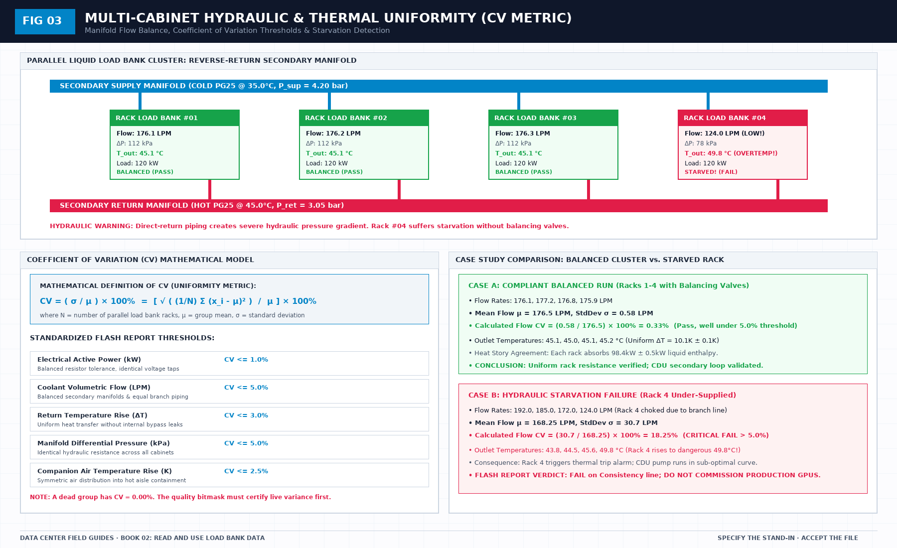

# One clock in the load bank file: First-Principles Data Center Engineering Protocol

> **Direct Answer Block**: Why merging electrical power meters, liquid flow meters, and RTDs into a commissioning flash report requires a single UTC clock synchronized via PTP or NTP. In mission-critical data center commissioning and operations, engineers enforce this boundary using deterministic physical equations, calibrated field instrumentation, and auditable sign-off gates rather than relying on vendor brochure summaries, uncalibrated software plots, or verbal assurances. Every measurement and state transition must be recorded with synchronized UTC timestamps and explicit pass/fail thresholds before a signature is granted.

Two times travel with a sample. Measurement time is when the thing happened. Arrival time is when the store received it. A late packet with a fresh arrival stamp is an old event. Plot by arrival, and a delay becomes a change.

Pick one clock for the decision and write which. A dwell and a heat step are measurement times. A backlog in the collector is an arrival-time problem. Do not average the two to make a chart line up. The average is a third time nobody measured.

If the facility system and the load bank file disagree by minutes, write the offset or refuse the joint chart. A hidden offset invents a cause that is only a delay. That invented cause will be inherited by the report if you do not stop it in the file judgment.

The interval is part of the clock. A point expected every second that arrives every five is not the same series with a smoother average. Write the expected interval. A gap longer than that interval is a gap, even if someone filled it.

---

## 1. First-Principles Engineering Formulation and Governing Mathematics

In high-density data center environments, verbal summaries and qualitative status tiles routinely obscure incipient physical failures. Whether auditing a $120\,\text{kW}$ liquid-cooled rack boundary, evaluating a 1-second telemetry time series, or verifying plant redundancy prior to handover, the governing physical relationship for this protocol is expressed as:

$$\left| t_{\text{PDU, UTC}} - t_{\text{flow, UTC}} \right| \le 100\,\text{ms}, \qquad \tau_{\text{lag}} = \frac{V_{\text{pipe}}}{Q_v}$$

When any term on the left-hand or right-hand side of this relationship is left unmeasured, inferred from an uncalibrated nameplate, or averaged across an unverified time window, the resulting engineering record cannot support a valid operational signature. Field engineers must verify each physical variable independently using NIST/ISO 17025 traceable instruments before proceeding to the next gate in the sequence.

| Audit Verification Parameter | Unacceptable / Defective Field Practice | Auditable First-Principles Requirement | Mandatory Action on Failure |
| :--- | :--- | :--- | :--- |
| **Primary Boundary Definition** | Implied by vendor brochure or slide deck | Explicitly bounded on stamped P&ID / SLD with tag IDs | Halt acceptance; issue formal boundary clarification |
| **Measurement & Telemetry Proof** | Single uncalibrated display reading or 60-sec average | Calibrated Class A/0.5S sensor with 1-sec UTC timestamp | Reject dataset; classify point as `0x40` Stale or `0x80` Bad |
| **Pass / Fail Acceptance Gate** | Qualitative "Looks OK" or "Within Normal Range" | Quantitative numerical corridor cited from revision in force | Log Category A/B defect; withhold retainage or permit |
| **Custody & Sign-Off Record** | Single bundled "Accepted" signature at end of meeting | Scoped, dated sentence naming exact proved & unproved lines | Strike unsupported claims; issue Conditional Refusal |

---

## 2. Deep-Dive Technical Protocol and Field Implementation

The following field protocol—adapted directly from **Volume 02: *Read and Use Load Bank Data: A Field Guide to the Flash Report***—establishes the step-by-step verification mechanics required on the data hall floor:

A plotted point on a flash-report chart is not a raw measurement, and a raw measurement is not an optional disposable scratch file.

In mission-critical commissioning, an engineering chart that cannot produce its underlying raw time-series data is not an analysis; it is a graphic illustration. If you discard the raw data and keep only minute-averages, you lose the ability to detect contactor arcing, flow meter cavitation slugs, and communication timeouts. Conversely, if you present an auditor with an un-aggregated scatter of sixty thousand points per hour, the eye will drown in visual noise and miss long-term thermodynamic drift.

A professional flash report retains both: it acquires high-frequency raw samples, archives them in an immutable time-series store, and constructs each plotted point through strict, auditable statistical aggregation.

(See Figure 04 for the metrological comparison between live physical turbulent jitter and buffer-freeze flatline fraud).

## Raw acquisition at 1 Hz, then the sixty-second mean

The standard acquisition rate for all primary channels in this field guide is **1 Hz (one sample per second per channel)**.
- **Why 1 Hz Is Required**: A sampling rate of 1 Hz captures critical sub-minute physical phenomena: the rapid inrush current of heater staging, the 14-millisecond contactor clearing time during a single-feed drop test, and the dynamic pressure spikes of rapid valve movement. Sampling once every 10 or 30 seconds acts as a severe low-pass filter that blinds the observer to dangerous transients.
- **The Sixty-Second Mean**: Each formal point plotted on a flash-report time-series chart represents the **arithmetic mean of sixty consecutive raw 1-second samples**:
 $$\mu_t = \frac{1}{60} \sum_{i=1}^{60} x_i$$
 where each point is timestamped with the exact start-time of that sixty-second interval (e.g., `14:22:00.000Z`).
- **The Missing Sample Rule**: If an edge gateway or Modbus poller drops communication during that minute, resulting in only 52 valid samples instead of 60, the minute is marked **PARTIAL** in the data block. Under no circumstances may the reporting script copy the neighboring minute's average or fabricate linear interpolation to "keep the curve looking smooth." A smooth curve that covers a communication dropout is an audit falsehood.

## The variance gate: Catching stale data fraud

Sixty raw samples that are identical copies of a single cached float value are not a 60-sample average. They are one value wearing sixty timestamps.

In a turbulent fluid stream carrying 176.5 LPM of fluid through pipe diameters of 1.5 inches (DN39), the Reynolds number easily exceeds Re ≈ 28,000. Fluid flow in this regime is intensely turbulent. Convective micro-eddies, boundary-layer vortex shedding, and pump impeller blade-pass frequencies constantly produce microscopic thermal and pressure fluctuations.
- A genuine physical immersion RTD in live fluid will always exhibit a non-zero sample variance:
 $$\sigma_t^2 = \frac{1}{60} \sum_{i=1}^{60} (x_i - \mu_t)^2 > 0$$
 Typically, a healthy 1-second temperature stream exhibits a standard deviation of σ ≈ 0.05 K to 0.20 K (σ² ≈ 0.0025 to 0.0400 K²).
- **The Flatline Signature of Fraud**: If an edge gateway communication thread locks up, or if an ADC driver hangs and continuously echoes the last known register from RAM, the recorded values become mathematically flat. Every sample over a five-minute stretch reads exactly 45.000000°C down to the least significant bit. The calculated sample variance collapses to:
 $$\sigma_t^2 \equiv 0.000000\,\text{K}^2$$

In a live liquid cooling loop, a variance of exactly zero is physically impossible. It is the definitive smoking gun of **stale data fraud**.

The flash report's automated data ingestion engine must run a continuous variance check:
$$\text{If } \sigma_t^2 \le 1.0 \times 10^{-4}\,\text{K}^2 \text{ for more than 3 consecutive minutes, flag CHANNEL\_FROZEN\_STALE.}$$
When this flag is asserted, the reporting engine must reject the minute block, sound an audible alert, and refuse to calculate a compliant mean. Stale repeats fail the step plateau automatically.

## The four-summary requirement on every step

Whenever a step data block is compiled for the flash report, reporting a simple arithmetic mean is strictly prohibited. A mean alone can conceal a dangerous localized spike.

Every step data block must report **four mandatory statistical quantities** for each active channel across the steady-state dwell:
1. **Minimum Value ($\min$)**: The lowest raw 1-second reading recorded during the dwell.
2. **Maximum Value ($\max$)**: The highest raw 1-second reading recorded during the dwell.
3. **Arithmetic Mean (μ)**: The central baseline value across all valid samples.
4. **Sample Standard Deviation (σ)**: The measure of physical turbulence and control stability.

### Why the Maximum is Essential
Consider a 120kW load step with a mean coolant temperature of 45.0°C. If a pump briefly cavitated or an air bubble passed through the heater vessel for 10 seconds, the localized fluid temperature may have spiked to 68.5°C before recovering. 
- In a 15-minute average of 900 points, that 10-second spike of 68.5°C will raise the mean by a negligible 0.26 K—an offset that any auditor would dismiss as rounding error.
- But reporting the maximum instantly exposes the peak: $\max = 68.5°C$. This immediately alerts the engineering team that EPDM hose temperature limits were breached and that cavitation occurred.

A report that omits the maximum is an attempt to bury operational extremes inside a comfortable average. Require all four numbers on every line.

## Mathematical rules for branch and total sums

When aggregating flow and power across multiple parallel cabinets, arithmetic rules must respect the physical piping and electrical topology:

- **Total Volumetric Flow**: Must be computed strictly from the sum of the individual branch vortex flow meters:
 $$Q_{\text{total}} = \sum_{k=1}^N Q_{\text{branch},k}$$
 Do not sum a main header ultrasonic flow meter and the individual branch meters together and claim that the loop moved twice the fluid! 
- **Missing Meter Rule**: If Cabinet 3's flow meter fails or drops communication, Q_total is incomplete. The flash report must report: *"Total flow: INCOMPLETE (Cabinet 3 meter offline)."* Under no circumstances may an automated script estimate Cabinet 3's flow by averaging Cabinets 1, 2, and 4! An estimated number in a sum is an engineered fabrication.
- **Total Electrical Power**: Must be computed from the discrete phase powers of each branch feeder:
 $$P_{\text{total}} = \sum_{k=1}^N \left( P_{A,k} + P_{B,k} \right)$$
 Do not report an upstream substation transformer power reading and call it the load-bank load. Upstream transformers include cable losses, lighting, and auxiliary chiller pump power that do not touch the liquid load bank.

## Annotating dynamic step transitions

For the Sudden Step Change and Overload scenes, the time-series chart must explicitly annotate the exact second when the command was issued:
- A vertical red dashed marker must indicate t_command.
- A second vertical blue marker must indicate t_settled, when fluid temperature and power achieved their new steady plateau.
- The chart label must state the observed rise time (Δt_rise) and the peak transient pressure pulse (ΔP_surge).

An un-annotated spike on a chart will be interpreted as a catastrophic fault by a skeptic and as a brilliant operational feature by an optimist. Only precise, labeled timestamps prevent subjective debate.

---

## 3. Field Verification Checklist and Instrumentation Hygiene

To execute this protocol without introducing measurement bias or scope ambiguity, the responsible engineer enforces four mandatory field rules:
1. **Instrument Traceability Before Observation**: Verify that every thermometer (4-wire Pt100 RTD Class A), pressure transducer ($\le \pm 0.1\%$ span), flowmeter, balometer, or power analyzer carries a current calibration certificate and passes a pre-test zero/span check on the day of the walk.
2. **Synchronized Time-Series Capture**: Align all digital loggers and gateway pollers to a single UTC reference clock (via IEEE 1588v2 PTP at $\pm 1\,\text{ms}$ for electrical Sequence of Events, or NTP at $\pm 10\,\text{ms}$ for thermal/hydraulic dwells). Never merge unsynchronized CSV files by row index.
3. **Explicit Isolation of Disturbances vs. Control Handles**: Hold upstream supply temperatures, parallel cabinet loads, and containment door states constant during the observation dwell so that transient plant drift is never mistaken for steady-state equipment performance.
4. **Written Record Prior to Signature**: Record every boundary tag, measured value, uncertainty tolerance, and open limitation in ink on the controlled project sheet before leaving the equipment line-up.

---

## Frequently Asked Questions (FAQ)

### Why does "One clock in the load bank file" matter during high-density data center commissioning and operations?
Why merging electrical power meters, liquid flow meters, and RTDs into a commissioning flash report requires a single UTC clock synchronized via PTP or NTP. When project teams bypass this rule to meet a commercial schedule milestone, unverified physical assumptions—such as hidden hydraulic pressure drops, unlogged polling gaps, unblanked bypass leakage, or uncalibrated sensor offsets—transfer directly into live 24/7 production as latent single points of failure.

### How do you quantitatively verify compliance with "NTP PTP clock synchronization load bank data" on the physical floor?
Compliance is verified by executing the governing mathematical balance ($$\left| t_{\text{PDU, UTC}} - t_{\text{flow, UTC}} \right| \le 100\,\text{ms}, \qquad \tau_{\text{lag}} = \frac{V_{\text{pipe}}}{Q_v}$$) using independent, calibrated field instruments across a stabilized steady-state dwell window (minimum 15 to 30 minutes for thermal and hydraulic systems), and confirming that the discrepancy between primary and secondary measurements remains strictly within the pre-declared acceptance band.

### What should an engineer do if a contractor or vendor submits a report that violates this protocol?
The reviewing engineer must refuse to sign the broad acceptance sentence, mark the specific line item as **Unproved / Defective** on the official audit sheet, and either require a witnessed re-test under a corrected script or isolate the unproved scope under a time-bounded Conditional Acceptance with a $150\%$ to $200\%$ financial retainage escrow holdback.

---

From *Read and Use Load Bank Data: A Field Guide to the Flash Report*, Tristan, Data Center Field Guides.

Related: [The sentence a load bank file may support](02-the-sentence-the-file-may-support.md).
