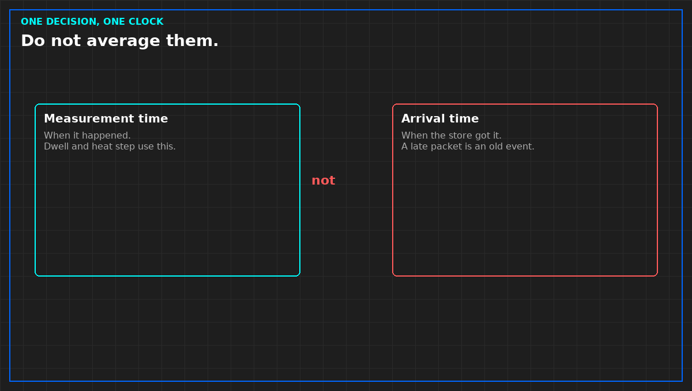

# One clock in the load bank file

*Original diagram. Not a site record.*

Two times travel with a sample. Measurement time is when the thing happened. Arrival time is when the store received it. A late packet with a fresh arrival stamp is an old event. Plot by arrival, and a delay becomes a change.

Pick one clock for the decision and write which. A dwell and a heat step are measurement times. A backlog in the collector is an arrival-time problem. Do not average the two to make a chart line up. The average is a third time nobody measured.

If the facility system and the load bank file disagree by minutes, write the offset or refuse the joint chart. A hidden offset invents a cause that is only a delay. That invented cause will be inherited by the report if you do not stop it in the file judgment.

The interval is part of the clock. A point expected every second that arrives every five is not the same series with a smoother average. Write the expected interval. A gap longer than that interval is a gap, even if someone filled it.

From *Read and Use Load Bank Data*, Tristan, Data Center Field Guides. No store link until the Kindle edition is listed.

Related: [The sentence a load bank file may support](02-the-sentence-the-file-may-support.md).
