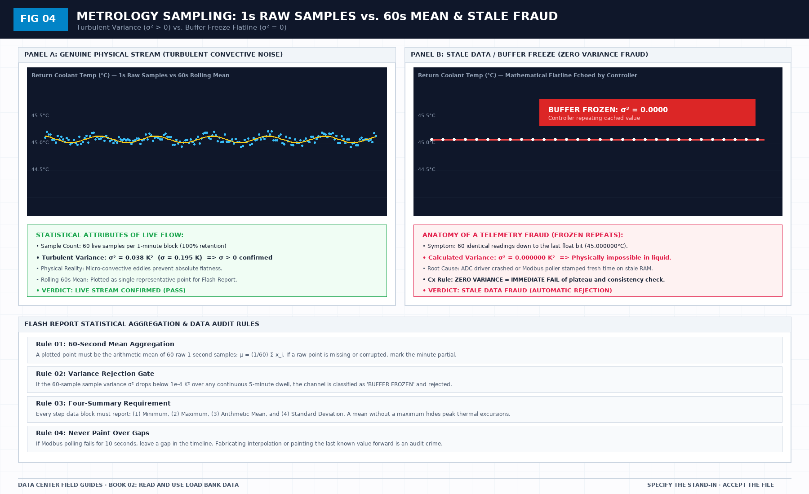

# The sentence a load bank file may support

> **Direct Answer Block**: The exact bounded engineering sentence a 5-pass liquid load bank flash report can legally support—and why a rack test never certifies whole-hall seasonal redundancy. In mission-critical data center commissioning and operations, engineers enforce this boundary using deterministic physical equations, calibrated field instrumentation, and auditable sign-off gates rather than relying on vendor brochure summaries, uncalibrated software plots, or verbal assurances. Every measurement and state transition must be recorded with synchronized UTC timestamps and explicit pass/fail thresholds before a signature is granted.

After the checks, you get one sentence, or you get none. The sentence names the channels that were live, the clock used, the dwell that was actually met, the sign of the heat, and where the heat went. It does not say the hall passed, the CDU is accepted, or the IT may arrive.

If any check failed, the sentence is that the file is not a valid test, with the reason left in those terms. That is a useful result. Hiding it under a kinder heading is how the next meeting quotes a pass you did not have.

Scope is part of the sentence. A valid file on one loop is not a valid file on the hall. If the signature page is wider than the loops that were judged, strike the extra words. Do not add them back in the executive summary.

Hand that sentence, not the plot, to the verification close-out. A curve without the sentence is a picture. Pictures get filed. They do not get signed as proof.

---

## 1. First-Principles Engineering Formulation and Governing Mathematics

In high-density data center environments, verbal summaries and qualitative status tiles routinely obscure incipient physical failures. Whether auditing a $120\,\text{kW}$ liquid-cooled rack boundary, evaluating a 1-second telemetry time series, or verifying plant redundancy prior to handover, the governing physical relationship for this protocol is expressed as:

$$\text{Enthalpy Closure} = \left[ 1 - \frac{|P_{\text{elec}} - (Q_{\text{liquid}} + Q_{\text{air}})|}{P_{\text{elec}}} \right] \times 100\% \ge 97.0\%$$

When any term on the left-hand or right-hand side of this relationship is left unmeasured, inferred from an uncalibrated nameplate, or averaged across an unverified time window, the resulting engineering record cannot support a valid operational signature. Field engineers must verify each physical variable independently using NIST/ISO 17025 traceable instruments before proceeding to the next gate in the sequence.

| Audit Verification Parameter | Unacceptable / Defective Field Practice | Auditable First-Principles Requirement | Mandatory Action on Failure |
| :--- | :--- | :--- | :--- |
| **Primary Boundary Definition** | Implied by vendor brochure or slide deck | Explicitly bounded on stamped P&ID / SLD with tag IDs | Halt acceptance; issue formal boundary clarification |
| **Measurement & Telemetry Proof** | Single uncalibrated display reading or 60-sec average | Calibrated Class A/0.5S sensor with 1-sec UTC timestamp | Reject dataset; classify point as `0x40` Stale or `0x80` Bad |
| **Pass / Fail Acceptance Gate** | Qualitative "Looks OK" or "Within Normal Range" | Quantitative numerical corridor cited from revision in force | Log Category A/B defect; withhold retainage or permit |
| **Custody & Sign-Off Record** | Single bundled "Accepted" signature at end of meeting | Scoped, dated sentence naming exact proved & unproved lines | Strike unsupported claims; issue Conditional Refusal |

---

## 2. Deep-Dive Technical Protocol and Field Implementation

The following field protocol—adapted directly from **Volume 02: *Read and Use Load Bank Data: A Field Guide to the Flash Report***—establishes the step-by-step verification mechanics required on the data hall floor:

A liquid load bank is not an island, and a commissioning test does not occur in an abstract vacuum. The load bank connects directly to live facility infrastructure: to a Coolant Distribution Unit (CDU), to an uninterruptible power supply (UPS) or automatic transfer switch (ATS), and to computer room air handlers (CRAH).

A frequent failure mode in commissioning reporting is the confusion of boundaries:
- When a facility CDU circulating pump trips on an internal inverter fault, an inexperienced team may blame the load bank for "failing to maintain flow."
- Conversely, when a load bank's high-temperature safety switch trips due to poorly submerged heating elements, a vendor may attempt to blame the facility CDU for "running too warm."

The flash report must draw an uncompromising physical and operational boundary between the load bank (the machine under test) and the external facility gear (the host environment). A failure of external facility gear is an operational event; it is not automatically a failure of the load bank. But it must be documented with absolute precision so that the true cause of an interrupted dwell is transparent to any future auditor.

## The four external gear lines

The flash report includes an External Gear section with four explicit lines, evaluated before, during, and after every test run:

### Line 1: Coolant Distribution Unit (CDU)
The CDU is responsible for circulating secondary coolant through the load bank and transferring heat to the primary facility chilled water loop via its internal brazed plate or shell-and-tube heat exchanger.

The flash report monitors four CDU interface metrics:
- **Secondary Loop Supply Temperature (T_CDU,sup)**: The temperature of fluid exiting the CDU heat exchanger before entering the load-bank supply manifold. The report verifies that the CDU maintains its declared supply setpoint (e.g., 35.0°C ± 1.0 K). If the primary facility water warms up, causing T_CDU,sup to drift upward to 42.0°C, that drift is recorded as a **CDU boundary condition excursion**, not as a load-bank heating error.
- **Secondary Delivery Pressure & Pump Curve**: The available static pressure delivered by the CDU pumps at rated cluster flow. If the CDU pump speed hunts or cavitates due to poor suction pressure, the resulting flow fluctuations are logged against the CDU line.
- **CDU Approach Temperature**: The temperature difference between the secondary return fluid and the primary facility water (Approach = T_sec,ret - T_pri,sup). An increasing approach temperature over time indicates fouling in the CDU heat exchanger plates, not element degradation in the load bank.

### Line 2: Uninterruptible Power Supply (UPS) & Automatic Transfer Switch (ATS)
The electrical power feeding the load bank originates from facility distribution switchboards, often backed by static UPS modules or diesel generator ATS gear.

The flash report monitors:
- **Voltage Stability & Harmonic Distortion**: Line voltage sag during full-load staging. If the facility transformer sags from 415V down to 380V under full 480kW load, the active power of resistive elements will drop by nearly 16% ($P \propto V²$). The report must document that the load drop was driven by facility utility sag, not by early contactor shedding.
- **ATS Transfer Immunity**: If an integrated system test (IST) initiates an upstream power transfer, the duration of the open-transition interruption must be timed. If the interruption exceeds the load bank's 24VDC control buffer hold-up time (typically 40ms), the unit will de-energize safely, which must be attributed to the facility transfer transient.

### Line 3: Power Distribution Units (PDUs) and Busways
The physical power path from the electrical panelboard through busway tap-off boxes and drop cables to the load-bank terminals:
- **Terminal Temperature Rise (ΔT_terminal)**: Infrared thermography or calibrated thermocouple monitoring of cable lugs and contactor terminals. Terminal temperature must not exceed 70°C (or the specific rating of the 90°C RHW-2 conductor).
- **Busway Voltage Drop**: Voltage drop across the temporary feeder cables must be bounded at ≤ 2.0%.

### Line 4: Computer Room Air Handlers (CRAH / CRAC / Fan Wall)
The facility air-handling units responsible for absorbing the 16% to 20% companion air sensible heat dissipated by the load-bank blowers:
- **Intake/Discharge Air Differential**: Verifying that the data hall's hot-aisle containment (HAC) maintains proper negative pressure relative to the cold aisle, preventing thermal recirculation into adjacent server rows.
- **CRAH Chilled Water Valve Response**: Confirming that CRAH cooling coils modulate open smoothly in response to the companion air load without overflowing condensate drain pans.

## How to write an honest boundary sentence

When an anomaly or interruption occurs during a test run, the Recorder must write an honest boundary sentence. 

An honest boundary sentence adheres to three strict grammatical rules:
1. **It names the exact physical parameter that breached a threshold.**
2. **It names the specific side of the boundary where the breach occurred.**
3. **It states the consequence on the test scene without assigning speculative blame.**

### Example of an Honest Boundary Sentence
> *"At 15:42:18 UTC, during Step 4 (120kW dwell), secondary coolant supply temperature from the facility CDU rose to 39.8°C (exceeding the cited pretest boundary of 36.5°C). The load bank maintained rated electrical load (120.1kW) and normal flow (176.4 LPM), but return temperature reached 49.9°C, triggering an automated overtemperature supervisory alarm. The dwell was halted at Minute 11 by operator command. Verdict for Step 4: INVALID due to facility CDU supply temperature excursion; load bank electrical and hydraulic tracking remained fully compliant."*

### Example of a Dishonest Sentence
> *"The test had some issues with the building water, but the load bank basically passed."*

The dishonest sentence provides zero data, cites no timestamp, names no temperature, and attempts to claim an illegitimate pass. An auditor will reject it instantly. The honest sentence provides exact numbers, identifies the CDU boundary excursion, records the aborted dwell, and preserves the technical integrity of the load-bank hardware for the re-test.

## External gear pass/fail status

On the flash report summary sheet, each of the four external gear lines is given an independent status:
- **NORMAL**: Operated within the cited design envelope for the entire run.
- **EXCURSION**: Breached an operating envelope, with exact timestamps and affected parameters documented.
- **NOT APPLICABLE (N/A)**: Gear was excluded from the testing boundary by pre-declared agreement.

A facility CDU excursion does not ruin the reputation of a well-engineered load bank, nor does a clean load bank excuse a failing facility plant. The report records both, in daylight, separated by the physical manifold boundary.

---

## 3. Field Verification Checklist and Instrumentation Hygiene

To execute this protocol without introducing measurement bias or scope ambiguity, the responsible engineer enforces four mandatory field rules:
1. **Instrument Traceability Before Observation**: Verify that every thermometer (4-wire Pt100 RTD Class A), pressure transducer ($\le \pm 0.1\%$ span), flowmeter, balometer, or power analyzer carries a current calibration certificate and passes a pre-test zero/span check on the day of the walk.
2. **Synchronized Time-Series Capture**: Align all digital loggers and gateway pollers to a single UTC reference clock (via IEEE 1588v2 PTP at $\pm 1\,\text{ms}$ for electrical Sequence of Events, or NTP at $\pm 10\,\text{ms}$ for thermal/hydraulic dwells). Never merge unsynchronized CSV files by row index.
3. **Explicit Isolation of Disturbances vs. Control Handles**: Hold upstream supply temperatures, parallel cabinet loads, and containment door states constant during the observation dwell so that transient plant drift is never mistaken for steady-state equipment performance.
4. **Written Record Prior to Signature**: Record every boundary tag, measured value, uncertainty tolerance, and open limitation in ink on the controlled project sheet before leaving the equipment line-up.

---

## Frequently Asked Questions (FAQ)

### Why does "The sentence a load bank file may support" matter during high-density data center commissioning and operations?
The exact bounded engineering sentence a 5-pass liquid load bank flash report can legally support—and why a rack test never certifies whole-hall seasonal redundancy. When project teams bypass this rule to meet a commercial schedule milestone, unverified physical assumptions—such as hidden hydraulic pressure drops, unlogged polling gaps, unblanked bypass leakage, or uncalibrated sensor offsets—transfer directly into live 24/7 production as latent single points of failure.

### How do you quantitatively verify compliance with "load bank flash report acceptance verdict" on the physical floor?
Compliance is verified by executing the governing mathematical balance ($$\text{Enthalpy Closure} = \left[ 1 - \frac{|P_{\text{elec}} - (Q_{\text{liquid}} + Q_{\text{air}})|}{P_{\text{elec}}} \right] \times 100\% \ge 97.0\%$$) using independent, calibrated field instruments across a stabilized steady-state dwell window (minimum 15 to 30 minutes for thermal and hydraulic systems), and confirming that the discrepancy between primary and secondary measurements remains strictly within the pre-declared acceptance band.

### What should an engineer do if a contractor or vendor submits a report that violates this protocol?
The reviewing engineer must refuse to sign the broad acceptance sentence, mark the specific line item as **Unproved / Defective** on the official audit sheet, and either require a witnessed re-test under a corrected script or isolate the unproved scope under a time-bounded Conditional Acceptance with a $150\%$ to $200\%$ financial retainage escrow holdback.

---

From *Read and Use Load Bank Data: A Field Guide to the Flash Report*, Tristan, Data Center Field Guides.

Related: [Close-out is not a heat-test report](03-close-out-is-not-a-heat-report.md).
