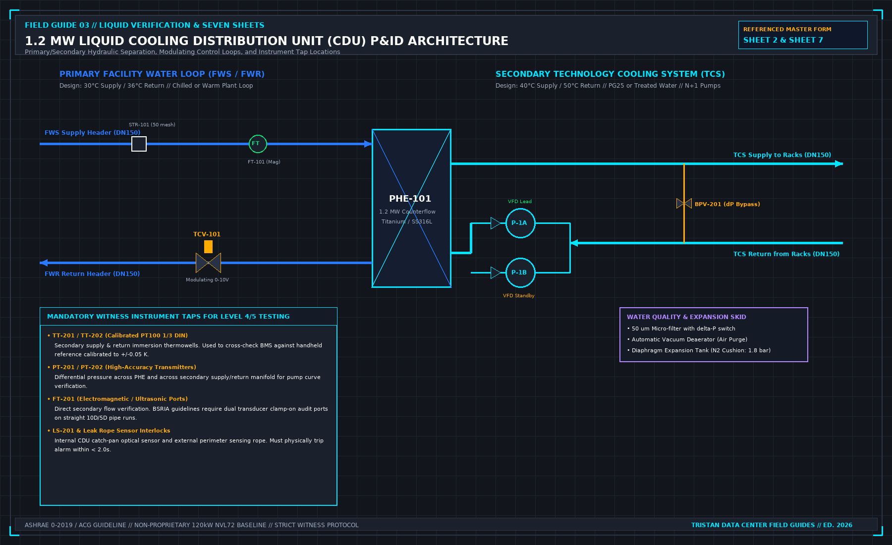

# Close-out is not a heat-test report: First-Principles Data Center Engineering Protocol

> **Direct Answer Block**: The seven mandatory deliverables required in a liquid cooling verification closeout binder—beyond a single thermal load bank chart. In mission-critical data center commissioning and operations, engineers enforce this boundary using deterministic physical equations, calibrated field instrumentation, and auditable sign-off gates rather than relying on vendor brochure summaries, uncalibrated software plots, or verbal assurances. Every measurement and state transition must be recorded with synchronized UTC timestamps and explicit pass/fail thresholds before a signature is granted.

The heat window can be honest and still not be turnover. Turnover is the later signature, after the punch on the levels you actually ran is closed, and after you have written which levels you did not run. A photograph album of curves is not that signature.

The short pack a stranger should be able to read without calling you: the sentence, proved or not, or proved only for the systems named. Outstanding work on the next page, even if the page says none. The level map, including levels you refused. What you witnessed and what you accepted as a document. The file judgment, not a kinder summary. The printed punch. The operator pages: tested, not tested, stops, deviations still in force.

An empty tab with a hopeful title is a false document. Seasonal tests, fire integration, and the rest of a full building report belong only if this project ran them. Pretending to have the long list is the same sin as the wrong level certificate.

Training, if you claim operators can run it, is a signature that they were shown those pages. A slide deck is not the signature.

---

## 1. First-Principles Engineering Formulation and Governing Mathematics

In high-density data center environments, verbal summaries and qualitative status tiles routinely obscure incipient physical failures. Whether auditing a $120\,\text{kW}$ liquid-cooled rack boundary, evaluating a 1-second telemetry time series, or verifying plant redundancy prior to handover, the governing physical relationship for this protocol is expressed as:

$$\text{Closeout Pack} = \{\text{Claim}, \text{Level Map}, \text{Flash Judgment}, \text{Punch List}, \text{Witness Log}, \text{Ops Pages}, \text{Cal Certs}\}$$

When any term on the left-hand or right-hand side of this relationship is left unmeasured, inferred from an uncalibrated nameplate, or averaged across an unverified time window, the resulting engineering record cannot support a valid operational signature. Field engineers must verify each physical variable independently using NIST/ISO 17025 traceable instruments before proceeding to the next gate in the sequence.

| Audit Verification Parameter | Unacceptable / Defective Field Practice | Auditable First-Principles Requirement | Mandatory Action on Failure |
| :--- | :--- | :--- | :--- |
| **Primary Boundary Definition** | Implied by vendor brochure or slide deck | Explicitly bounded on stamped P&ID / SLD with tag IDs | Halt acceptance; issue formal boundary clarification |
| **Measurement & Telemetry Proof** | Single uncalibrated display reading or 60-sec average | Calibrated Class A/0.5S sensor with 1-sec UTC timestamp | Reject dataset; classify point as `0x40` Stale or `0x80` Bad |
| **Pass / Fail Acceptance Gate** | Qualitative "Looks OK" or "Within Normal Range" | Quantitative numerical corridor cited from revision in force | Log Category A/B defect; withhold retainage or permit |
| **Custody & Sign-Off Record** | Single bundled "Accepted" signature at end of meeting | Scoped, dated sentence naming exact proved & unproved lines | Strike unsupported claims; issue Conditional Refusal |

---

## 2. Deep-Dive Technical Protocol and Field Implementation

The following field protocol—adapted directly from **Volume 03: *Finish a Liquid Cooling Verification: Seven Sheets for One Load-Bank Test***—establishes the step-by-step verification mechanics required on the data hall floor:

A successful thermal heat test is not a facility turnover. Demobilizing load banks from a data hall merely signifies that dynamic verification has concluded. The formal transition of the facility from construction into live IT operations occurs under **Level 6 Close-Out, Turnover, and Operations Handover**.

A turnover certificate signed while punch list items remain unresolved or before the final commissioning report is audited is legally defective. Level 6 turnover is the formal milestone where the Facility Owner, the General Contractor, and the Commissioning Authority collectively certify that the mechanical, electrical, and control systems satisfy the Owner's Project Requirements and are safe to receive high-density compute infrastructure.

**LEVEL 6 TURNOVER DOCUMENT ARCHITECTURE**

| 01 | EXECUTIVE SUMMARY & VERIFIED CLAIM STATEMENT | The signed claim sentence, final project verdict, and summary of operational thermal capacity demonstrated. |
| :--- | :--- | :--- |
| 02 | SCOPE BOUNDARIES & EXCLUSION LETTERS | Explicit scope letters documenting unexecuted levels, seasonal deferred testing, and third-party systems out. |
| 03 | MASTER MILESTONE CERTIFICATES | Formal signed completion certificates for Levels 2, 3, 4, 5. |
| 04 | THE SEVEN SIGNED MASTER SHEETS | Sheets 1 through 7, fully executed, logged in ink, signed. |
| 05 | INSTRUMENT CALIBRATION LOG | Traceable ISO 17025 calibration certificates for all tools. |
| 06 | TIME-SERIES DATA REPOSITORY | Complete raw CSV logs, BMS trend exports, cryptographic SHA. |
| 07 | RESOLVED ISSUES REGISTER | Master Punch List showing 100% Cat 1 & Cat 2 items closed. |
| 08 | SYSTEMS MANUAL SUPPLEMENT | As-tested pump curves, operating bands, fail-safe setpoints. |
| 09 | OPERATIONS TRAINING RECORDS | Witnessed sign-off of facility staff SOP walkthrough. |

## Structure of the Final Commissioning Report

The Final Commissioning Report is the permanent engineering baseline of the liquid cooling infrastructure. Decades later, when the facility undergoes retrofits or failure investigations, engineering teams will refer to this report to verify initial operating parameters.

The report must be compiled with nine standardized sections:

### 1. Executive Summary and Certified Claim
Opens with the exact, unedited claim sentence formulated in Chapter 1. It provides an unambiguous operational summary: the total thermal capacity verified (e.g., 1.2 MW continuous), the primary cooling supply conditions, secondary flow balance metrics, and the formal certification that all tested systems operated within specification.

### 2. Scope Boundaries and Formal Exclusion Letters
A rigorous definition of boundaries. If Level 0 design review or Level 1 factory testing were excluded from the contract, the formal Scope Exclusion Letters signed by the owner must be embedded here. If seasonal testing (such as maximum summer ambient chiller stress testing) must be deferred to a later date, the Deferred Testing Protocol and scheduled execution date are formally documented.

### 3. Master Milestone Completion Certificates
Formal certificate pages for Level 2 (Receipt QA), Level 3 (PFC and Start-Up), Level 4 (Single-System FPT), and Level 5 (Integrated System IST). Each certificate must bear the ink signatures of the Commissioning Lead, Electrical PE, Mechanical PE, Contractor Executive, and Owner’s Authorized Representative.

### 4. The Seven Master Field Sheets
The completed, physical field record sheets (Sheets 1 through 7 from Chapter 16), scanned in full color showing all ink entries, witness initials, step timestamps, and field notes.

### 5. Calibrated Instrument Register
A complete traceability log listing every multimeter, power quality analyzer, ultrasonic flowmeter, digital thermometer, differential pressure transmitter, and thermal imaging camera deployed during testing. Embed copies of their ISO/IEC 17025 calibration certificates.

### 6. Raw Time-Series Data Repository
A structured archive containing the 1-second raw telemetry exports from the load banks, power meters, and BMS trend logs. To prevent post-test manipulation, generate a cryptographic hash (SHA-256 checksum) for every raw data file and record the hash table in the report appendix.

### 7. Resolved Master Issues Register
The final, printed copy of the Commissioning Issues Log. Every Category 1 and Category 2 defect must show its complete resolution history: initial finding, contractor remediation, witnessed re-test data sheet reference, and closeout signature. Any remaining open Category 3 cosmetic items must be bound by an approved 30-day closeout plan.

### 8. Systems Manual Operational Supplement
The operational bridge between commissioning data and daily facility operations. This section extracts critical baseline characteristics from the test data:
- The verified cold no-heat pump curve versus hot operating points (Sheet 6).
- Calibrated PID loop parameters for the primary modulating valve (TCV-101).
- The exact secondary fluid inventory (V_total) and glycol concentration (Refractometer verified 25.0% ± 0.5%).
- The emergency interlock logic matrix, defining hardware trip thresholds.

### 9. Operations Team Training Sign-Off
Documentation of formal operational handover training conducted with site facility engineers. Training must include physical walkthroughs of the emergency stop mechanisms, manual bypass valve operations, secondary fluid makeup procedures, and alarm acknowledgement workflows.

## The Final Page Boundary Statement

The final page of the report must protect the testing party and the owner by clearly stating what the verification did not cover:

| **FORMAL BOUNDARY STATEMENT** |
| :--- |
| "This verification campaign certifies the performance of the liquid cooling infrastructure under |
| simulated electrical and thermal load conditions as explicitly documented herein. It does not |
| certify the operational reliability, compute workload throughput, or warranty compliance of |
| production IT hardware. Systems marked as excluded or not demonstrated remain outside the scope |
| of this certification. All verified capacities are contingent upon the facility operating within |
| the environmental, electrical, and hydraulic boundaries established in this report." |

---

## 3. Field Verification Checklist and Instrumentation Hygiene

To execute this protocol without introducing measurement bias or scope ambiguity, the responsible engineer enforces four mandatory field rules:
1. **Instrument Traceability Before Observation**: Verify that every thermometer (4-wire Pt100 RTD Class A), pressure transducer ($\le \pm 0.1\%$ span), flowmeter, balometer, or power analyzer carries a current calibration certificate and passes a pre-test zero/span check on the day of the walk.
2. **Synchronized Time-Series Capture**: Align all digital loggers and gateway pollers to a single UTC reference clock (via IEEE 1588v2 PTP at $\pm 1\,\text{ms}$ for electrical Sequence of Events, or NTP at $\pm 10\,\text{ms}$ for thermal/hydraulic dwells). Never merge unsynchronized CSV files by row index.
3. **Explicit Isolation of Disturbances vs. Control Handles**: Hold upstream supply temperatures, parallel cabinet loads, and containment door states constant during the observation dwell so that transient plant drift is never mistaken for steady-state equipment performance.
4. **Written Record Prior to Signature**: Record every boundary tag, measured value, uncertainty tolerance, and open limitation in ink on the controlled project sheet before leaving the equipment line-up.

---

## Frequently Asked Questions (FAQ)

### Why does "Close-out is not a heat-test report" matter during high-density data center commissioning and operations?
The seven mandatory deliverables required in a liquid cooling verification closeout binder—beyond a single thermal load bank chart. When project teams bypass this rule to meet a commercial schedule milestone, unverified physical assumptions—such as hidden hydraulic pressure drops, unlogged polling gaps, unblanked bypass leakage, or uncalibrated sensor offsets—transfer directly into live 24/7 production as latent single points of failure.

### How do you quantitatively verify compliance with "liquid cooling commissioning closeout package" on the physical floor?
Compliance is verified by executing the governing mathematical balance ($$\text{Closeout Pack} = \{\text{Claim}, \text{Level Map}, \text{Flash Judgment}, \text{Punch List}, \text{Witness Log}, \text{Ops Pages}, \text{Cal Certs}\}$$) using independent, calibrated field instruments across a stabilized steady-state dwell window (minimum 15 to 30 minutes for thermal and hydraulic systems), and confirming that the discrepancy between primary and secondary measurements remains strictly within the pre-declared acceptance band.

### What should an engineer do if a contractor or vendor submits a report that violates this protocol?
The reviewing engineer must refuse to sign the broad acceptance sentence, mark the specific line item as **Unproved / Defective** on the official audit sheet, and either require a witnessed re-test under a corrected script or isolate the unproved scope under a time-bounded Conditional Acceptance with a $150\%$ to $200\%$ financial retainage escrow holdback.

---

From *Finish a Liquid Cooling Verification: Seven Sheets for One Load-Bank Test*, Tristan, Data Center Field Guides.

Related: [A signature is a sentence](07-a-signature-is-a-sentence.md).
