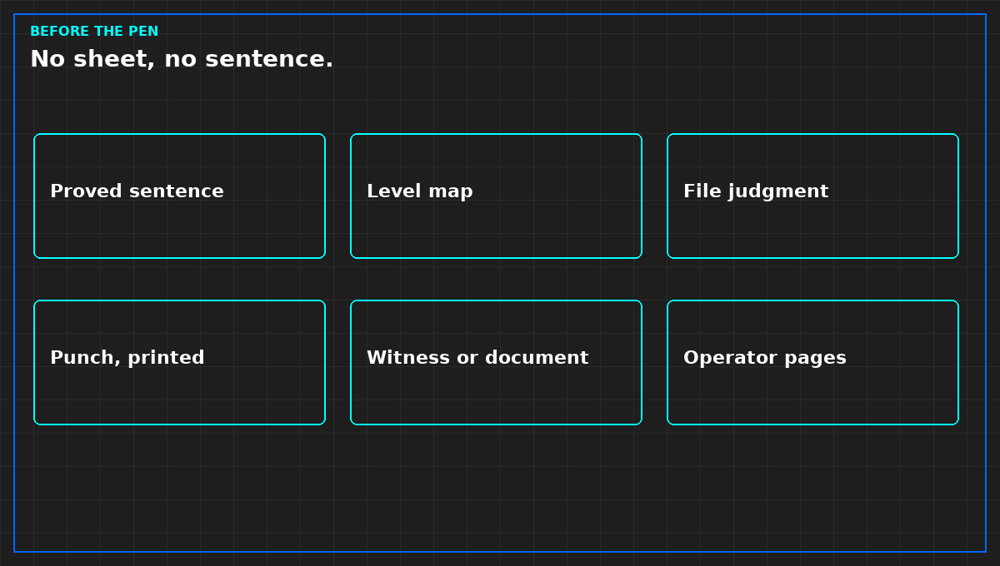

# Close-out is not a heat-test report

*Original diagram. Not a site record.*

The heat window can be honest and still not be turnover. Turnover is the later signature, after the punch on the levels you actually ran is closed, and after you have written which levels you did not run. A photograph album of curves is not that signature.

The short pack a stranger should be able to read without calling you: the sentence, proved or not, or proved only for the systems named. Outstanding work on the next page, even if the page says none. The level map, including levels you refused. What you witnessed and what you accepted as a document. The file judgment, not a kinder summary. The printed punch. The operator pages: tested, not tested, stops, deviations still in force.

An empty tab with a hopeful title is a false document. Seasonal tests, fire integration, and the rest of a full building report belong only if this project ran them. Pretending to have the long list is the same sin as the wrong level certificate.

Training, if you claim operators can run it, is a signature that they were shown those pages. A slide deck is not the signature.

From *Finish a Liquid Cooling Verification*, Tristan, Data Center Field Guides. No store link until the Kindle edition is listed.

Related: [A signature is a sentence](07-a-signature-is-a-sentence.md).
