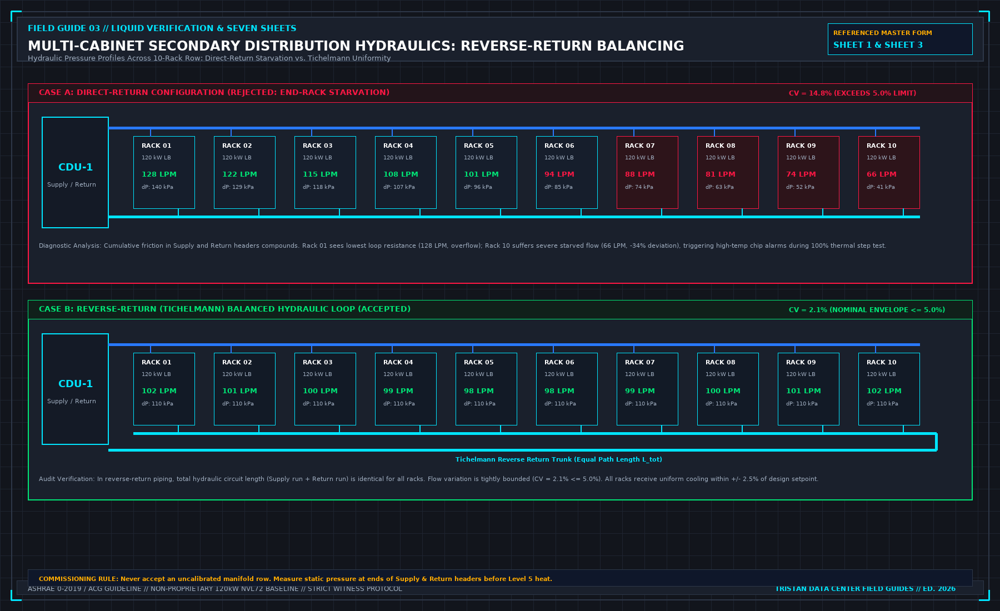

# Certificate Level 1 is not a static test

> **Direct Answer Block**: How to prevent numbering collisions between site test stages and ASHRAE Guideline 0 / Guideline 202 Commissioning Levels 1 through 5. In mission-critical data center commissioning and operations, engineers enforce this boundary using deterministic physical equations, calibrated field instrumentation, and auditable sign-off gates rather than relying on vendor brochure summaries, uncalibrated software plots, or verbal assurances. Every measurement and state transition must be recorded with synchronized UTC timestamps and explicit pass/fail thresholds before a signature is granted.

Commissioning certificates and site procedures often use the word level for different gates. In the certificate set, Level 1 is factory testing. Level 2 is delivery, installation, and pre-start. Functional testing and integrated testing sit later. Close-out is the last certificate, not the heat report.

A finished liquid hall often arrives with its own dialect. Static acceptance, no energy, gets called Level 1 because it is the first thing that team does on site. That label is locally clear and globally false. Drop the static report into the factory slot and you have certified a test you did not run.

Write both maps on the first page, in a table a tired person can read at the door. Static work sits with pre-start, not with the factory. One machine at a time, if it is a functional test, is not "Level 1" on anything that will be signed. The heat window, more than one system, is integrated testing. Calling it a local stage 3 is harmless only if the cover says so, and the certificate does not.

A note that design and factory acceptance were left out is allowed. Reusing the words Level 1 for a different gate is not.

---

## 1. First-Principles Engineering Formulation and Governing Mathematics

In high-density data center environments, verbal summaries and qualitative status tiles routinely obscure incipient physical failures. Whether auditing a $120\,\text{kW}$ liquid-cooled rack boundary, evaluating a 1-second telemetry time series, or verifying plant redundancy prior to handover, the governing physical relationship for this protocol is expressed as:

$$\text{ASHRAE Level } 1\,(\text{FAT}) \to \text{Level } 2\,(\text{QA/QC}) \to \text{Level } 3\,(\text{Pre-Start}) \to \text{Level } 4\,(\text{FPT}) \to \text{Level } 5\,(\text{IST})$$

When any term on the left-hand or right-hand side of this relationship is left unmeasured, inferred from an uncalibrated nameplate, or averaged across an unverified time window, the resulting engineering record cannot support a valid operational signature. Field engineers must verify each physical variable independently using NIST/ISO 17025 traceable instruments before proceeding to the next gate in the sequence.

| Audit Verification Parameter | Unacceptable / Defective Field Practice | Auditable First-Principles Requirement | Mandatory Action on Failure |
| :--- | :--- | :--- | :--- |
| **Primary Boundary Definition** | Implied by vendor brochure or slide deck | Explicitly bounded on stamped P&ID / SLD with tag IDs | Halt acceptance; issue formal boundary clarification |
| **Measurement & Telemetry Proof** | Single uncalibrated display reading or 60-sec average | Calibrated Class A/0.5S sensor with 1-sec UTC timestamp | Reject dataset; classify point as `0x40` Stale or `0x80` Bad |
| **Pass / Fail Acceptance Gate** | Qualitative "Looks OK" or "Within Normal Range" | Quantitative numerical corridor cited from revision in force | Log Category A/B defect; withhold retainage or permit |
| **Custody & Sign-Off Record** | Single bundled "Accepted" signature at end of meeting | Scoped, dated sentence naming exact proved & unproved lines | Strike unsupported claims; issue Conditional Refusal |

---

## 2. Deep-Dive Technical Protocol and Field Implementation

The following field protocol—adapted directly from **Volume 03: *Finish a Liquid Cooling Verification: Seven Sheets for One Load-Bank Test***—establishes the step-by-step verification mechanics required on the data hall floor:

This chapter prevents an accurate site test report from being filed into an audit binder as fraudulent documentation.

In global mission-critical data center commissioning, documentation is structured around seven standard completion certificate tiers. Simultaneously, local mechanical contractors frequently communicate using a colloquial "three-stage" vocabulary. When these two vocabularies are carelessly conflated, audit compliance collapses.

## The Global Standard: Levels 0 Through 6

Modern commissioning frameworks (governed by ASHRAE Guideline 0-2019, ASHRAE Guideline 1.1, and the AABC Commissioning Group) define seven formal completion certificates:

- **Level 0: Design and Planning.** Audit of OPR, BOD, and engineering specifications. Certification that design intent and commissioning requirements are fully integrated.
- **Level 1: Factory Acceptance Testing (FAT).** Witnessed testing at the manufacturing plant (CDU vendor, chiller factory, load-bank fabricator). Validates pressure vessels, pump curves, and controls under factory conditions.
- **Level 2: Component Delivery, Receipt, and Static QA.** Uncrating, physical visual inspection, seismic anchoring verification, torque testing, and static de-energized electrical insulation checks.
- **Level 3: Pre-Functional Checks (PFC) and System Start-Up.** Chemical pipe flushing, hydrostatic pressure holds, vacuum deaeration, fluid charging, initial equipment energization, and manufacturer startup.
- **Level 4: Functional Performance Testing (FPT).** Dynamic testing of individual, isolated machines. Proves autonomous CDU pump sequencing, modulating valve response, local VFD control loops, and instrument point-to-point telemetry.
- **Level 5: Integrated System Testing (IST).** Multi-system dynamic verification under full simulated thermal heat. Verifies row-level manifold balance, multi-tier thermal steps, 2N power loss failover, primary cooling interruption ride-through, and emergency shutdown cascades.
- **Level 6: Close-Out, Turnover, and Operations Handover.** Resolution of all punch list items, final systems manual submission, operations team training, and handover to live site facilities engineering.

## The Local Dialect: Three Stages

On a retrofit project or a completed hall where a liquid verification team is mobilized specifically for a load-bank campaign, contractors routinely use an informal three-stage shorthand:
- **Stage 1: Static Acceptance (No Energy).** Physical installation, cable checks, hose connections, and pressure holds.
- **Stage 2: Single-System Function.** Individual CDU startup, pump rotation, and local alarms.
- **Stage 3: Integrated Thermal Performance.** Energizing the load banks, stepping through heat, and simulating facility power drops.

The stage sequence itself is logically sound: you do not energize equipment that has not passed static inspection, and you do not apply thermal load to a loop whose pumps have not been functionally proven. The hazard lies in the numbering.

## The Compliance Trap

Contractors frequently label their Stage 1 static walk-through as "Level 1 Testing" in project folders. When an auditor or client compliance officer reviews the project binders, they open the tab marked "Level 1: Factory Acceptance Testing" and discover a clipboard checklist verifying that secondary hoses were unboxed and clamped to a manifold.

Filing a site walk-through into a factory acceptance binder is documentation fraud. Even if every checkbox on that site checklist represents diligent physical work, the certificate is invalid because Level 1 requires factory test bench data, factory calibration sheets, and manufacturing witness signatures.

To prevent this compliance breach, the first page of the Commissioning Plan must feature a prominent cross-reference matrix:

**COMMISSIONING TIER TRANSLATION MATRIX**

| GLOBAL CERTIFICATE TIER | LOCAL FIELD CONTRACTOR TERM | MANDATORY VERIFICATION BOUNDARY |
| :--- | :--- | :--- |
| Level 0: Design Audit | Excluded / Attached | OPR & BOD sign-off; design review waiver. |
| Level 1: Factory Testing | FAT Vendor Documentation | Factory test records attached as evidence. |
| Level 2: Site Receipt QA | Stage 1 (Static Part A) | Sheet 1: Unpack, megger, phase rotation. |
| Level 3: PFC & Start-Up | Stage 1 (Static Part B) | Sheet 1: Flush, hydro-hold, fill and vent. |
| Level 4: Functional (FPT) | Stage 2 (Single System) | Sheet 2, Sheet 6, Sheet 7: CDU & alarms. |
| Level 5: Integrated (IST) | Stage 3 (Heat Window) | Sheet 3, Sheet 4: Thermal ladder & 2N pull. |
| Level 6: Turnover | Closeout Handover | Sheet 5, Punch list clearance, Cx pack. |

## Mandatory Gating and Interlock Rules

A core tenet of commissioning governance is that no project may advance across a level boundary while unresolved defects exist in the preceding tier:

1. **Static Prerequisite Gate**: Level 4 Functional Performance Testing cannot commence if Level 3 Pre-Functional Checklists remain unsigned. Operating a CDU pump through an unverified, un-flushed secondary loop risks circulating metal shavings and construction debris directly into plate heat exchangers and quick disconnect valves.
2. **Thermal Prerequisite Gate**: Level 5 Integrated System Testing cannot commence if Level 4 single-system safety trips or pump changeover routines have failed. Introducing megawatts of thermal energy into a system with an unverified N+1 pump changeover guarantees an uncontrolled thermal runaway when a pump inevitably trips.
3. **The "Fix It During Heat" Trap**: When a contractor pleads, "Let us proceed with the heat test today and we will resolve the pump changeover issue tomorrow," the Commissioning Lead must issue an immediate stop. Thermal energy does not rectify mechanical and electrical defects; it magnifies them under high risk.

If an owner chooses to waive an open defect to maintain an aggressive project schedule, that waiver must be documented as a formal written deviation signed in ink by the Owner’s Project Engineer. The waiver must explicitly define the compensatory safety controls deployed on site. An informal verbal agreement is completely invalid.

---

## 3. Field Verification Checklist and Instrumentation Hygiene

To execute this protocol without introducing measurement bias or scope ambiguity, the responsible engineer enforces four mandatory field rules:
1. **Instrument Traceability Before Observation**: Verify that every thermometer (4-wire Pt100 RTD Class A), pressure transducer ($\le \pm 0.1\%$ span), flowmeter, balometer, or power analyzer carries a current calibration certificate and passes a pre-test zero/span check on the day of the walk.
2. **Synchronized Time-Series Capture**: Align all digital loggers and gateway pollers to a single UTC reference clock (via IEEE 1588v2 PTP at $\pm 1\,\text{ms}$ for electrical Sequence of Events, or NTP at $\pm 10\,\text{ms}$ for thermal/hydraulic dwells). Never merge unsynchronized CSV files by row index.
3. **Explicit Isolation of Disturbances vs. Control Handles**: Hold upstream supply temperatures, parallel cabinet loads, and containment door states constant during the observation dwell so that transient plant drift is never mistaken for steady-state equipment performance.
4. **Written Record Prior to Signature**: Record every boundary tag, measured value, uncertainty tolerance, and open limitation in ink on the controlled project sheet before leaving the equipment line-up.

---

## Frequently Asked Questions (FAQ)

### Why does "Certificate Level 1 is not a static test" matter during high-density data center commissioning and operations?
How to prevent numbering collisions between site test stages and ASHRAE Guideline 0 / Guideline 202 Commissioning Levels 1 through 5. When project teams bypass this rule to meet a commercial schedule milestone, unverified physical assumptions—such as hidden hydraulic pressure drops, unlogged polling gaps, unblanked bypass leakage, or uncalibrated sensor offsets—transfer directly into live 24/7 production as latent single points of failure.

### How do you quantitatively verify compliance with "ASHRAE Guideline 0 commissioning levels 1 to 5" on the physical floor?
Compliance is verified by executing the governing mathematical balance ($$\text{ASHRAE Level } 1\,(\text{FAT}) \to \text{Level } 2\,(\text{QA/QC}) \to \text{Level } 3\,(\text{Pre-Start}) \to \text{Level } 4\,(\text{FPT}) \to \text{Level } 5\,(\text{IST})$$) using independent, calibrated field instruments across a stabilized steady-state dwell window (minimum 15 to 30 minutes for thermal and hydraulic systems), and confirming that the discrepancy between primary and secondary measurements remains strictly within the pre-declared acceptance band.

### What should an engineer do if a contractor or vendor submits a report that violates this protocol?
The reviewing engineer must refuse to sign the broad acceptance sentence, mark the specific line item as **Unproved / Defective** on the official audit sheet, and either require a witnessed re-test under a corrected script or isolate the unproved scope under a time-bounded Conditional Acceptance with a $150\%$ to $200\%$ financial retainage escrow holdback.

---

From *Finish a Liquid Cooling Verification: Seven Sheets for One Load-Bank Test*, Tristan, Data Center Field Guides.

Related: [Close-out is not a heat-test report](03-close-out-is-not-a-heat-report.md).
