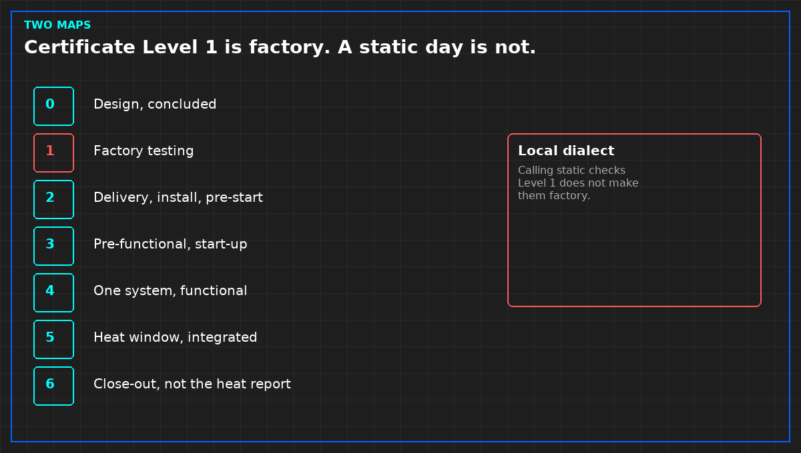

# Certificate Level 1 is not a static test

*Original diagram. Not a site record.*

Commissioning certificates and site procedures often use the word level for different gates. In the certificate set, Level 1 is factory testing. Level 2 is delivery, installation, and pre-start. Functional testing and integrated testing sit later. Close-out is the last certificate, not the heat report.

A finished liquid hall often arrives with its own dialect. Static acceptance, no energy, gets called Level 1 because it is the first thing that team does on site. That label is locally clear and globally false. Drop the static report into the factory slot and you have certified a test you did not run.

Write both maps on the first page, in a table a tired person can read at the door. Static work sits with pre-start, not with the factory. One machine at a time, if it is a functional test, is not "Level 1" on anything that will be signed. The heat window, more than one system, is integrated testing. Calling it a local stage 3 is harmless only if the cover says so, and the certificate does not.

A note that design and factory acceptance were left out is allowed. Reusing the words Level 1 for a different gate is not.

From *Finish a Liquid Cooling Verification*, Tristan, Data Center Field Guides. No store link until the Kindle edition is listed.

Related: [Close-out is not a heat-test report](03-close-out-is-not-a-heat-report.md).
