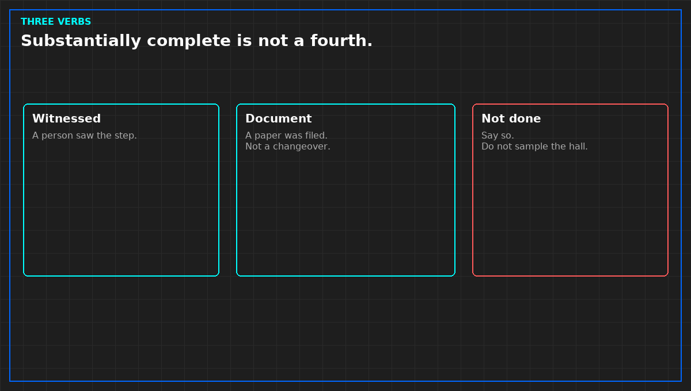

# Witnessed is not the same as accepted a document

*Original diagram. Not a site record.*

For each script someone wants called proved, the pack says which verb applies. Witnessed means a person saw the step. Accepted as a document means a paper was filed and a named party took it as the record. Not done means not done. A fourth word, "substantially complete," means not done, wearing a better coat. Do not add it.

If you cannot tell the verbs apart, you do not sign the proved sentence for that script. A document can be honest and still not be a witness. A missing witness does not make the document disappear. The signature has to say which one you are relying on.

A letter that says a setting was adjusted is not a witnessed changeover. A photograph of a label is not a leak test. A remote note that a value "looked normal" is not a file judgment. If a punch line was closed on one of these, do not inherit the close when the script asked for a witness the first time.

Sampling belongs in the same place. If every line was not witnessed, the pack says what was sampled and what rule picked the sample. "We saw enough" is not a rule. A sample can support a sentence about the sample. It cannot support a sentence about the hall. Strike the hall-wide claim.

A path a second person cannot open is not a document. You are relying on a name. Names are not records.

From *Finish a Liquid Cooling Verification*, Tristan, Data Center Field Guides. No store link until the Kindle edition is listed.

Related: [Approve the test script before the day](03-approve-the-script-before-the-day.md).
