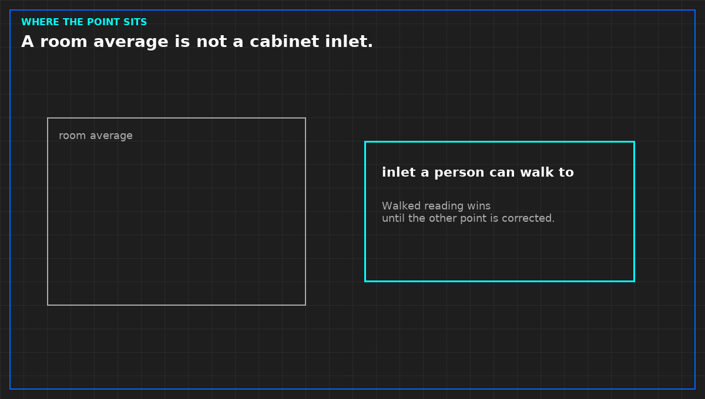

# The walked reading wins

*Original diagram. Not a site record.*

Disagreement is not an error to be smoothed. It is the information. A probe at the inlet and a model at a different place are not two estimates of one truth. They are two sentences. Until you correct the path, the scale, or the place, the walked reading is the one you operate on.

Write both values and both times. Do not take the mean. A mean has no place. It cannot be walked again next week to see if the correction worked.

Correction is not finished when the plot is recolored. The source has to be accepted again if the path changed. A new image, a renamed point, or a moved probe is a new measurement. The old agreement does not transfer.

This rule is the same one a monitor has to live with. A green tile does not outrank a probe because it updates by itself. Automation is not a higher class of evidence. It is a faster class, and speed is how a wrong place gets believed.

From *Judge a Data Hall CFD*, Tristan, Data Center Field Guides. No store link until the Kindle edition is listed.

Related: [A room average is not a cabinet inlet](04-room-average-is-not-an-inlet.md).
