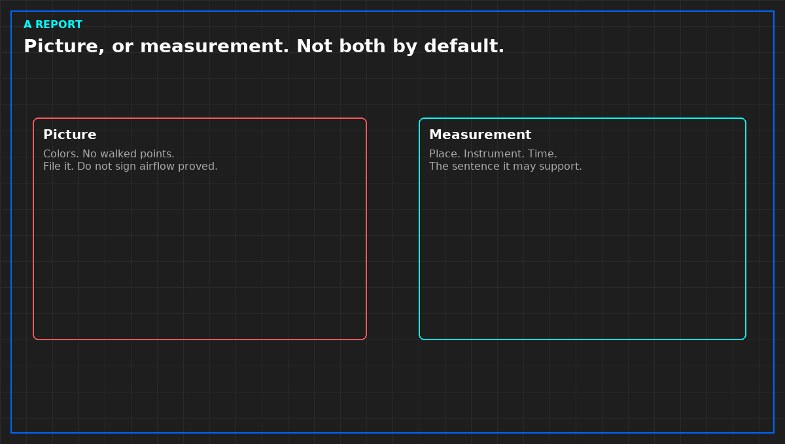

# What a CFD report may decide

*Original diagram. Not a site record.*

A report may support a sentence you wrote before you opened it: this layout, these assumptions, this comparison, not a pass of the operating hall. It may show that one option is worse than another inside the model. It may not set a temperature limit, clear a cabinet, or contradict a walked inlet in silence.

Recommendations that have already been built need a walked check after the build. The model may have been right. The hall may not have followed it. Without the walk, you sign neither "built as modeled" nor "model accepted as the hall."

Do not carry a limit from the legend into a customer notice. If a facilities title is the source of a limit, you read that title yourself and cite the edition. You do not ask a plot, or an article, to remember the number.

File the picture. Use the measurement sheet for the decision. If they disagree, the disagreement is the result. Averaging a streamline and a probe is how both become false.

From *Judge a Data Hall CFD*, Tristan, Data Center Field Guides. No store link until the Kindle edition is listed.

Related: [The walked reading wins](04-walked-reading-wins.md).
