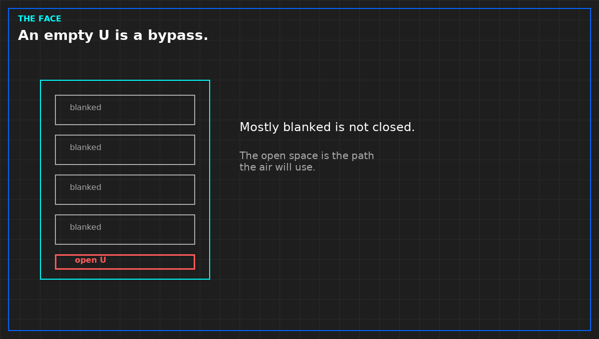

# An empty U without a blank is a bypass

*Original diagram. Not a site record.*

Cold air does not care that a cabinet was specified with blanking panels. It cares whether the opening is closed. An empty unit space is a hole from the cold side to the hot side, or the reverse, depending on how the row is fed. The equipment that is installed then sees a mix. A room that looks full from the aisle can still be bypassing through the gaps you did not walk.

The check is a walk, not a model. Every empty U is either blanked or written down as open. A blank that does not meet the rails, or that leaves a slot around a cable, is not closed. Write the function: empty U, cable cutout, gap beside a chassis. Do not write a brand. A panel from a catalog is not evidence. The fit on this cabinet is the evidence.

Do not call the row optimized because most cabinets were done. The one open U is the path the air will use. "Mostly blanked" is the word minor, applied to a hole. It does not get a pass sentence.

A temperature map that shows a comfortable room average does not clear the open U. The average is not the inlet at that cabinet. If the claim is the equipment, look at the face, then look at the holes in the face. The picture can wait.

This walk is not a substitute for judging a CFD report. It is what you do before you let the report say the air is organized. If the blanks are missing, the report is a picture of a different hall, or of a hall you have not built.

From the field-guide series, Tristan, Data Center Field Guides. The picture-versus-measurement half is *Judge a Data Hall CFD*. No store link until that Kindle edition is listed.

Related: [A room average is not a cabinet inlet](04-room-average-is-not-an-inlet.md).
