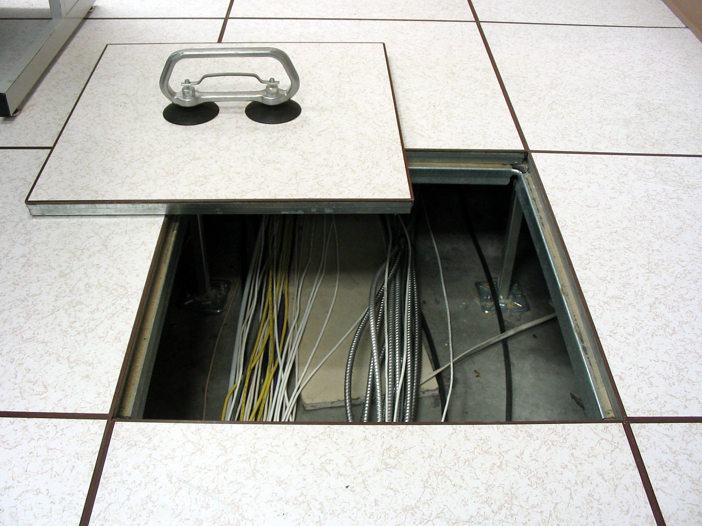
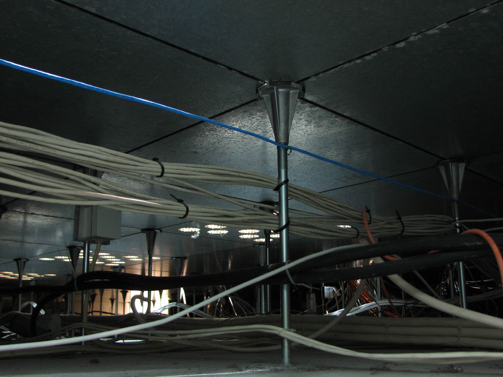
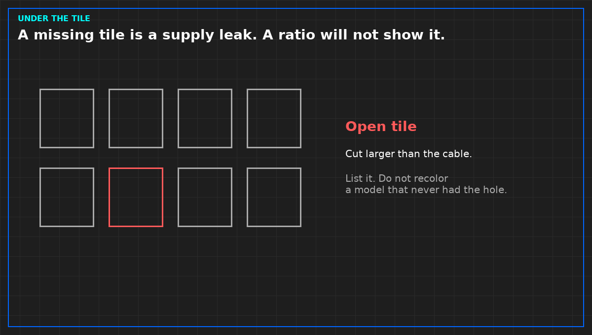

# A missing floor tile is a supply leak

*Public domain. [Wikimedia Commons, File:Tile-lifter-in-use-raised-floor.jpg](https://commons.wikimedia.org/wiki/File:Tile-lifter-in-use-raised-floor.jpg). No author is recorded on the file page.*

*CC BY-SA 3.0. Adamantios, [Beneath the raised floor](https://commons.wikimedia.org/wiki/File:Beneath-the-raised-floor-0a.jpg). ShareAlike applies to this photograph. Changes to the photo must stay under the same license.*

*Original diagram. A cooling-capacity ratio will not show this hole.*

On a raised floor, the supply path is the space under the tiles, not the aisle you can see. A missing tile, a tile with an unsealed cable cut, or a tile left open for a temporary pull is a leak of the air you thought was going to the faces. The model will not show that leak unless someone put the hole in the model. Most reports do not.

Walk the floor before you read the colors. List holes by function: open tile, cut larger than the cable, brush seal missing, tile out of place in front of a cabinet that is not supposed to be fed that way. A photograph can sit in the site file. The note you keep is the function and whether it was open during the claim you are about to sign.

Do not seal a hole that is a required relief or a life-safety path and then mark it closed. Name it. An intended opening is a path. An accidental opening is a defect in the airflow sentence. Mixing them is how a later cable pull is called "the design."

A cooling-capacity ratio is not this list. Total cooler kilowatts over IT kilowatts can look generous while the air never arrives at the cabinet, because it left through a tile three rows away. Refuse that ratio as proof the floor is organized. It is a different sheet, and it does not get to clear a hole you can see.

Fix the floor, then hang or walk the measurement the report needs. A model dated before the tiles were closed is a picture of the leak. Do not recolor it and call it the repair.

From the field-guide series, Tristan, Data Center Field Guides. Related book: *Judge a Data Hall CFD*. No store link until that Kindle edition is listed.

Related: [A CFD picture is not a measurement](04-a-cfd-picture-is-not-a-measurement.md).
