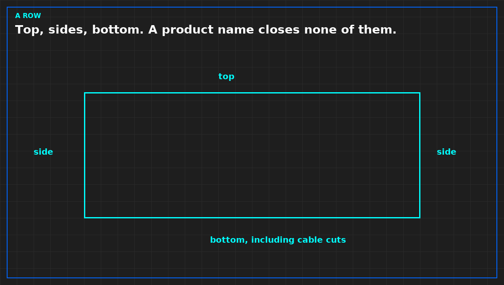

# A row has three edges, not a product name

*Original diagram. Not a site record.*

Closing a row is not buying a containment name. The air leaks at the top, at the sides, and at the bottom, and each edge is its own check. A roof panel that stops short of the last cabinet, a side gap where two rows were never meant to meet, and a bottom gap where power cables leave the cabinet are three holes. One product photo does not close them.

Walk the three edges and write which are closed. Cable penetrations for power and network count as the bottom edge, or as the side, wherever they actually are. A gland that was cut away so a later cable would fit is open. Write it open. Do not inherit last year's seal note.

End of row matters as much as the middle. The last cabinet is where a side panel is often missing because the row was going to be extended. If it was not extended, the missing panel is a bypass. "Future growth" is not a seal.

Do not start at the room. The room is what is left after the cabinets and the row are closed. Tuning a CRAH setpoint, or adding a unit, while the row is open, spends money on air you are not delivering. Close the edges you can see. Then decide whether the room still has a sentence to fix.

A CFD that assumes a sealed row does not prove the row. If the report's geometry has panels the floor does not have, the report is not this hall. Say so before anyone uses it to decline a blanking job.

From the field-guide series, Tristan, Data Center Field Guides. Related book: *Judge a Data Hall CFD*. No store link until that Kindle edition is listed.

Related: [An empty U without a blank is a bypass](04b-empty-u-is-a-bypass.md).
