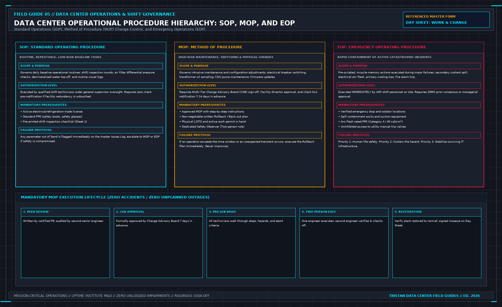

# An Alarm Is Not an Incident: Data Center Escalation Gates, First-Hour Logging, and Root Cause Discipline

> **Direct Answer Block**: In data center operations, an alarm is a telemetry notification indicating that a single monitored point has crossed a configured threshold, whereas an incident is an unplanned event where critical service leaves its contracted SLA boundary, personnel safety is threatened, or redundant plant capacity is degraded below single-fault tolerance. Shift teams must never promote a noisy chattering alarm into an incident solely because of its duration, nor demote a true redundancy loss because the data hall remains quiet.

In high-density critical facilities, thousands of Building Management System (BMS) and Electrical Power Monitoring System (EPMS) points report state changes every minute. A fundamental failure of undisciplined operations teams is confusing the volume of the audible horn with the severity of the physical event. 

An incident occurs when—and only when—one of three physical conditions is met:
1. **Service Boundary Breach**: The delivered power, cooling, or environmental envelope crosses a contracted Service Level Agreement (SLA) limit (e.g., ASHRAE supply air temperature $> 27^\circ\text{C}$ or loss of one customer PDU feed).
2. **Personnel Safety Hazard**: Any condition involving arc-flash exposure, refrigerant asphyxiation risk, thermal runaway, life-safety fire detection, or unsafe physical access.
3. **Loss of Fault Tolerance (Redundancy Degradation)**: A primary or standby machine fails or trips such that the next single component failure will cause an immediate customer outage (e.g., an $N+1$ chiller plant loses one chiller, dropping to $N+0$ exposed operation).

A chattering differential pressure sensor or a condensersump high-water warning that meets none of these three criteria is an **alarm**—it requires a maintenance work order and sensor calibration, not an executive incident bridge. Conversely, a silent trip of a 2N static transfer switch (STS) primary silicon-controlled rectifier (SCR) gate drive—even if the room sounds completely normal and IT racks remain online—is an immediate **incident** because fault tolerance has vanished.

---

## 1. The Quantitative Alarm-to-Incident Escalation Matrix

To remove subjective guesswork during a 03:00 AM shift disturbance, critical facility engineers evaluate every abnormal event against two physical equations: **Thermal Ride-Through Margin ($t_{\text{ride}}$)** and **Remaining Redundant Capacity ($C_{\text{rem}}$)**.

$$\begin{aligned}
t_{\text{ride}} &= \frac{M_{\text{thermal}} \cdot c_p \cdot \left( T_{\text{SLA\_max}} - T_{\text{current}} \right)}{\dot{Q}_{\text{IT}} - \dot{Q}_{\text{cooling\_available}}} \\
C_{\text{rem}} &= \frac{\sum_{i=1}^{N_{\text{online}}} P_{\text{rated}, i} - P_{\text{IT\_load}}}{P_{\text{IT\_load}}}
\end{aligned}$$

When net cooling deficit ($\dot{Q}_{\text{IT}} > \dot{Q}_{\text{cooling\_available}}$) causes a finite $t_{\text{ride}}$ countdown toward $T_{\text{SLA\_max}}$, or when $C_{\text{rem}}$ drops below the required $N+1$ reserve threshold after a breaker or compressor trip, the event automatically crosses the gate from an operational alarm into a formal incident.

| Operational Parameter | Condition A: Operational Alarm (Work Order) | Condition B: Critical Incident (SLA / Redundancy Event) |
| :--- | :--- | :--- |
| **Redundancy State** | Full $2N$ or $N+1$ fault tolerance intact ($C_{\text{rem}} \ge 1$ unit). | Degraded to $N+0$ (single-threaded) or running on emergency battery/tank reserve. |
| **Customer SLA Boundary** | All voltage, frequency, pressure, and temperature metrics inside normal band. | Any customer boundary metric outside contracted SLA or trending toward breach ($t_{\text{ride}} < 30\text{ min}$). |
| **Life & Plant Safety** | Zero personnel hazard; fault isolated within non-critical sub-circuit. | Active VESDA smoke pre-alarm, battery H2/thermal runaway, or arc fault trip. |
| **Required Governance** | Log on shift sheet; open corrective maintenance ticket; repair under SOP/MOP. | Declare Sev-1/Sev-2 Incident; execute EOP to First Safe State; issue 60-minute customer notice. |

---

## 2. The First-Hour Rule: Write the Clock, Never the Root Cause

During the first 60 minutes of a declared incident, the shift manager faces intense pressure from account executives and tenants demanding to know *"Why did this happen?"* Yielding to that pressure by writing an unverified guess into the initial incident notification is one of the most destructive mistakes in facility management.

**THE FIRST-HOUR INCIDENT DOCUMENTATION GATE**

| MANDATORY FACTS TO LOG & TRANSMIT | STRICTLY FORBIDDEN IN HOUR ONE |
| :--- | :--- |
| 1. Exact minute of detection (UTC) | 1. Unverified Root Cause claims |
| 2. Physical symptoms witnessed | 2. Blaming OEM firmware or utility |
| 3. Minute First Safe State reached | 3. Speculative repair timelines |
| 4. Named individuals contacted | 4. Declaring incident "Closed" |
| 5. Current customer impact state | solely because alarms cleared |

In the first hour, you do not know the root cause. A protective relay target showing `87T Differential Trip` tells you which protection element operated; it does not tell you whether the trip was caused by an internal winding turn-to-turn fault, a saturated current transformer (CT), or moisture ingress in a marshalling cabinet. Any cause proposed in the first 60 minutes is strictly a **working hypothesis**.

If a working hypothesis is typed into a customer incident notice without being explicitly labeled as an unverified hypothesis under investigation, legal and commercial teams will quote that preliminary guess as a binding admission of fault for the next twelve months. Your first-hour record must state five verified facts and nothing more:
1. **Detection Timestamp**: The exact minute the shift knew of the abnormality (distinguishing between actual measurement timestamp and operator observation time).
2. **Witnessed Physical State**: The specific gauges, breaker flags, and boundary readings observed on the floor.
3. **Safe State Timestamp**: The exact minute the Emergency Operating Procedure (EOP) stabilized the plant in its First Safe State.
4. **Escalation Chain**: The specific named individuals (never generic group aliases) who answered the escalation call.
5. **Customer Boundary Status**: Whether critical load is held within SLA tolerances and what redundancy protection currently backs it.

---

## 3. Why Clearing the Alarm Does Not Close the Incident

A critical error in BMS-driven operations is closing an incident ticket the moment the red alarm row disappears from the operator workstation or the replacement component is bolted into the rack.

Consider a chilled water loop low-differential-pressure incident where a primary VFD pump trips offline and the standby pump fails to auto-start. If a technician manually starts the standby pump locally in `HAND` mode at the variable frequency drive keypad, differential pressure recovers and the BMS low-$\Delta P$ alarm clears to green. **The incident is not closed.**

While the pump runs in local `HAND` mode:
- The central PLC automatic lead/lag staging sequence is bypassed.
- Automatic pressure-relief modulation is disabled.
- If that pump trips, no secondary standby automation will respond.

An incident remains open until three independent closure gates are satisfied:
1. **Service Confirmation**: Downstream physical service metrics (cold aisle temperatures, PDU voltage stability, differential pressures) are verified via live sensors across a full thermal/electrical stabilization dwell.
2. **Redundancy & Auto-Control Restoration**: All standby paths, automatic transfer switches, and PLC control loops are returned to `AUTO` with verified health flags, or a formal risk-accepted temporary operating configuration is signed by the Operations Director.
3. **Notice Alignment**: The customer closeout notice accurately reflects the true duration of degraded redundancy and the verified restoration timestamp.

---

## 4. Post-Incident Review: One Owned Change Beat Ten Meetings

After the plant is restored, organizations often conduct sprawling post-mortem meetings that merely retell the chronology of fear without altering the physical or procedural condition that permitted the failure. A post-incident review that ends with *"Technicians reminded to be more careful"* is an engineering failure.

Every authentic incident review produces at least **one concrete, owned, and dated engineering change**—for example, modifying a PLC start-failure timer from $15\text{ s}$ to $5\text{ s}$, adding a physical Kirk-key interlock, or splitting an ambiguous SOP into a dedicated MOP. If no physical or procedural change is required, the review must document an explicit engineering justification signed by the Chief Engineer.

---

## Frequently Asked Questions (FAQ)

### When does a chattering BMS alarm become a formal facility incident?
A chattering alarm is a telemetry or sensor defect (managed via a maintenance work order and hysteresis deadband tuning) unless the underlying physical process actually crosses a customer SLA boundary, threatens personnel safety, or strips the facility of its required $N+1$ or $2N$ fault tolerance. However, if a chattering sensor drives an automated control loop into hunting or trips a real piece of equipment, the resulting redundancy loss immediately becomes an incident.

### Why shouldn't the shift lead include the suspected root cause in the initial 15-minute or 60-minute customer advisory?
During active stabilization, field data is incomplete and sequence-of-events (SOE) logs have not yet been time-aligned across relays and PLCs. Stating a suspected root cause prematurely locks the organization into a speculative narrative that often proves inaccurate once forensic logs are pulled, damaging technical credibility and creating commercial liability.

### Can an incident be downgraded if the customer never lost power or cooling?
An incident is classified by both service impact and redundancy loss. If one side of a 2N UPS system trips offline unexpectedly, customers experience zero power interruption (a "zero-downtime event"), but the facility was exposed to single-point failure during the outage. It remains a formal critical facility incident (often classified as a Near-Miss or Redundancy Loss Incident) requiring full EOP response and root-cause analysis.

---

From *Run the Data Center Day*, Tristan, Data Center Field Guides.

Related: [A green tile can be stale](06-stale-is-not-green.md).
